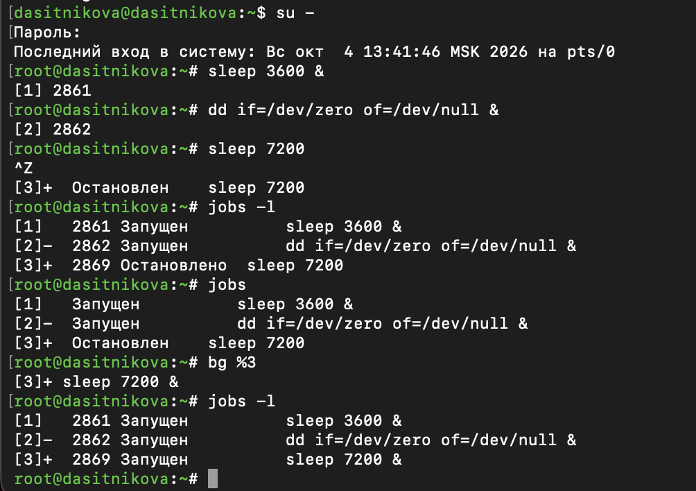
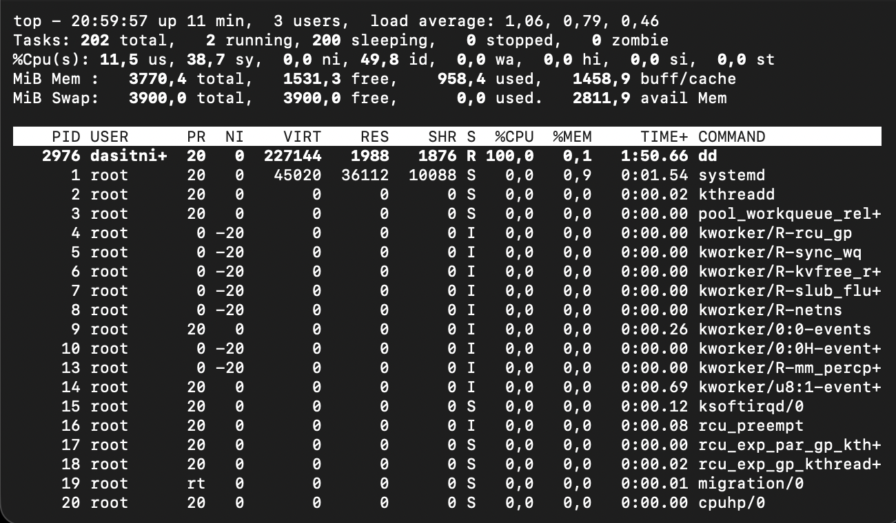
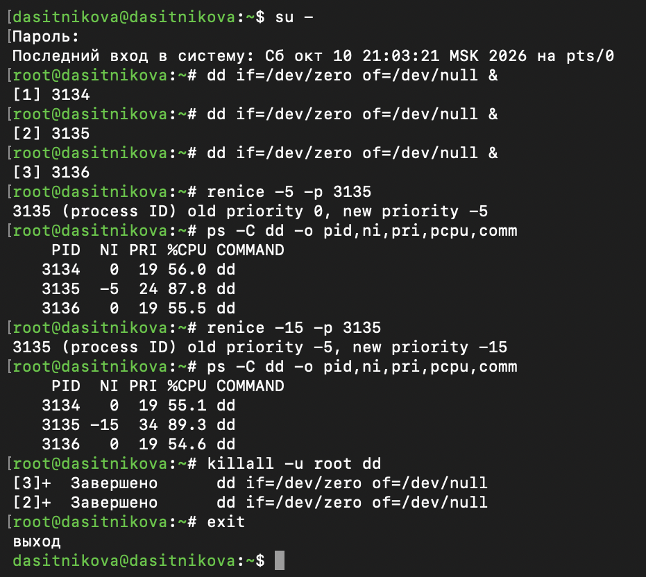

---
## Author
author:
  name: Ситникова Диана Александровна
  degrees: BSc
  email: 1032201746@rudn.ru
  affiliation:
    - name: Российский университет дружбы народов
      country: Российская Федерация
      postal-code: 117198
      city: Москва
      address: ул. Миклухо-Маклая, д. 6
## Title
title: "Лабораторная работа № 6"
subtitle: "Управление процессами"
institute:
  - "Российский университет дружбы народов им. П. Лумумбы"
  - "Преподаватель: д.ф.-м.н., профессор Кулябов Дмитрий Сергеевич"
license: CC BY
date: today
date-format: "YYYY-MM-DD"
---

# Информация

## Докладчик

:::::::::::::: {.columns align=center}
::: {.column width="68%"}

- Ситникова Диана Александровна
- направление 09.03.03 «Прикладная информатика»
- Российский университет дружбы народов
- [1032201746@rudn.ru](mailto:1032201746@rudn.ru)

:::
::: {.column width="32%"}

{width=100%}

:::
::::::::::::::

# Вводная часть

## Актуальность

- Любая программа в Linux работает как процесс, и администратору приходится находить, приостанавливать и завершать процессы.
- Зависшая или ресурсоёмкая задача мешает остальным: нужно уметь понизить её приоритет или завершить её из другого терминала.
- Длительные задачи должны переживать отключение от сервера по SSH.

## Объект, предмет, цель и задачи

**Объект** --- процессы и задания командной оболочки Rocky Linux 10.2.

**Предмет** --- средства управления заданиями, сигналами и приоритетами.

**Цель** --- получить навыки управления процессами операционной системы.

**Задачи:** продемонстрировать навыки управления заданиями и процессами операционной системы; выполнить задания для самостоятельной работы.

## Материалы и методы

| Компонент | Значение |
|---|---|
| Стенд | Rocky Linux 10.2, ядро 6.12, 2 виртуальных процессора |
| Нагрузка | `dd if=/dev/zero of=/dev/null`, `yes > /dev/null` |
| Задания | `&`, Ctrl+Z, Ctrl+C, `jobs`, `fg`, `bg` |
| Процессы и сигналы | `ps`, `top`, `kill`, `killall`, `nohup` |
| Приоритеты | `nice`, `renice` |

# Содержание исследования

## Ctrl+Z, bg и fg переключают задания

:::::::::::::: {.columns align=center}
::: {.column width="40%"}

Ctrl+Z приостанавливает задание переднего плана: «Остановлен».

`bg %3` продолжает его в фоне: «Запущен».

`fg` возвращает задание на передний план, Ctrl+C его прерывает.

:::
::: {.column width="60%"}

{width=100%}

:::
::::::::::::::

## Фоновое задание переживает exit

:::::::::::::: {.columns align=center}
::: {.column width="40%"}

`dd` из закрытого терминала работает: 100 % одного процессора.

`exit` не рассылает SIGHUP фоновым заданиям.

Процесс завершён из `top`: `k`, PID, сигнал 15.

:::
::: {.column width="60%"}

{width=100%}

:::
::::::::::::::

## Сироты усыновляются процессом 1

{width=70%}

- `ps fax`: три `dd` запущены из оболочки root `-bash` (PID 3020).
- `kill -9 $$` уничтожил её, а `dd` продолжили работу с `PPID` 1.
- NI 5 после `renice` сохранился; завершены командой `killall -u root dd`.

## −15 не быстрее −5, когда есть свободный процессор

:::::::::::::: {.columns align=center}
::: {.column width="45%"}

Вес процесса: 1024 при nice 0, 3121 при −5, 29 154 при −15.

Уже при −5 процесс занимает почти целый процессор из двух, больше одного ему не получить.

На одном процессоре: 60 % и 93 %.

:::
::: {.column width="55%"}

{width=100%}

:::
::::::::::::::

## Процесс из nohup переживает закрытие окна

:::::::::::::: {.columns align=center}
::: {.column width="40%"}

`nohup yes … &` → PID 3214, сеанс SSH закрыт.

После повторного входа процесс работает: `PPID` 1, `jobs` пуст.

В `top` --- 100 % процессора и почти 3 мин процессорного времени.

:::
::: {.column width="60%"}

{width=100%}

:::
::::::::::::::

## nohup защищает только от SIGHUP

:::::::::::::: {.columns align=center}
::: {.column width="40%"}

После `kill -HUP` процесс 3283 из `nohup` работает, обычный 3276 завершён: «Обрыв терминальной линии».

`kill` и `killall` посылают SIGTERM и завершают его.

:::
::: {.column width="60%"}

{width=100%}

:::
::::::::::::::

## nice и renice задают значение nice

:::::::::::::: {.columns align=center}
::: {.column width="40%"}

`sudo nice -n -5`: NI −5, `PRI` 24 против 0 и 19.

Отрицательный nice --- только суперпользователю.

`sudo renice 0` уравнял приоритеты: NI 0, `PRI` 19.

:::
::: {.column width="60%"}

{width=100%}

:::
::::::::::::::

# Результаты

## Задания, процессы и приоритеты под контролем

- Задания запускались в фоне и на переднем плане, приостанавливались и завершались по номеру, PID и имени.
- Изучено дерево процессов: после гибели родителя потомки продолжают работу под процессом 1.
- Процесс из `nohup` пережил закрытие терминала и сигнал SIGHUP.
- Приоритеты изменены командами `nice` и `renice`, их эффект измерен.

## Вывод

Задание оболочки --- это группа процессов, которой оболочка управляет сигналами: Ctrl+Z, Ctrl+C, `fg` и `bg` сводятся к SIGTSTP, SIGINT и SIGCONT.

Nice задаёт не скорость, а вес процесса: повышение приоритета заметно, только когда процессам не хватает процессоров.
