---
## Author
author:
  name: Ситникова Диана Александровна
  degrees: BSc
  email: 1032201746@rudn.ru
  affiliation:
    - name: Российский университет дружбы народов
      country: Российская Федерация
      postal-code: 117198
      city: Москва
      address: ул. Миклухо-Маклая, д. 6

## Title
title: "Отчёт по лабораторной работе №6"
subtitle: "Управление процессами"
license: "CC BY"
bibliography: bib/cite.bib
---

# Цель работы

Целью данной работы является получение навыков управления процессами операционной системы.

# Задание

- Продемонстрировать навыки управления заданиями операционной системы.
- Продемонстрировать навыки управления процессами операционной системы.
- Выполнить задания для самостоятельной работы.

# Теоретическое введение

## Процесс и его атрибуты

Процесс --- это выполняющийся экземпляр программы вместе с выделенными ему ресурсами: адресным пространством, открытыми файлами, текущим каталогом, учётными данными владельца и т. д. [@tanenbaum_book_modern-os_ru; @robachevsky_book_unix_ru]. Ядро присваивает каждому процессу уникальный идентификатор PID, а также хранит идентификатор родительского процесса PPID [@man7_credentials].

Новый процесс в Unix создаётся системным вызовом `fork()`, который порождает копию вызывающего процесса, после чего потомок обычно загружает другую программу вызовом `exec()`. Так командная оболочка запускает каждую введённую команду. Поэтому все процессы системы образуют дерево. Его корень --- процесс с PID 1, в Rocky Linux это systemd; потоки ядра порождаются отдельным процессом `kthreadd` с PID 2.

Если родительский процесс завершается раньше потомков, они не уничтожаются, а становятся «сиротами» и усыновляются процессом с PID 1 или ближайшим предком, объявившим себя «сборщиком» потомков (subreaper). Обратная ситуация --- процесс-зомби: потомок уже завершился, но родитель ещё не прочитал код его завершения вызовом `wait()`, поэтому запись о процессе сохраняется в таблице процессов.

## Состояния процессов

Текущее состояние процесса выводится в столбце `S` или `STAT` программ `ps` и `top` ([табл. @tbl-states]). В BSD-формате вывода `ps` за буквой состояния могут следовать дополнительные флаги: `<` --- повышенный приоритет, `N` --- пониженный приоритет, `s` --- лидер сеанса, `l` --- многопоточный процесс, `+` --- процесс входит в группу переднего плана терминала.

| Код | Состояние |
|-----|------------------------------------------------------------------|
| `R` | выполняется или готов к выполнению и стоит в очереди планировщика |
| `S` | прерываемое ожидание события, например ввода или истечения таймера |
| `D` | непрерываемое ожидание, обычно завершения операции ввода-вывода |
| `T` | остановлен сигналом управления заданиями |
| `t` | остановлен отладчиком |
| `Z` | зомби: завершён, но не обработан родителем |
| `I` | простаивающий поток ядра |

: Состояния процессов Linux {#tbl-states}

## Просмотр процессов: ps, top, pstree

Программа `ps` из пакета `procps-ng` выводит снимок списка процессов [@procps_docs]. Она поддерживает три синтаксиса ключей: UNIX (с дефисом, например `ps -e -o pid,cmd`), BSD (без дефиса, например `ps aux`) и длинные ключи GNU (`--forest`). Основные поля вывода приведены в [табл. @tbl-ps-fields].

| Поле | Значение |
|-------------|------------------------------------------------------------|
| `USER` | владелец процесса |
| `PID`, `PPID` | идентификатор процесса и его родителя |
| `%CPU` | доля процессорного времени за всё время жизни процесса |
| `%MEM` | доля физической памяти |
| `VSZ`, `RSS` | виртуальный размер и резидентная часть процесса, КиБ |
| `TTY` | управляющий терминал; `?` --- терминала нет |
| `STAT` | состояние процесса ([табл. @tbl-states]) |
| `NI` | значение nice |
| `PRI` | приоритет планирования |
| `TIME` | суммарное потреблённое процессорное время |
| `COMMAND` | команда запуска |

: Основные поля вывода команды ps {#tbl-ps-fields}

В работе используются следующие варианты команды: `ps aux` --- все процессы системы в формате, ориентированном на пользователя; `ps fax` --- все процессы в виде дерева «предок --- потомок»; `ps -C имя -o поля` --- процессы с заданным именем команды и выбранные поля; `ps -p PID` --- процесс с заданным идентификатором. Дерево процессов выводит также программа `pstree`.

Программа `top` показывает список процессов в реальном времени и по умолчанию обновляет его каждые три секунды. В заголовке выводятся время работы системы, число пользователей, средняя загрузка за 1, 5 и 15 минут, число процессов по состояниям, распределение процессорного времени и сведения о памяти. Строка `%Cpu(s)` делит время процессоров на категории: `us` --- код пользовательских процессов, `sy` --- код ядра, `ni` --- процессы с положительным nice, `id` --- простой, `wa` --- ожидание ввода-вывода и др. Столбец `PR` показывает приоритет процесса, `NI` --- значение nice. Основные интерактивные команды `top` приведены в [табл. @tbl-top-keys].

| Клавиша | Действие |
|--------------|------------------------------------------------------------|
| `P` | сортировка по загрузке процессора |
| `M` | сортировка по использованию памяти |
| `k` | отправить сигнал процессу: запрашиваются PID и номер сигнала |
| `r` | изменить nice процесса |
| `u` | показать процессы одного пользователя |
| `1` | показать загрузку каждого процессора отдельно |
| `q` | выйти |

: Интерактивные команды top {#tbl-top-keys}

## Задания и управление ими в bash

Задание (job) --- это команда или конвейер, запущенные из текущего экземпляра командной оболочки [@bash_manual; @newham_book_learning-bash_en]. Оболочка помещает процессы каждого задания в отдельную группу процессов и присваивает заданию порядковый номер. Все группы, запущенные из одного терминала, входят в один сеанс, лидером которого является оболочка входа.

В каждый момент одна группа процессов сеанса находится на переднем плане: только она может читать с терминала и получает сигналы, сформированные клавиатурой. Остальные задания работают в фоновом режиме. Команда, после которой указан символ `&`, сразу запускается в фоне, и оболочка выводит номер задания и PID его последнего процесса. Команды управления заданиями приведены в [табл. @tbl-jobs].

| Команда | Действие |
|--------------|------------------------------------------------------------------|
| `команда &` | запустить задание в фоновом режиме |
| Ctrl+Z | приостановить задание переднего плана (сигнал SIGTSTP) |
| Ctrl+C | прервать задание переднего плана (сигнал SIGINT) |
| `jobs` | вывести список заданий; `jobs -l` --- вместе с PID |
| `fg %n` | перевести задание `n` на передний план |
| `bg %n` | продолжить приостановленное задание `n` в фоновом режиме |
| `kill %n` | отправить сигнал заданию `n` |

: Управление заданиями в bash {#tbl-jobs}

В выводе `jobs` знак `+` отмечает текущее задание, которое используют `fg` и `bg` без аргументов, а знак `-` --- предыдущее. Задание можно указать номером (`%2`), знаками `%+` и `%-` или началом командной строки (`%yes`). Номера заданий имеют смысл только в той оболочке, которая их запустила. Специальный параметр `$!` содержит PID последнего фонового процесса, а `$$` --- PID самой оболочки.

## Сигналы

Сигнал --- асинхронное уведомление, которое ядро доставляет процессу [@man7_signal]. Для каждого сигнала задано действие по умолчанию: завершить процесс, завершить его с созданием дампа памяти, проигнорировать сигнал, остановить или продолжить процесс. Процесс может назначить собственный обработчик или игнорировать сигнал; исключение составляют SIGKILL и SIGSTOP, которые нельзя ни перехватить, ни игнорировать. Сигналы, используемые в работе, приведены в [табл. @tbl-signals].

| Номер | Имя | Источник | Действие по умолчанию |
|----------|-----------|-----------------------------------|---------------------------------|
| 1 | `SIGHUP` | обрыв связи с терминалом | завершение |
| 2 | `SIGINT` | Ctrl+C | завершение |
| 3 | `SIGQUIT` | Ctrl+\\ | завершение с дампом |
| 9 | `SIGKILL` | `kill -9` | завершение, нельзя перехватить |
| 15 | `SIGTERM` | `kill`, `killall` без ключей | завершение |
| 18 | `SIGCONT` | `fg`, `bg` | продолжение |
| 19 | `SIGSTOP` | `kill -STOP` | остановка, нельзя перехватить |
| 20 | `SIGTSTP` | Ctrl+Z | остановка |

: Основные сигналы Linux {#tbl-signals}

Сигналы отправляют командой `kill`: `kill PID` посылает SIGTERM, а другой сигнал задаётся номером или именем, например `kill -9 PID` или `kill -HUP PID`. Встроенная в bash команда `kill` принимает и номера заданий: `kill %2`. Команда `killall имя` отправляет сигнал всем процессам с указанным именем, а ключ `-u` ограничивает выбор процессами одного пользователя; `pkill` выбирает процессы по шаблону. Обычный пользователь может посылать сигналы только своим процессам, суперпользователь --- любым [@nemeth_book_unix-linux-admin_ru].

SIGTERM --- вежливая просьба завершиться: процесс может её обработать, например сохранить данные и закрыть файлы. SIGKILL завершает процесс ядром немедленно, поэтому его используют, только если процесс не реагирует на SIGTERM.

## Завершение сеанса, SIGHUP и nohup

Когда терминал закрывается, например при разрыве соединения SSH, ядро посылает сигнал SIGHUP управляющему процессу сеанса --- оболочке входа. Интерактивная оболочка bash, получив SIGHUP, пересылает его всем своим заданиям и завершается, поэтому фоновые задания, запущенные обычным способом, завершаются вместе с окном терминала [@bash_manual]. Если же оболочка завершается командой `exit`, она рассылает SIGHUP заданиям только при включённом параметре `huponexit`, который по умолчанию выключен; ядро при этом посылает SIGHUP лишь группе переднего плана терминала.

Утилита `nohup` запускает команду с игнорированием сигнала SIGHUP [@coreutils_nohup]. Признак игнорирования сигнала сохраняется при вызове `exec()`, поэтому запущенная программа не завершается при закрытии терминала. Если стандартный вывод направлен на терминал, `nohup` перенаправляет его в файл `nohup.out` в текущем или домашнем каталоге; если на терминал направлен стандартный ввод, `nohup` отсоединяет его. Типичная форма запуска --- `nohup команда &`. От других сигналов, в том числе SIGTERM и SIGKILL, `nohup` не защищает.

## Планирование и приоритеты

Процессорное время между обычными процессами (политика `SCHED_OTHER`) распределяет планировщик ядра. В ядрах Linux начиная с версии 6.6, в том числе в ядре 6.12 Rocky Linux 10, используется планировщик EEVDF, пришедший на смену CFS [@kernel_sched_eevdf]. Каждому готовому к выполнению процессу назначается вес, и при конкуренции за процессор процессы получают время пропорционально весам [@man7_sched].

Вес определяется значением nice --- целым числом от −20 (наивысший приоритет) до 19 (наименьший). Изменение nice на единицу меняет вес примерно в 1,25 раза, поэтому из двух процессов, конкурирующих за один процессор, процесс с nice на единицу меньшим получает примерно на 10 % больше времени. Веса и доли процессора для некоторых значений приведены в [табл. @tbl-nice]. В столбце `PR` программы `top` для обычных процессов выводится значение 20 + nice; у процессов с политиками реального времени `SCHED_FIFO` и `SCHED_RR`, которые всегда выполняются раньше обычных, выводится `rt`.

| nice | Вес | `PR` в `top` | Доля процессора против процесса с nice 0 |
|------|--------|-----|----------------|
| −20 | 88 761 | 0 | 98,9 % |
| −15 | 29 154 | 5 | 96,6 % |
| −10 | 9 548 | 10 | 90,3 % |
| −5 | 3 121 | 15 | 75,3 % |
| 0 | 1 024 | 20 | 50,0 % |
| 5 | 335 | 25 | 24,6 % |
| 10 | 110 | 30 | 9,7 % |
| 19 | 15 | 39 | 1,4 % |

: Значение nice, вес процесса и доля процессорного времени при конкуренции двух процессов за один процессор {#tbl-nice}

Nice влияет только на распределение времени между процессами, ожидающими одного процессора. Если свободных процессоров достаточно, каждый процесс получает целый процессор независимо от nice. Nice не ограничивает потребление памяти и операций ввода-вывода.

Значение nice наследуется потомками. Команда `nice -n N команда` запускает команду со значением nice родителя, увеличенным на `N`, а без ключа `-n` --- на 10. Команда `renice N -p PID` устанавливает выполняющемуся процессу значение nice `N`; ключи `-g` и `-u` применяют его ко всем процессам группы или пользователя. Обычный пользователь может только увеличивать nice своих процессов, то есть понижать их приоритет; уменьшение nice требует прав суперпользователя [@kolisnichenko_book_linux-admin_ru; @neil_book_learning-centos_en].

# Выполнение лабораторной работы

Работа выполнена в виртуальной машине с Rocky Linux 10.2 в двух терминалах, подключённых к гостевой системе по SSH; полномочия администратора получены командой `su -`.

## Управление заданиями

Получены полномочия администратора и введены команды `sleep 3600 &`, `dd if=/dev/zero of=/dev/null &` и `sleep 7200`. Поскольку последняя команда запущена без `&`, она заняла терминал, и процесс остановлен сочетанием Ctrl+Z. Командой `jobs` выведены задания, для продолжения выполнения задания 3 в фоновом режиме введена команда `bg`, и с помощью `jobs` просмотрены изменения в статусе заданий ([рис. @fig-001]).

~~~bash
su -
sleep 3600 &
dd if=/dev/zero of=/dev/null &
sleep 7200
jobs -l
jobs
bg %3
jobs -l
~~~

{#fig-001 width=85%}

Фоновые задания получили номера 1 и 2, оболочка вывела PID их процессов: 2861 и 2862. После нажатия Ctrl+Z оболочка сообщила, что задание 3 остановлено. В выводе `jobs` первые два задания имеют состояние «Запущен», третье --- «Остановлен»; знак `+` отмечает задание 3 как текущее, знак `-` --- задание 2 как предыдущее. Ключ `-l` добавляет PID процессов: у задания 3 это 2869. Команда `bg %3` вывела командную строку задания с символом `&`, и задание 3 продолжило работу в фоне: теперь все три задания имеют состояние «Запущен».

Для перемещения задания 1 на передний план введена команда `fg`, и сочетанием Ctrl+C задание 1 отменено. То же проделано для отмены заданий 2 и 3 ([рис. @fig-002]).

~~~bash
fg %1
fg %2
fg %3
exit
~~~

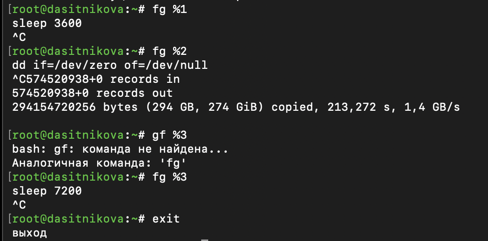{#fig-002 width=85%}

Команда `fg` выводит командную строку задания и передаёт ему терминал. Нажатие Ctrl+C посылает группе переднего плана сигнал SIGINT, и задание завершается. Программа `dd`, получив SIGINT, перед завершением вывела статистику: за 213 секунд она прочитала из `/dev/zero` и записала в `/dev/null` 574 520 938 блоков по 512 байт, то есть 294 ГБ со скоростью 1,4 ГБ/с. Такая скорость возможна потому, что оба устройства виртуальные и копирование не затрагивает диск.

Открыт второй терминал, и под учётной записью своего пользователя в нём введена команда `dd if=/dev/zero of=/dev/null &`, после чего второй терминал закрыт командой `exit` ([рис. @fig-003]).

~~~bash
dd if=/dev/zero of=/dev/null &
exit
~~~

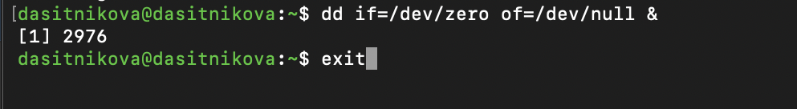{#fig-003 width=85%}

На другом терминале под учётной записью своего пользователя запущена программа `top`, список процессов отсортирован по загрузке процессора клавишами Shift+P ([рис. @fig-004]).

~~~bash
top
~~~

{#fig-004 width=85%}

Процесс `dd` с PID 2976 всё ещё запущен, хотя терминал, из которого он был запущен, закрыт: процесс находится в состоянии `R`, использует 100 % процессора и уже набрал 1 мин 50 с процессорного времени. Оболочка завершилась командой `exit` и не разослала SIGHUP фоновому заданию, а ядро при закрытии терминала посылает этот сигнал только группе переднего плана. В заголовке `top` видно, что `dd` полностью занимает один из двух процессоров: 11,5 % времени приходится на пользовательский код (`us`), 38,7 % --- на код ядра (`sy`), 49,8 % процессорного времени свободно. Большая доля времени ядра объясняется тем, что работа `dd` состоит из системных вызовов чтения и записи.

В `top` клавишей `k` убито задание `dd`: указан PID 2976 и сигнал 15 (SIGTERM), после чего выполнен выход из `top` клавишей `q`. В следующем списке процессов ([рис. @fig-005]) процессов `dd` пользователя `dasitnikova` уже нет.

## Управление процессами

Получены полномочия администратора, и трижды введена команда `dd if=/dev/zero of=/dev/null &`. Командой `ps aux | grep dd` выведены все строки, в которых есть буквы `dd`. PID одного из процессов `dd` использован, чтобы изменить приоритет командой `renice`. Затем введена команда `ps fax | grep -B5 dd`: параметр `-B5` показывает соответствующие запросу строки, включая пять строк до них, а `ps fax` показывает иерархию процессов, поэтому видна оболочка, из которой были запущены все процессы `dd`, и её PID ([рис. @fig-005]).

~~~bash
su -
dd if=/dev/zero of=/dev/null &
dd if=/dev/zero of=/dev/null &
dd if=/dev/zero of=/dev/null &
ps aux | grep dd
renice 5 -p 3053
ps -C dd -o pid,ppid,ni,comm
ps fax | grep -B5 dd
~~~

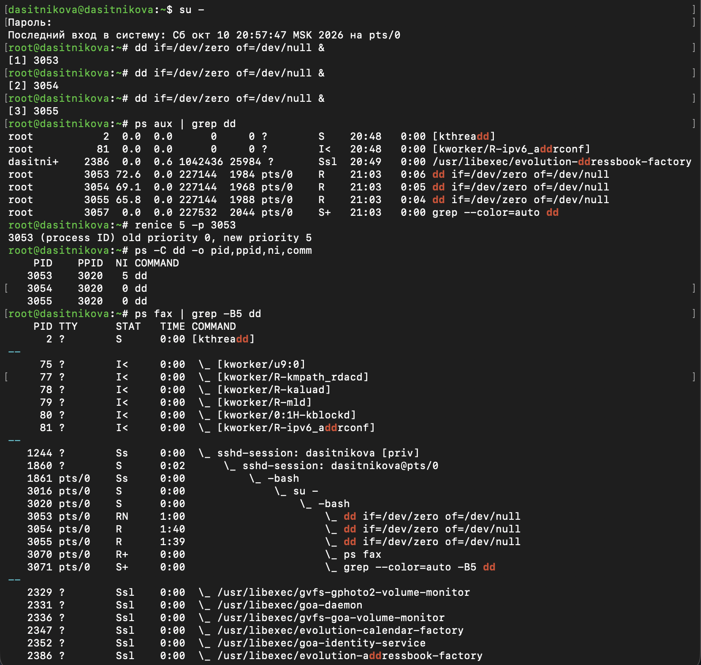{#fig-005 width=85%}

Процессы `dd` получили PID 3053, 3054 и 3055 и принадлежат пользователю `root`. Их загрузка процессора --- 72,6 %, 69,1 % и 65,8 %: три процесса делят два процессора, и каждому достаётся около двух третей процессора. Шаблон `dd` совпал также с потоками ядра `kthreadd` и `kworker/R-ipv6_addrconf`, процессом `evolution-addressbook-factory` и с самой командой `grep`, поскольку в их именах есть эти буквы.

Команда `renice` сообщила, что значение nice процесса 3053 изменено с 0 на 5. Вывод `ps -C dd` подтверждает это и показывает, что родителем всех трёх процессов является процесс 3020.

Дерево процессов, выведенное `ps fax`, показывает всю цепочку запуска: процесс `sshd-session` с PID 1244 обслуживает подключение по SSH, его потомок 1860 работает от имени пользователя на терминале `pts/0`, далее следуют оболочка входа `-bash` (1861, флаг `s` --- лидер сеанса), команда `su -` (3016) и оболочка суперпользователя `-bash` (3020), из которой запущены три процесса `dd`, а также `ps` и `grep` с флагом `+` --- группа переднего плана. Процесс 3053 имеет состояние `RN`, где `N` обозначает пониженный приоритет, и набрал 1 мин процессорного времени против 1 мин 40 с и 1 мин 39 с у двух других: после изменения nice его вес уменьшился с 1024 до 335.

Найден PID корневой оболочки, из которой были запущены процессы `dd`, и введена команда `kill -9` с этим PID: параметр `$$` подставляет PID текущей оболочки, то есть 3020. Затем выведен список процессов `dd`, они завершены командой `killall`, и список выведен повторно ([рис. @fig-006]).

~~~bash
kill -9 $$
ps -C dd -o pid,ppid,ni,comm
sudo killall -u root dd
ps -C dd -o pid,ppid,ni,comm
~~~

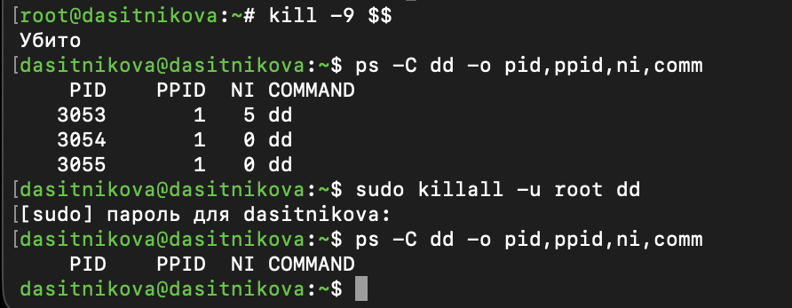{#fig-006 width=75%}

Оболочка вывела сообщение «Убито», и управление вернулось к оболочке пользователя `dasitnikova`: команда `su`, дождавшись завершения своего потомка, тоже завершилась. Процессы `dd` 3053, 3054 и 3055 продолжили работу, а их родителем стал процесс с PID 1: после уничтожения родителя процессы-сироты усыновлены systemd. Значение nice процесса 3053 сохранилось равным 5. Сигнал SIGKILL нельзя обработать, поэтому оболочка не успела разослать своим заданиям никаких сигналов. Команда `sudo killall -u root dd` отправила SIGTERM всем процессам `dd` пользователя `root`, и повторный вывод `ps` пуст.

## Самостоятельная работа. Задание 1

Команда `dd if=/dev/zero of=/dev/null` трижды запущена как фоновое задание. Приоритет одной из этих команд увеличен с использованием значения −5, затем приоритет того же процесса изменён ещё раз с использованием значения −15; после каждого изменения выведены значения nice, приоритет и загрузка процессора. Затем все запущенные процессы `dd` завершены ([рис. @fig-007]).

~~~bash
su -
dd if=/dev/zero of=/dev/null &
dd if=/dev/zero of=/dev/null &
dd if=/dev/zero of=/dev/null &
renice -5 -p 3135
ps -C dd -o pid,ni,pri,pcpu,comm
renice -15 -p 3135
ps -C dd -o pid,ni,pri,pcpu,comm
killall -u root dd
exit
~~~

{#fig-007 width=75%}

Процессы получили PID 3134, 3135 и 3136. Команда `renice` сообщила об изменении nice процесса 3135 с 0 на −5, а затем с −5 на −15. Столбец `PRI` программы `ps` выводит значение 19 − nice: 19 при nice 0, 24 при −5 и 34 при −15, то есть в этом столбце большее число соответствует более высокому приоритету. При nice −5 процесс 3135 использовал 87,8 % процессора против 56,0 % и 55,5 % у соседей, при nice −15 --- 89,3 % против 55,1 % и 54,6 %.

Разница между значениями −5 и −15 --- в весе процесса: 3121 и 29 154, то есть в 3 и в 28 раз больше, чем у соседа с nice 0. Однако процесс не может занимать больше одного процессора. Уже при nice −5 процесс 3135 получает почти целый процессор, а два других делят второй, поэтому дальнейшее повышение приоритета на распределение времени в этом опыте практически не влияет. Значение `%CPU` в `ps` --- это среднее за всё время жизни процесса, поэтому оно медленно растёт к 100 %: с 87,8 % до 89,3 %. Различие проявилось бы при конкуренции за один процессор: против двух процессов с nice 0 процесс с nice −5 получил бы около 60 % времени, а с nice −15 --- около 93 %.

Команда `killall -u root dd` завершила все три процесса, оболочка сообщила о завершении заданий, и выполнен выход из оболочки суперпользователя.

## Самостоятельная работа. Задание 2

Программа `yes` запущена в фоновом режиме с подавлением потока вывода. Затем программа `yes` запущена на переднем плане с подавлением потока вывода, её выполнение приостановлено, возобновлено на переднем плане командой `fg` и завершено. То же выполнено для программы `yes`, запущенной на переднем плане без подавления потока вывода ([рис. @fig-008]).

~~~bash
yes > /dev/null &
yes > /dev/null
jobs -l
fg %2
yes
fg %2
~~~

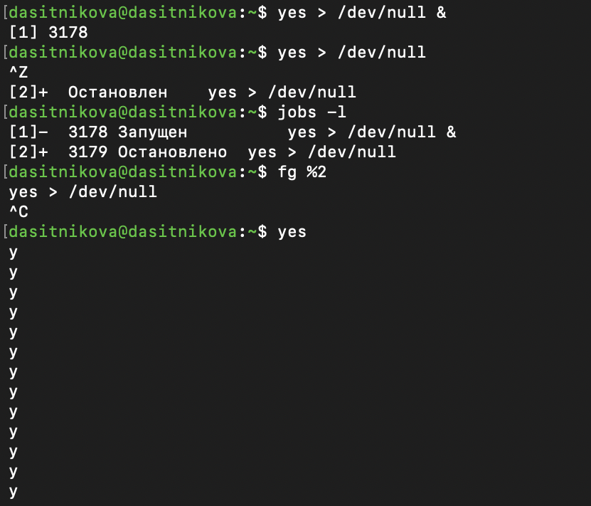{#fig-008 width=75%}

Фоновое задание 1 получило PID 3178. Задание переднего плана после нажатия Ctrl+Z перешло в состояние «Остановлен» и получило номер 2 и PID 3179. Команда `fg %2` вернула его на передний план, и оно продолжило работу, пока не было прервано сочетанием Ctrl+C. Программа `yes` без перенаправления непрерывно выводит на терминал строки `y` и занимает его до приостановки; она также приостановлена Ctrl+Z, продолжена командой `fg %2` и прервана Ctrl+C.

Состояния заданий проверены командой `jobs`. Процесс, который выполняется в фоновом режиме, переведён на передний план и остановлен ([рис. @fig-009]).

~~~bash
jobs -l
fg %1
~~~

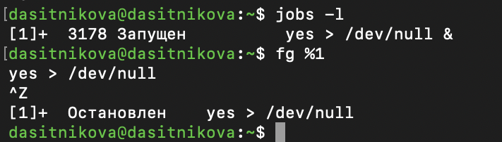{#fig-009 width=70%}

В списке осталось одно задание --- фоновая программа `yes` с PID 3178, и оно стало текущим. После `fg %1` и нажатия Ctrl+Z задание перешло в состояние «Остановлен».

Процесс с подавлением потока вывода переведён в фоновый режим, и состояния заданий проверены командой `jobs` ([рис. @fig-010]).

~~~bash
jobs -l
bg %1
jobs -l
kill %1
~~~

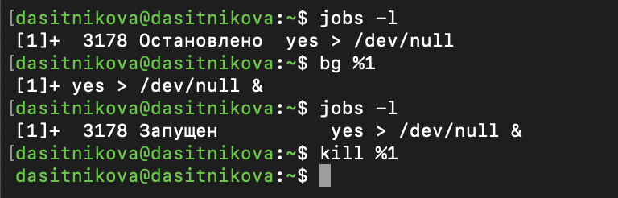{#fig-010 width=70%}

До выполнения `bg %1` задание имеет состояние «Остановлено», после --- «Запущен»: процесс стал выполняющимся в фоновом режиме. Затем задание завершено командой `kill %1`, которая отправила ему сигнал SIGTERM.

Процесс запущен в фоновом режиме с помощью `nohup` таким образом, чтобы он продолжил свою работу даже после отключения от терминала, после чего окно закрыто ([рис. @fig-011]).

~~~bash
nohup yes > /dev/null 2>&1 < /dev/null &
echo $!
exit
exit
~~~

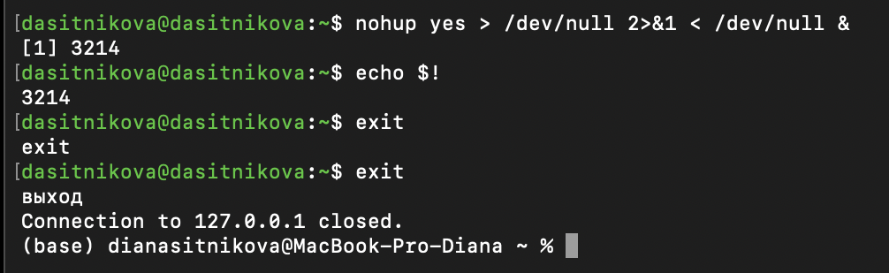{#fig-011 width=85%}

Стандартный вывод и поток ошибок перенаправлены в `/dev/null`, а стандартный ввод взят из `/dev/null`, поэтому ни один поток процесса не связан с терминалом и файл `nohup.out` не создаётся. Параметр `$!` вывел PID фонового процесса --- 3214. Команды `exit` завершили оболочки, и соединение SSH было закрыто.

Консоль запущена заново, и проверено, что процесс продолжил свою работу ([рис. @fig-012]). Информация о запущенных в операционной системе процессах получена с помощью утилиты `top` ([рис. @fig-013]).

~~~bash
ps -p 3214 -o pid,ppid,ni,stat,args
jobs -l
top
~~~

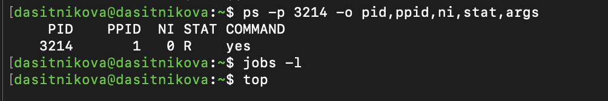{#fig-012 width=85%}

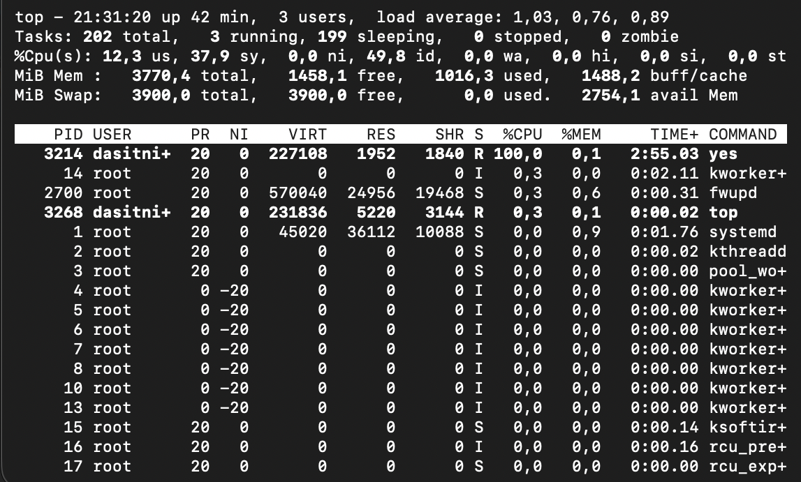{#fig-013 width=85%}

Процесс 3214 выполняется (состояние `R`), значение nice равно 0, а родителем стал процесс 1: оболочка, запустившая процесс, завершена, и он усыновлён systemd. Закрытие терминала его не завершило, поскольку `nohup` установил для него игнорирование SIGHUP. Список заданий новой оболочки пуст: процесс принадлежит другому, уже закрытому сеансу. В `top` процесс `yes` пользователя `dasitnikova` находится на первом месте, использует 100 % процессора и набрал почти 3 мин процессорного времени.

В текущем сеансе с помощью `nohup` запущен ещё один процесс `yes`, и утилита `top` запущена повторно ([рис. @fig-014]).

~~~bash
nohup yes > /dev/null 2>&1 < /dev/null &
jobs -l
top
~~~

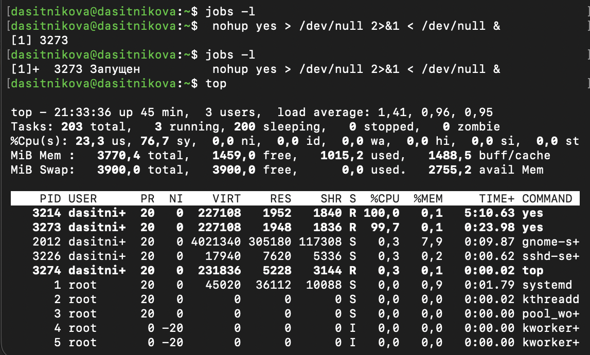{#fig-014 width=85%}

Новый процесс получил номер задания 1 и PID 3273. В `top` видны оба процесса `yes`: 3214 из закрытого сеанса с накопленным временем 5 мин 10 с и новый 3273. Каждый использует целый процессор, поэтому в строке `%Cpu(s)` свободного времени нет: `id` равно 0,0.

Запущены ещё три программы `yes` в фоновом режиме с подавлением потока вывода. Убиты два процесса: для одного использован его PID, а для другого --- идентификатор задания ([рис. @fig-015]).

~~~bash
yes > /dev/null &
yes > /dev/null &
yes > /dev/null &
jobs -l
kill 3273
kill %2
jobs -l
jobs -l
~~~

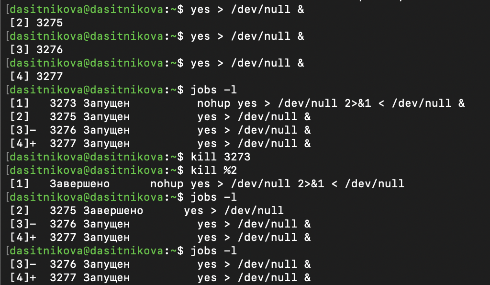{#fig-015 width=85%}

Новые задания 2, 3 и 4 получили PID 3275, 3276 и 3277. Команда `kill 3273` завершила процесс по PID: это процесс задания 1, запущенный через `nohup`, и оболочка сообщила о его завершении. SIGTERM не игнорируется, поэтому `nohup` от него не защищает. Команда `kill %2` завершила задание 2 с PID 3275. В списке остались задания 3 и 4.

Сигнал 1 (SIGHUP) послан процессу, запущенному с помощью `nohup`, и обычному процессу ([рис. @fig-016]).

~~~bash
nohup yes > /dev/null 2>&1 < /dev/null &
jobs -l
kill -HUP 3283
kill -HUP 3276
ps -p 3283,3276 -o pid,stat,args
jobs -l
~~~

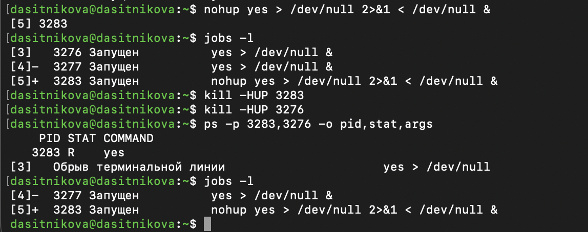{#fig-016 width=85%}

Процесс, запущенный через `nohup`, получил номер задания 5 и PID 3283, обычный процесс --- задание 3 с PID 3276. После отправки SIGHUP команда `ps` находит только процесс 3283: он продолжает выполняться. Обычный процесс 3276 завершился, так как действие SIGHUP по умолчанию --- завершение процесса; оболочка сообщила о завершении задания 3 с описанием сигнала «Обрыв терминальной линии». В списке заданий остались задания 4 и 5.

Запущены ещё несколько программ `yes` в фоновом режиме с подавлением потока вывода, и их работа завершена одновременно командой `killall` ([рис. @fig-017]).

~~~bash
yes > /dev/null &
yes > /dev/null &
jobs -l
killall -u dasitnikova yes
jobs -l
jobs -l
~~~

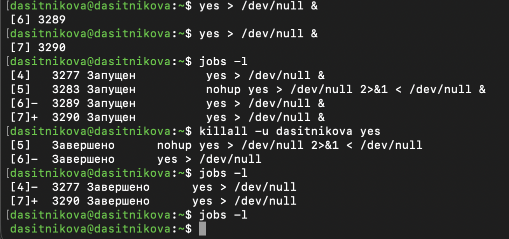{#fig-017 width=85%}

Перед выполнением `killall` работают четыре задания: 4, 5, 6 и 7, в том числе процесс 3283, запущенный через `nohup`. Команда `killall` отправила SIGTERM всем процессам с именем `yes`, принадлежащим пользователю `dasitnikova`, и оболочка сообщила о завершении всех четырёх заданий; после этого список заданий пуст. Вместе с ними завершён и процесс 3214 из закрытого сеанса: в следующем опыте ([рис. @fig-018]) команда `ps -C yes` находит только новые процессы.

Программа `yes` запущена в фоновом режиме с подавлением потока вывода. С помощью утилиты `nice` программа `yes` запущена с теми же параметрами и с приоритетом, большим на 5. Абсолютные и относительные приоритеты этих двух процессов сравнены, после чего с помощью утилиты `renice` приоритет одного из потоков `yes` изменён так, чтобы у обоих потоков приоритеты были равны ([рис. @fig-018]).

~~~bash
sudo -v
yes > /dev/null &
sudo nice -n -5 yes > /dev/null &
ps -C yes -o user,pid,ni,pri,comm
sudo renice 0 -p 3307
ps -C yes -o user,pid,ni,pri,comm
killall -u dasitnikova yes
sudo killall -u root yes
~~~

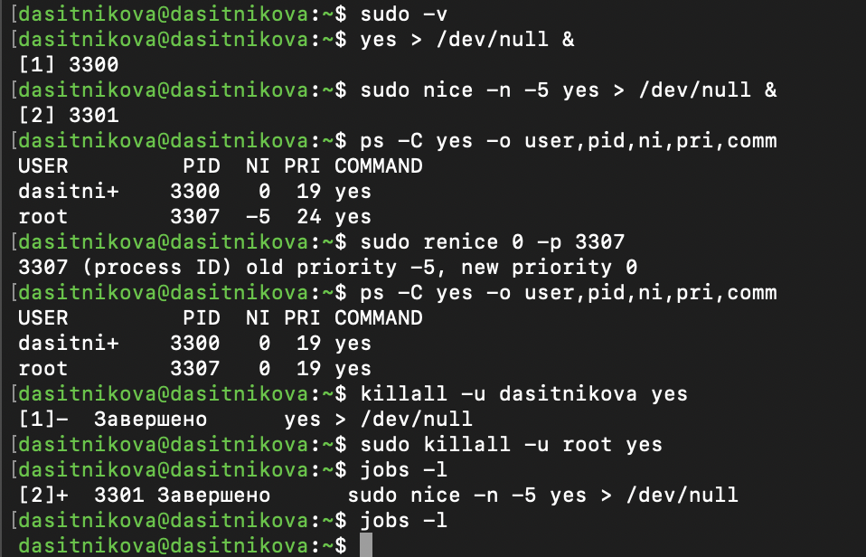{#fig-018 width=85%}

Приоритет, больший на 5, соответствует значению nice, меньшему на 5, то есть −5. Отрицательное значение nice может задать только суперпользователь, поэтому вторая команда выполнена через `sudo`; команда `sudo -v` заранее запрашивает пароль, который фоновое задание не может прочитать с терминала. Задание 2 получило PID 3301 --- это процесс самой команды `sudo`, а запущенная ею программа `yes` имеет PID 3307 и принадлежит пользователю `root`.

Абсолютные приоритеты процессов: у процесса 3300 значение nice 0 и `PRI` 19, у процесса 3307 --- nice −5 и `PRI` 24; в `top` им соответствуют значения `PR` 20 и 15. Относительный приоритет определяется отношением весов: 3121 к 1024, то есть при конкуренции за один процессор второй процесс получал бы примерно в 3 раза больше времени, чем первый. Команда `sudo renice 0 -p 3307` изменила nice второго процесса с −5 на 0, и у обоих процессов значения nice и `PRI` стали равны: 0 и 19. Затем процессы обоих пользователей завершены командой `killall`.

# Выводы

В ходе лабораторной работы получены навыки управления заданиями и процессами Rocky Linux 10.2. Задания запускались в фоновом режиме и на переднем плане, приостанавливались, переводились между передним планом и фоном и завершались по номеру задания, по PID и по имени программы. Изучены иерархия процессов и поведение потомков после завершения родителя: процессы-сироты продолжают работу и усыновляются процессом с PID 1.

Показано, что процесс, запущенный через `nohup`, продолжает работу после закрытия терминала и игнорирует сигнал SIGHUP, который завершает обычный процесс, но завершается сигналом SIGTERM. Изучено управление приоритетами командами `nice` и `renice`: меньшему значению nice соответствует больший вес процесса при распределении процессорного времени, а эффект от изменения приоритета проявляется только при конкуренции процессов за процессор.

# Контрольные вопросы

1. **Какая команда даёт обзор всех текущих заданий оболочки?**

   `jobs`; `jobs -l` дополнительно выводит PID ([рис. @fig-001]). Она показывает задания текущей оболочки, а не все процессы пользователя.

   ~~~bash
   jobs -l
   ~~~

2. **Как остановить текущее задание оболочки, чтобы продолжить его выполнение в фоновом режиме?**

   Нажать Ctrl+Z, затем выполнить `bg` или `bg %номер` ([рис. @fig-001], [рис. @fig-010]). Ctrl+Z приостанавливает группу процессов переднего плана, а `bg` продолжает её выполнение в фоне.

   ~~~bash
   bg %3
   ~~~

3. **Какую комбинацию клавиш можно использовать для отмены текущего задания оболочки?**

   Ctrl+C посылает SIGINT группе процессов переднего плана ([рис. @fig-002]). Обычные `sleep`, `dd`, `yes` завершаются; произвольная программа может обработать или игнорировать этот сигнал.

4. **Необходимо отменить одно из начатых заданий. Доступ к оболочке, в которой в данный момент работает пользователь, невозможен. Что можно сделать, чтобы отменить задание?**

   Открыть другой терминал, найти процесс через `ps`, `pgrep` или `top`, проверить PID и выполнить `kill PID` (SIGTERM). Если процесс не реагирует, допускается `kill -KILL PID`. Номер `%1` из исходной оболочки в новой не работает. Для чужого процесса нужны соответствующие права. Так процесс `dd`, запущенный во втором терминале, был завершён из `top` в первом ([рис. @fig-004]).

   ~~~bash
   pgrep -a dd
   kill PID
   ~~~

5. **Какая команда используется для отображения отношений между родительскими и дочерними процессами?**

   `ps fax` или `pstree -p` ([рис. @fig-005]). `PPID` в выводе `ps` содержит идентификатор родителя.

   ~~~bash
   ps fax
   pstree -p
   ~~~

6. **Какая команда позволит изменить приоритет процесса с идентификатором 1234 на более высокий?**

   Сначала узнать текущий NI: `ps -p 1234 -o pid,ni,comm`. Если NI = 0, команда `sudo renice -5 -p 1234` повысит приоритет, установив NI = −5 ([рис. @fig-007]). Новое число должно быть меньше прежнего; установка −5 процессу с NI = −10 понизит приоритет.

   ~~~bash
   ps -p 1234 -o pid,ni,comm
   sudo renice -5 -p 1234
   ~~~

7. **В системе в настоящее время запущено 20 процессов dd. Как проще всего остановить их все сразу?**

   Если под «остановить» имеется в виду завершить --- `killall dd`, при необходимости с `sudo` ([рис. @fig-006], [рис. @fig-007]). Это все доступные по правам процессы с именем `dd`. Для приостановки с возможностью продолжения --- `killall -STOP dd`, продолжить --- `killall -CONT dd`.

   ~~~bash
   sudo killall dd
   ~~~

8. **Какая команда позволяет остановить команду с именем mycommand?**

   `killall mycommand` завершает процессы с этим именем сигналом SIGTERM ([рис. @fig-017]). Если известен конкретный PID, точнее `kill PID`. Для временной приостановки --- `kill -STOP PID`.

   ~~~bash
   killall mycommand
   ~~~

9. **Какая команда используется в top, чтобы убить процесс?**

   Клавиша `k`, затем PID и сигнал ([рис. @fig-004]). Сначала используют SIGTERM (15); SIGKILL (9) --- при необходимости принудительного завершения.

10. **Как запустить команду с достаточно высоким приоритетом, не рискуя, что не хватит ресурсов для других процессов?**

    Использовать умеренно отрицательный NI, например `sudo nice -n -5 команда`, сохраняя обычную политику планирования ([рис. @fig-018]). Это увеличивает относительный вес задачи при конкуренции за процессор. Nice не является ограничителем ресурсов и не гарантирует отсутствие дефицита памяти или ввода-вывода; не следует включать политику реального времени.

    ~~~bash
    sudo nice -n -5 команда
    ~~~

# Список литературы{.unnumbered}

::: {#refs}
:::
