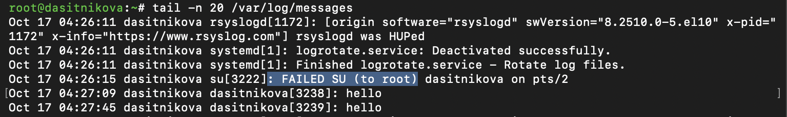
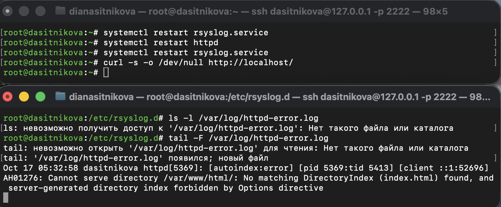
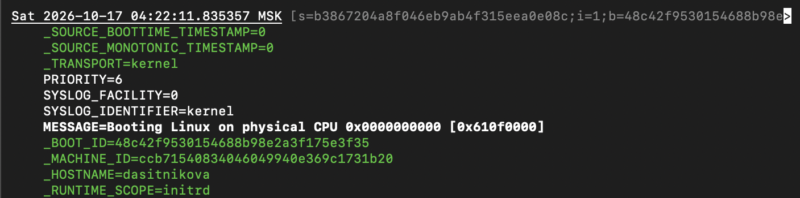
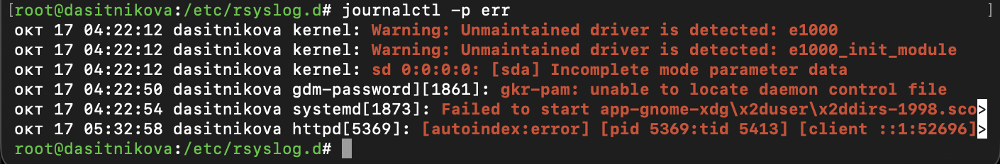
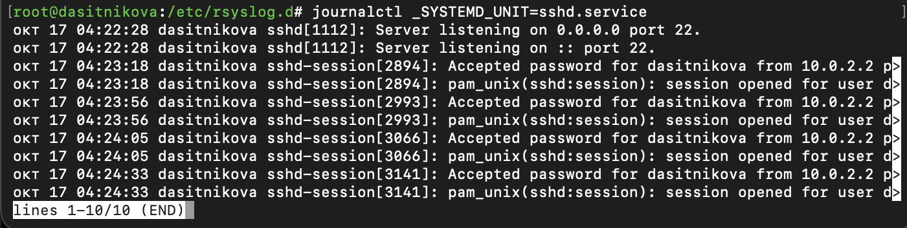
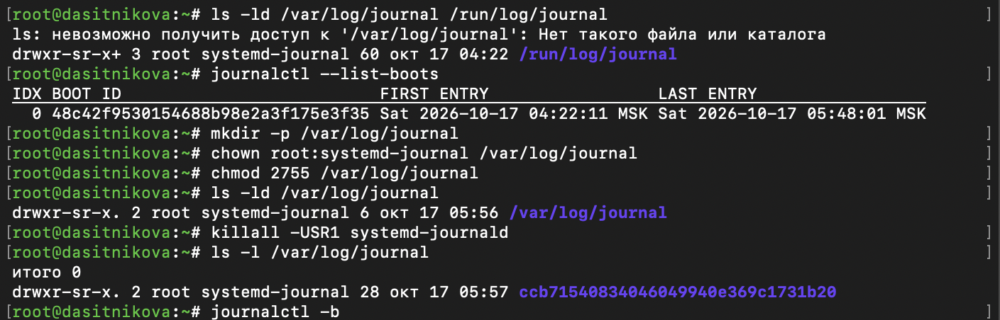
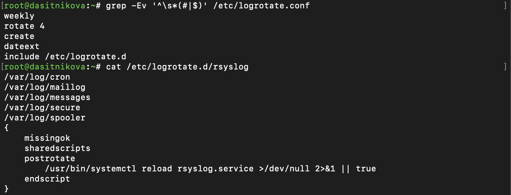

---
## Author
author:
  name: Ситникова Диана Александровна
  degrees: BSc
  email: 1032201746@rudn.ru
  affiliation:
    - name: Российский университет дружбы народов
      country: Российская Федерация
      postal-code: 117198
      city: Москва
      address: ул. Миклухо-Маклая, д. 6
## Title
title: "Лабораторная работа № 7"
subtitle: "Управление журналами событий в системе"
institute:
  - "Российский университет дружбы народов им. П. Лумумбы"
  - "Преподаватель: д.ф.-м.н., профессор Кулябов Дмитрий Сергеевич"
license: CC BY
date: today
date-format: "YYYY-MM-DD"
---

# Информация

## Докладчик

:::::::::::::: {.columns align=center}
::: {.column width="68%"}

- Ситникова Диана Александровна
- направление 09.03.03 «Прикладная информатика»
- Российский университет дружбы народов
- [1032201746@rudn.ru](mailto:1032201746@rudn.ru)

:::
::: {.column width="32%"}

{width=100%}

:::
::::::::::::::

# Вводная часть

## Актуальность

- Журналы --- первое место, куда администратор смотрит при сбое службы или подозрительном входе.
- В Linux одновременно работают текстовые журналы rsyslog и двоичный журнал journald.
- Журнал в памяти теряется при перезагрузке --- вместе со сведениями о причине сбоя.

## Объект, предмет, цель и задачи

**Объект** --- журналы событий Rocky Linux 10.2.

**Предмет** --- средства настройки и просмотра журналов: rsyslog, journalctl, journald.

**Цель** --- получить навыки работы с журналами мониторинга различных событий в системе.

**Задачи:** продемонстрировать навыки работы с журналом мониторинга событий в реальном времени, настройки отдельного файла мониторинга событий веб-службы, работы с journalctl и journald.

## Материалы и методы

| Компонент | Значение |
|---|---|
| Стенд | Rocky Linux 10.2, rsyslog 8.2510, systemd 257 |
| Журналы rsyslog | `/var/log/messages`, `/var/log/secure` |
| Веб-служба | Apache 2.4.63, `ErrorLog syslog:local1` |
| Просмотр | `tail -f`, `journalctl` |
| Хранение | journald, `/var/log/journal`, logrotate |

# Содержание исследования

## Неудачный su виден в двух журналах

:::::::::::::: {.columns align=center}
::: {.column width="38%"}

`su` пишет в категорию `auth` → `/var/log/messages`: `FAILED SU (to root)`.

`pam_unix` пишет в `authpriv` → `/var/log/secure`: `authentication failure`.

`logger hello` → `user.notice` → `messages`.

:::
::: {.column width="62%"}

{width=100%}

{width=100%}

:::
::::::::::::::

## Apache пишет ошибки в отдельный файл через local1

:::::::::::::: {.columns align=center}
::: {.column width="40%"}

`httpd.conf`: `ErrorLog syslog:local1`.

`rsyslog.d/httpd.conf`: `local1.* -/var/log/httpd-error.log`.

При `LogLevel warn` в syslog идут только ошибки: файл появился с первой ошибкой `AH01276`.

:::
::: {.column width="60%"}

{width=100%}

:::
::::::::::::::

## *.debug собирает все сообщения

:::::::::::::: {.columns align=center}
::: {.column width="40%"}

`*.debug` --- все категории, все приоритеты от `debug` и выше.

`logger -p daemon.debug` → `root[5580]: Daemon Debug Message`.

В `/var/log/messages` отладка не попадает: там `*.info`.

:::
::: {.column width="60%"}

{width=100%}

:::
::::::::::::::

## journald хранит записи как наборы полей

:::::::::::::: {.columns align=center}
::: {.column width="40%"}

`journalctl -o verbose` показывает все поля записи.

`_TRANSPORT`, `PRIORITY`, `SYSLOG_FACILITY`, `_BOOT_ID`, `_MACHINE_ID`.

Поля с `_` заполняет сам journald --- отправитель не может их подделать.

:::
::: {.column width="60%"}

{width=100%}

:::
::::::::::::::

## journalctl фильтрует по приоритету и полям

:::::::::::::: {.columns align=center}
::: {.column width="35%"}

`-p err`: шесть записей с приоритетом `err` и выше.

`_SYSTEMD_UNIT=sshd.service`: четыре входа `dasitnikova` с `10.0.2.2`.

:::
::: {.column width="65%"}

{width=100%}

{width=100%}

:::
::::::::::::::

## Каталог /var/log/journal делает журнал постоянным

:::::::::::::: {.columns align=center}
::: {.column width="38%"}

До: только `/run/log/journal`, одна загрузка.

`mkdir`, `chown root:systemd-journal`, `chmod 2755`, `killall -USR1`.

После перезагрузки в журнале две загрузки: `-1` и `0`.

:::
::: {.column width="62%"}

{width=100%}

{width=100%}

:::
::::::::::::::

## logrotate раз в неделю начинает журналы заново

:::::::::::::: {.columns align=center}
::: {.column width="40%"}

`weekly`, `rotate 4`, `create`, `dateext` → `messages-20261017`.

После недели без работы ротация прошла через 4 минуты после загрузки.

`postrotate`: rsyslog получает SIGHUP и открывает новые файлы.

:::
::: {.column width="60%"}

{width=100%}

:::
::::::::::::::

# Результаты

## Журналы настроены и проверены

- Сообщения о неудачном входе найдены в `/var/log/messages` и `/var/log/secure`.
- Ошибки Apache записываются через syslog в `/var/log/httpd-error.log`, отладка --- в `/var/log/messages-debug`.
- Журнал journald просмотрен с фильтрами по времени, приоритету и полям.
- Журнал journald сделан постоянным и пережил перезагрузку.

## Вывод

Все сообщения сначала попадают в journald, а rsyslog раскладывает их по текстовым файлам: категория и приоритет решают, в какой файл попадёт сообщение.

Чтобы журнал пережил перезагрузку, достаточно создать каталог `/var/log/journal`.
