---
## Author
author:
  name: Ситникова Диана Александровна
  degrees: BSc
  email: 1032201746@rudn.ru
  affiliation:
    - name: Российский университет дружбы народов
      country: Российская Федерация
      postal-code: 117198
      city: Москва
      address: ул. Миклухо-Маклая, д. 6

## Title
title: "Отчёт по лабораторной работе №7"
subtitle: "Управление журналами событий в системе"
license: "CC BY"
bibliography: bib/cite.bib
---

# Цель работы

Целью данной работы является получение навыков работы с журналами мониторинга различных событий в системе.

# Задание

- Продемонстрировать навыки работы с журналом мониторинга событий в реальном времени.
- Продемонстрировать навыки создания и настройки отдельного файла конфигурации мониторинга отслеживания событий веб-службы.
- Продемонстрировать навыки работы с journalctl.
- Продемонстрировать навыки работы с journald.

# Теоретическое введение

## Syslog, rsyslog и journald

Журналы событий --- основной источник сведений о работе системы: по ним администратор узнаёт о сбоях служб, попытках входа, ошибках оборудования и действиях пользователей. В Unix-системах сообщения журналов собирает специальная служба, а программы лишь передают ей текст сообщения с указанием источника и важности.

Протокол и служба syslog появились в 1980-х годах в BSD Unix: Эрик Оллман написал их для почтового сервера Sendmail, после чего механизм стали использовать и другие программы [@nemeth_book_unix-linux-admin_ru]. Формат сообщений долгое время оставался соглашением и был описан лишь в 2001 году в информационном документе RFC 3164 [@rfc3164], а стандартом стал в 2009 году в RFC 5424 [@rfc5424].

Rsyslog --- реализация syslog, которую с 2004 года развивает Райнер Герхардс [@rsyslog_docs]. Она совместима с классическим форматом правил, но добавляет собственный язык конфигурации RainerScript, фильтрацию по любым свойствам сообщения, передачу журналов по сети через TCP и TLS и запись в базы данных. В Red Hat Enterprise Linux rsyslog используется по умолчанию начиная с версии 6; в Rocky Linux 10 установлена версия 8.2510.

Systemd-journald --- служба журналирования, входящая в systemd [@pottering_systemd-admins_ru; @emelyanov_journald_ru]. В отличие от syslog, она хранит записи не в текстовых файлах, а в двоичном индексированном журнале. Каждая запись состоит из набора полей: кроме текста сообщения, journald сам добавляет сведения об отправителе --- PID, UID, имя программы, юнит systemd, идентификатор загрузки, контекст SELinux. Эти поля нельзя подделать, поэтому журнал позволяет надёжно найти все сообщения конкретной службы или пользователя.

## Путь сообщения в Rocky Linux 10

В Rocky Linux 10 journald и rsyslog работают вместе ([табл. @tbl-sources]). Все сообщения сначала попадают в journald: сокет `/dev/log`, через который программы передают сообщения функцией `syslog()`, на самом деле является ссылкой на сокет journald `/run/systemd/journal/dev-log`. Кроме того, journald принимает сообщения ядра из `/dev/kmsg` и всё, что службы выводят в стандартные потоки вывода и ошибок.

| Источник | Как попадает в журнал | Пример |
|-----------------------|---------------------------------------------|---------------------|
| Функция `syslog()` | сокет `/dev/log` → journald | `logger`, `su`, Apache с `ErrorLog syslog` |
| Собственный интерфейс journald | функции `sd_journal_*` | systemd, NetworkManager |
| Потоки вывода служб | stdout и stderr службы → journald | сообщения Apache до открытия журнала |
| Ядро | `/dev/kmsg` → journald | сообщения драйверов |
| Аудит | `auditd` → `/var/log/audit/audit.log` | SELinux, вход в систему |

: Источники сообщений журналов {#tbl-sources}

Rsyslog в конфигурации Rocky Linux 10 не слушает сокет `/dev/log` сам (`SysSock.Use="off"` модуля `imuxsock`), а читает новые записи из журнала journald модулем `imjournal`. Позицию чтения он сохраняет в файле `imjournal.state`, чтобы после перезапуска не обрабатывать записи повторно. Затем rsyslog распределяет сообщения по текстовым файлам в каталоге `/var/log` согласно своим правилам. Таким образом, одно и то же сообщение доступно и через `journalctl`, и в текстовом файле.

Некоторые программы ведут собственные журналы, минуя syslog: например, веб-сервер Apache по умолчанию пишет в файлы `/var/log/httpd/error_log` и `/var/log/httpd/access_log`, а служба аудита --- в `/var/log/audit/audit.log`.

## Категории и приоритеты сообщений

Каждое сообщение syslog имеет две характеристики: категорию (facility), указывающую на источник, и приоритет (severity), указывающий на важность [@rfc5424]. Категории и их числовые коды приведены в [табл. @tbl-facilities]. Категории `local0`--`local7` не закреплены ни за какой службой, и администратор может назначить их своим приложениям.

| Код | Категория | Источник сообщений |
|------|------------|------------------------------------------------|
| 0 | `kern` | ядро |
| 1 | `user` | программы пользователя; категория по умолчанию |
| 2 | `mail` | почтовая система |
| 3 | `daemon` | системные службы без собственной категории |
| 4 | `auth` | аутентификация и авторизация |
| 5 | `syslog` | сама служба журналирования |
| 6 | `lpr` | система печати |
| 7 | `news` | сервер новостей NNTP |
| 8 | `uucp` | система UUCP |
| 9 | `cron` | планировщик заданий |
| 10 | `authpriv` | аутентификация, конфиденциальные сведения |
| 16--23 | `local0`--`local7` | локальные категории для любых приложений |

: Категории сообщений syslog {#tbl-facilities}

Категории `auth` и `authpriv` различаются тем, куда направляются их сообщения: `authpriv` предназначена для сведений, которые нельзя показывать всем пользователям, и записывается в файл, доступный только суперпользователю.

Приоритеты приведены в [табл. @tbl-severities]: чем меньше число, тем важнее сообщение. Категория и приоритет передаются в начале сообщения одним числом PRI = категория × 8 + приоритет; например, у сообщения `local1.err` PRI = 17 · 8 + 3 = 139.

| Код | Приоритет | Значение |
|------|-------------------|----------------------------------------------------|
| 0 | `emerg` (`panic`) | система неработоспособна |
| 1 | `alert` | требуется немедленное вмешательство |
| 2 | `crit` | критическая ошибка |
| 3 | `err` (`error`) | ошибка |
| 4 | `warning` (`warn`) | предупреждение |
| 5 | `notice` | нормальное, но значимое событие |
| 6 | `info` | информационное сообщение |
| 7 | `debug` | отладочное сообщение |

: Приоритеты сообщений syslog {#tbl-severities}

## Правила rsyslog

Основной файл конфигурации rsyslog --- `/etc/rsyslog.conf`. Директива `include` подключает к нему все файлы `/etc/rsyslog.d/*.conf`, поэтому собственные правила удобно размещать в отдельных файлах, не изменяя основной [@rsyslog_docs].

Правило состоит из селектора и действия. Селектор имеет вид `категория.приоритет` и выбирает сообщения указанной категории с указанным приоритетом и **более важными**: `mail.warn` выбирает предупреждения, ошибки и всё, что важнее. Знак `=` перед приоритетом выбирает ровно этот приоритет, `!` --- исключает его, `*` обозначает любую категорию или любой приоритет, а `none` --- ни одного приоритета. Несколько категорий перечисляются через запятую, несколько селекторов --- через точку с запятой. Действие --- чаще всего путь к файлу, в который записывается сообщение; rsyslog создаёт файл при записи в него первого сообщения. В классическом синтаксисе перед путём может стоять знак `-`, унаследованный от sysklogd и означающий отказ от синхронизации файла с диском после каждой записи. В rsyslog синхронизация и так выключена по умолчанию и включается параметром `sync="on"`.

В Rocky Linux 10 правила по умолчанию записаны на языке RainerScript: действие задаётся функцией `action(type="omfile" file="…")`. Эти правила приведены в [табл. @tbl-rules].

| Селектор | Файл | Содержимое |
|----------------------------|---------------------------|----------------------------|
| `*.info;mail.none;` `authpriv.none;cron.none` | `/var/log/messages` | основной журнал системы |
| `authpriv.*` | `/var/log/secure` | аутентификация |
| `mail.*` | `/var/log/maillog` | почтовая система |
| `cron.*` | `/var/log/cron` | планировщик заданий |
| `*.emerg` | все терминалы | аварийные сообщения |
| `uucp,news.crit` | `/var/log/spooler` | UUCP и новости |
| `local7.*` | `/var/log/boot.log` | сообщения загрузки |

: Правила rsyslog по умолчанию в Rocky Linux 10 {#tbl-rules}

Каждое сообщение проверяется по всем правилам и записывается во все файлы, селекторы которых ему соответствуют, если правило не прерывает обработку явно действием `stop`. После изменения правил rsyslog нужно перезапустить: файлы конфигурации читаются только при запуске службы.

## Журнал journald

Журнал journald хранится в двоичных файлах с индексами и контрольными суммами. Записи состоят из полей вида `ИМЯ=значение` ([табл. @tbl-fields]). Поля, имена которых начинаются с подчёркивания, journald заполняет сам по сведениям ядра об отправителе, а остальные передаёт программа [@systemd_man].

| Поле | Значение |
|---------------------|-----------------------------------------------------------|
| `MESSAGE` | текст сообщения |
| `PRIORITY` | приоритет syslog, 0--7 |
| `SYSLOG_FACILITY` | категория syslog |
| `SYSLOG_IDENTIFIER` | имя программы, указанное ею самой |
| `_PID`, `_UID`, `_GID` | процесс-отправитель и его владелец |
| `_COMM`, `_EXE`, `_CMDLINE` | имя, исполняемый файл и командная строка отправителя |
| `_SYSTEMD_UNIT` | юнит systemd, которому принадлежит отправитель |
| `_TRANSPORT` | способ передачи: `syslog`, `journal`, `stdout`, `kernel` |
| `_BOOT_ID` | идентификатор загрузки системы |
| `_MACHINE_ID`, `_HOSTNAME` | идентификатор и имя компьютера |

: Основные поля записи журнала journald {#tbl-fields}

Где хранить журнал, определяет параметр `Storage` в файле `/etc/systemd/journald.conf`. Значение `volatile` означает хранение только в оперативной памяти, в каталоге `/run/log/journal`, и журнал теряется при перезагрузке. Значение `persistent` --- хранение на диске, в каталоге `/var/log/journal`. Значение по умолчанию `auto` выбирает постоянное хранение, если каталог `/var/log/journal` существует, и временное в противном случае. Поэтому для включения постоянного журнала достаточно создать этот каталог.

Каталог принадлежит группе `systemd-journal` и имеет права `2755`. Члены этой группы могут читать журнал всех пользователей, а бит SGID заставляет создаваемые в каталоге файлы наследовать группу каталога. Сигнал SIGUSR1 (или команда `journalctl --flush`) заставляет journald перенести записи из `/run/log/journal` в `/var/log/journal` без перезагрузки. Размер журнала ограничен: по умолчанию он занимает не более 10 % файловой системы и не более 4 ГиБ, после чего старые файлы удаляются.

Для просмотра журнала служит программа `journalctl`. Основные ключи приведены в [табл. @tbl-journalctl]. Фильтры по полям записываются как `ПОЛЕ=значение`; несколько условий для разных полей объединяются логическим «и».

| Ключ | Действие |
|-------------------------|-------------------------------------------------------------|
| `-f` | показывать новые записи в реальном времени |
| `-n N` | показать последние N записей |
| `-p приоритет` | записи с указанным приоритетом и более важные |
| `-b`, `-b -1` | записи текущей или предыдущей загрузки |
| `--list-boots` | список загрузок, сохранённых в журнале |
| `--since`, `--until` | записи начиная с момента или до момента времени |
| `-u юнит` | записи юнита systemd |
| `-o verbose`, `-o json` | вывод записей со всеми полями |
| `--no-pager` | вывод без программы постраничного просмотра |
| `--disk-usage`, `--vacuum-size` | размер журнала и его сокращение |

: Основные ключи программы journalctl {#tbl-journalctl}

## Ротация журналов

Текстовые журналы растут непрерывно, поэтому их периодически ротируют: текущий файл переименовывают, создают вместо него новый пустой, а самые старые копии удаляют. Эту работу выполняет программа `logrotate`, которую раз в сутки запускает таймер systemd `logrotate.timer` [@logrotate_man]. Общие параметры заданы в файле `/etc/logrotate.conf`, параметры отдельных журналов --- в файлах каталога `/etc/logrotate.d`.

В Rocky Linux 10 по умолчанию журналы ротируются раз в неделю (`weekly`), хранятся четыре старые копии (`rotate 4`), после ротации создаётся новый файл (`create`), а к имени старого файла добавляется дата (`dateext`), например `messages-20261017`. Файл `/etc/logrotate.d/rsyslog` перечисляет журналы rsyslog и после ротации выполняет команду `systemctl reload rsyslog.service`: rsyslog получает сигнал SIGHUP, закрывает старые файлы и открывает новые. Таймер имеет параметр `Persistent=true`, поэтому ротация, пропущенная из-за выключенной системы, выполняется вскоре после её загрузки.

Программа, которая держала открытым старый файл, продолжит читать его и после переименования. Так поступает `tail -f`, следящая за открытым файлом; команда `tail -F` следит за именем файла и после ротации открывает новый файл заново.

## Журналирование Apache через syslog

Директива `ErrorLog` веб-сервера Apache задаёт, куда записывается журнал ошибок. Вместо имени файла можно указать `syslog`, и тогда сообщения передаются функцией `syslog()` с категорией `local7`, а вариант `syslog:категория` задаёт другую категорию [@apache_core]. Если директива `ErrorLog` встречается в конфигурации несколько раз, действует последняя.

Объём журнала ошибок определяет директива `LogLevel`, по умолчанию `warn`: записываются предупреждения и более важные сообщения. Сообщения уровня `notice` о запуске и останове сервера Apache записывает в файл журнала независимо от `LogLevel`. При журналировании через syslog это исключение не действует, поэтому при `LogLevel warn` в syslog попадают только предупреждения и ошибки. Сообщения, которые Apache выводит в стандартный поток ошибок до открытия журнала, например предупреждение `AH00558` об отсутствии имени сервера, journald записывает от имени службы `httpd` с категорией по умолчанию.

# Выполнение лабораторной работы

Работа выполнена в виртуальной машине с Rocky Linux 10.2 в трёх терминалах, подключённых к гостевой системе по SSH; полномочия администратора получены командой `su -`.

## Мониторинг журнала системных событий в реальном времени

Запущены три вкладки терминала, и в каждой из них получены полномочия администратора. На второй вкладке терминала запущен мониторинг системных событий в реальном времени. В третьей вкладке выполнен возврат к учётной записи своего пользователя сочетанием Ctrl+D и сделана попытка получить полномочия администратора с неправильным паролем, после чего из оболочки пользователя введена команда `logger hello` ([рис. @fig-001]).

~~~bash
su -
tail -f /var/log/messages
su -
logger hello
~~~

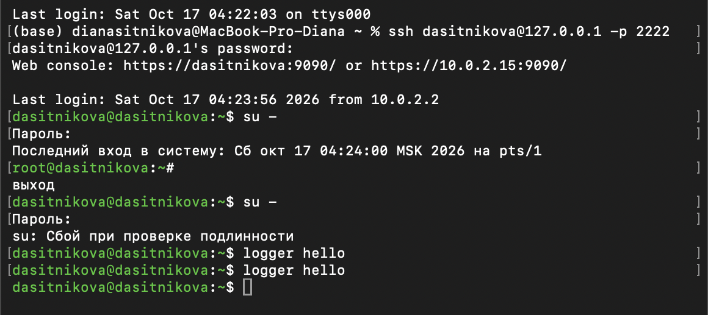{#fig-001 width=75%}

Команда `su` сообщила «Сбой при проверке подлинности», и оболочка осталась оболочкой пользователя `dasitnikova`. Команда `logger` выполнена дважды.

Сообщения, появившиеся во второй вкладке, и содержимое журнала после остановки трассировки приведены на [рис. @fig-002].

~~~bash
ls -l /var/log/messages*
tail -n 20 /var/log/messages
~~~

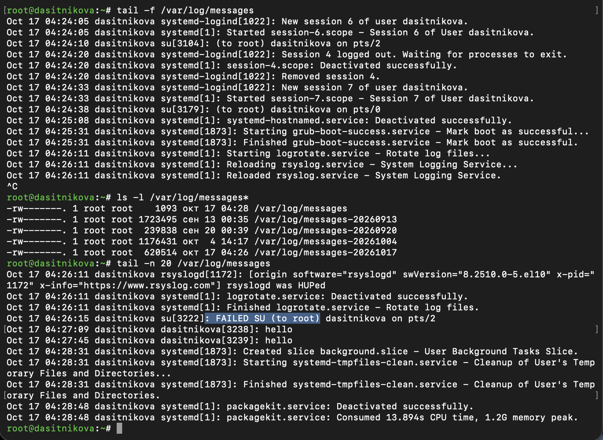{#fig-002 width=85%}

В режиме трассировки на экран выводились новые записи журнала: открытие сеансов SSH службой `systemd-logind`, успешные переключения `su[3104]: (to root) dasitnikova on pts/2`. В 04:26:11 запустилась служба `logrotate.service`: система до этого была выключена неделю, и недельная ротация журналов выполнилась сразу после загрузки. Файл журнала переименован в `messages-20261017`, rsyslog получил сигнал SIGHUP («rsyslogd was HUPed») и создал новый файл `/var/log/messages`, а `tail -f` продолжала следить за переименованным. Список файлов показывает новый журнал размером 1093 байта и четыре старые копии с датами ротации.

В новом файле записаны сообщение `su[3222]: FAILED SU (to root) dasitnikova on pts/2` о неудачной попытке в 04:26:15 и две строки `dasitnikova[3238]: hello` и `dasitnikova[3239]: hello`. Команда `logger` по умолчанию подписывает сообщение именем пользователя и отправляет его с категорией `user` и приоритетом `notice`, поэтому оно попадает в `/var/log/messages`. Программа `su` пишет о переключениях пользователя с категорией `auth`, которую правило `/var/log/messages` не исключает.

Во второй вкладке трассировка остановлена сочетанием Ctrl+C, и выведены последние 20 строк журнала сообщений безопасности ([рис. @fig-003]).

~~~bash
tail -n 20 /var/log/secure
~~~

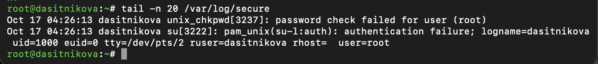{#fig-003 width=85%}

В файле `/var/log/secure` зафиксирована ошибка авторизации при вводе команды `su`: вспомогательная программа `unix_chkpwd` модуля `pam_unix` сообщила «password check failed for user (root)», а сам модуль --- об ошибке аутентификации `pam_unix(su-l:auth): authentication failure` с указанием инициатора (`logname=dasitnikova uid=1000`), терминала `/dev/pts/2` и целевого пользователя `root`. Эти сообщения имеют категорию `authpriv` и поэтому записаны в `/var/log/secure`, а не в общий журнал. Файл содержит только две строки, поскольку он тоже был создан заново при ротации в 04:26:11.

## Изменение правил rsyslog.conf

В первой вкладке терминала установлен Apache, после окончания установки веб-служба запущена и добавлена в автозапуск ([рис. @fig-004]).

~~~bash
dnf -y install httpd
systemctl start httpd
systemctl enable httpd
~~~

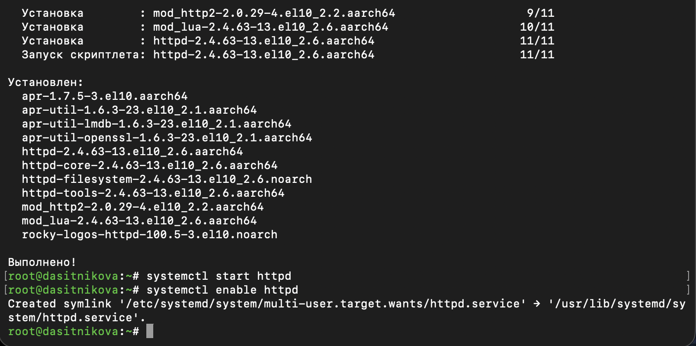{#fig-004 width=85%}

Установлен пакет `httpd` версии 2.4.63 вместе с зависимостями: библиотеками `apr` и `apr-util`, пакетами `httpd-core`, `httpd-filesystem`, `httpd-tools`, модулями `mod_http2` и `mod_lua` и оформлением `rocky-logos-httpd`. Команда `enable` создала ссылку на юнит `httpd.service` в каталоге `multi-user.target.wants`.

Во второй вкладке терминала просмотрен журнал сообщений об ошибках веб-службы ([рис. @fig-005]).

~~~bash
tail -f /var/log/httpd/error_log
~~~

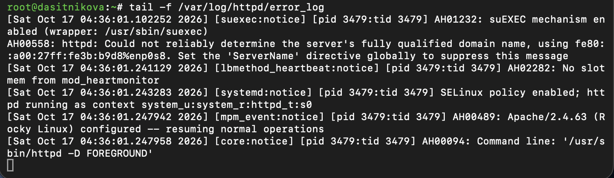{#fig-005 width=85%}

Каждая запись собственного журнала Apache содержит время с точностью до микросекунд, модуль и уровень сообщения в квадратных скобках, идентификаторы процесса и потока и код сообщения вида `AH00489`. При запуске в 04:36:01 записаны сообщения уровня `notice`: включён механизм suEXEC, служба работает в контексте SELinux `system_u:system_r:httpd_t:s0`, сервер Apache/2.4.63 настроен и начал работу, а также командная строка запуска. Строка `AH00558` без времени --- предупреждение об отсутствии директивы `ServerName`, выведенное до открытия журнала.

В третьей вкладке терминала получены полномочия администратора, и в конец файла конфигурации `/etc/httpd/conf/httpd.conf` добавлена строка `ErrorLog syslog:local1`. Затем в каталоге `/etc/rsyslog.d` создан файл мониторинга событий веб-службы `httpd.conf` ([рис. @fig-006]).

~~~bash
su -
echo "ErrorLog syslog:local1" >> /etc/httpd/conf/httpd.conf
tail -n 3 /etc/httpd/conf/httpd.conf
cd /etc/rsyslog.d
touch httpd.conf
~~~

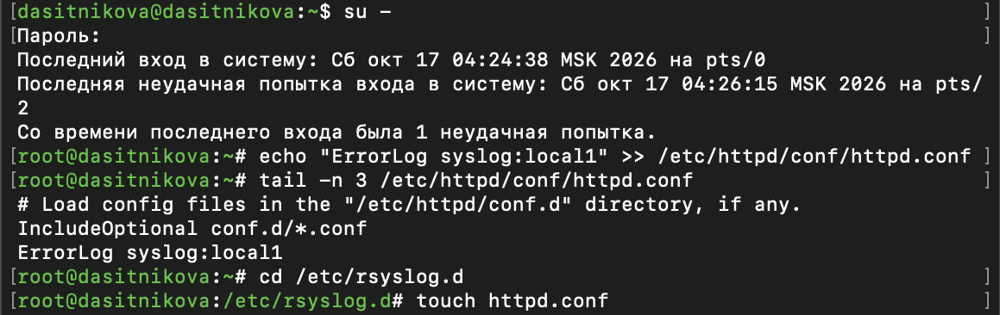{#fig-006 width=85%}

При входе `su` сообщила о последней неудачной попытке входа в 04:26:15 на `pts/2` --- это попытка с неправильным паролем, сведения о которой хранятся в файле `/var/log/btmp`. Последние строки конфигурации Apache: директива `IncludeOptional conf.d/*.conf` и добавленная директива `ErrorLog syslog:local1`. Она расположена после директивы `ErrorLog "logs/error_log"` из основной части файла и потому заменяет её.

В файл `/etc/rsyslog.d/httpd.conf` записано правило, отправляющее все сообщения объекта `local1` в файл `/var/log/httpd-error.log` ([рис. @fig-007]).

~~~bash
echo "local1.* -/var/log/httpd-error.log" > /etc/rsyslog.d/httpd.conf
cat /etc/rsyslog.d/httpd.conf
~~~

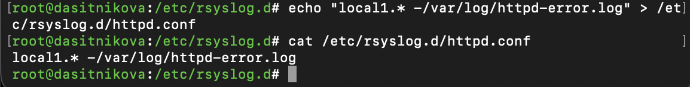{#fig-007 width=85%}

Полный текст файла `/etc/rsyslog.d/httpd.conf`:

~~~
local1.* -/var/log/httpd-error.log
~~~

Селектор `local1.*` выбирает сообщения категории `local1` с любым приоритетом.

В первой вкладке терминала перезагружены конфигурация rsyslogd и веб-служба. После перезапуска собственный журнал Apache больше не пополняется ([рис. @fig-008]).

~~~bash
systemctl restart rsyslog.service
systemctl restart httpd
~~~

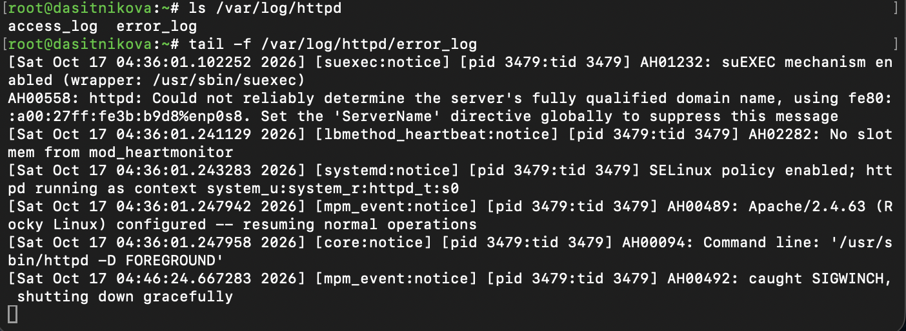{#fig-008 width=85%}

Последняя запись в `/var/log/httpd/error_log` --- `AH00492: caught SIGWINCH, shutting down gracefully` в 04:46:24: прежний процесс Apache получил сигнал корректного завершения при перезапуске и записал это в свой файл. Новый процесс открыл журнал ошибок через syslog, и в файл больше ничего не записывается.

Сообщения о запуске имеют уровень `notice` и при `LogLevel warn` в syslog не передаются, поэтому для проверки к веб-серверу отправлен запрос, вызывающий ошибку. Файл `/var/log/httpd-error.log` просмотрен в режиме реального времени командой `tail -F`, которая ожидает появления файла ([рис. @fig-009]).

~~~bash
tail -F /var/log/httpd-error.log
curl -s -o /dev/null http://localhost/
~~~

{#fig-009 width=85%}

До первого сообщения файла `/var/log/httpd-error.log` не существует: rsyslog создаёт файл при первой записи. После запроса к корню сайта `tail` сообщила о появлении файла, и в нём появилась запись `httpd[5369]: [autoindex:error] … AH01276: Cannot serve directory /var/www/html/: No matching DirectoryIndex (index.html) found`. В каталоге `/var/www/html` нет файла `index.html`, а автоматический список файлов запрещён, поэтому Apache записал ошибку и вернул клиенту страницу-заглушку. Запись имеет формат syslog: время, имя узла и метка программы `httpd[5369]`, за которыми следует текст сообщения Apache. Таким образом, сообщения об ошибках веб-службы записываются в файл `/var/log/httpd-error.log`.

В третьей вкладке терминала создан отдельный файл конфигурации для мониторинга отладочной информации ([рис. @fig-010]).

~~~bash
cd /etc/rsyslog.d
touch debug.conf
echo "*.debug /var/log/messages-debug" > /etc/rsyslog.d/debug.conf
cat /etc/rsyslog.d/debug.conf
~~~

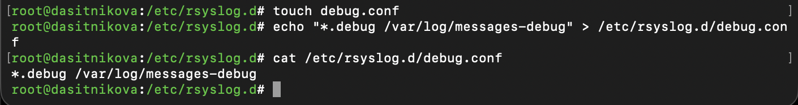{#fig-010 width=85%}

Полный текст файла `/etc/rsyslog.d/debug.conf`:

~~~
*.debug /var/log/messages-debug
~~~

Селектор `*.debug` выбирает сообщения всех категорий с приоритетом `debug` и более важными, то есть все сообщения без исключения.

В первой вкладке терминала снова перезапущен rsyslogd, во второй запущен мониторинг отладочной информации, а в третьей отправлено отладочное сообщение категории `daemon` ([рис. @fig-011]).

~~~bash
systemctl restart rsyslog.service
tail -f /var/log/messages-debug
logger -p daemon.debug "Daemon Debug Message"
~~~

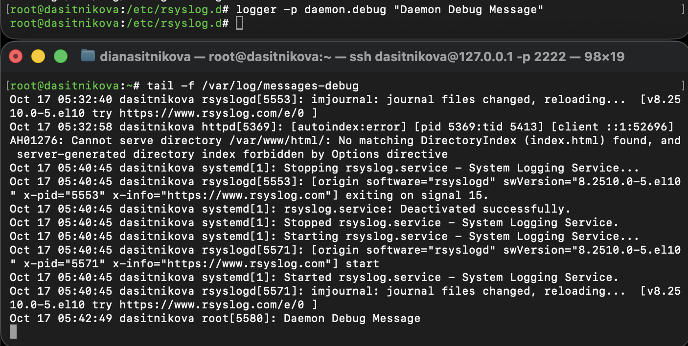{#fig-011 width=85%}

В терминале с мониторингом появилось сообщение отладки `root[5580]: Daemon Debug Message`: команда выполнена от имени суперпользователя, и `logger` подписал сообщение именем `root`. В том же файле записаны сообщения остановки и запуска rsyslog и ошибка Apache категории `local1`: правило `*.debug` собирает сообщения всех категорий. В файл `/var/log/messages` сообщение с приоритетом `debug` не попадает, поскольку его правило выбирает только приоритеты от `info` и выше.

## Использование journalctl

Во второй вкладке терминала просмотрено содержимое журнала с событиями с момента последнего запуска системы ([рис. @fig-012]).

~~~bash
journalctl
~~~

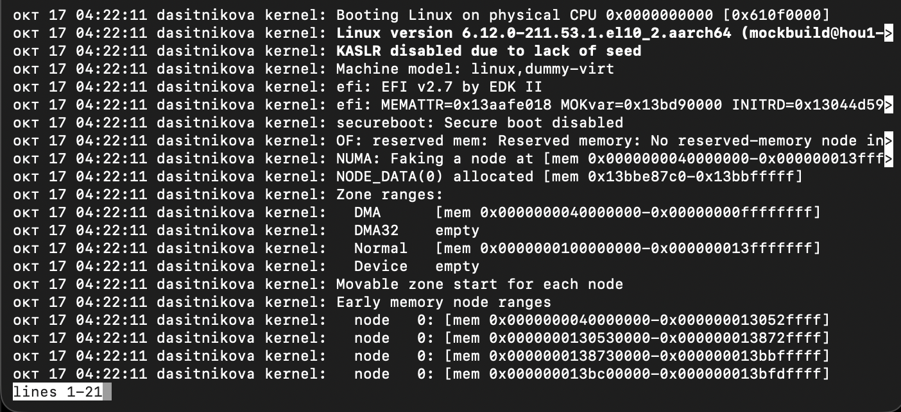{#fig-012 width=85%}

Журнал начинается с сообщений ядра при загрузке в 04:22:11: запуск на процессоре 0, версия ядра `6.12.0-211.53.1.el10_2.aarch64`, сведения о памяти. Строки выводятся программой постраничного просмотра `less`, строка состояния `lines 1-21` показывает номера видимых строк, а длинные строки обрезаны по ширине экрана (знак `>`). Записей более ранних загрузок в журнале нет: он хранится в оперативной памяти и при перезагрузке очищается.

Содержимое журнала просмотрено без использования пейджера ([рис. @fig-013]).

~~~bash
journalctl --no-pager
~~~

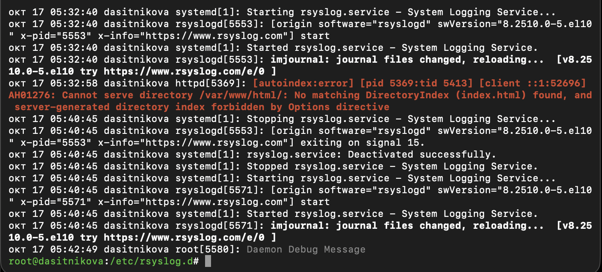{#fig-013 width=85%}

Весь журнал выведен на терминал сразу, длинные строки переносятся. В конце видны последние события: перезапуски rsyslog, ошибка Apache и отладочное сообщение. Программа `journalctl` выделяет записи цветом по приоритету: ошибка `AH01276` --- красным, отладочное сообщение --- серым, сообщения уровня `notice` --- полужирным.

Журнал просмотрен в режиме реального времени; для появления новой записи в третьей вкладке выполнена команда `logger` ([рис. @fig-014]).

~~~bash
journalctl -f
logger "journalctl -f test"
~~~

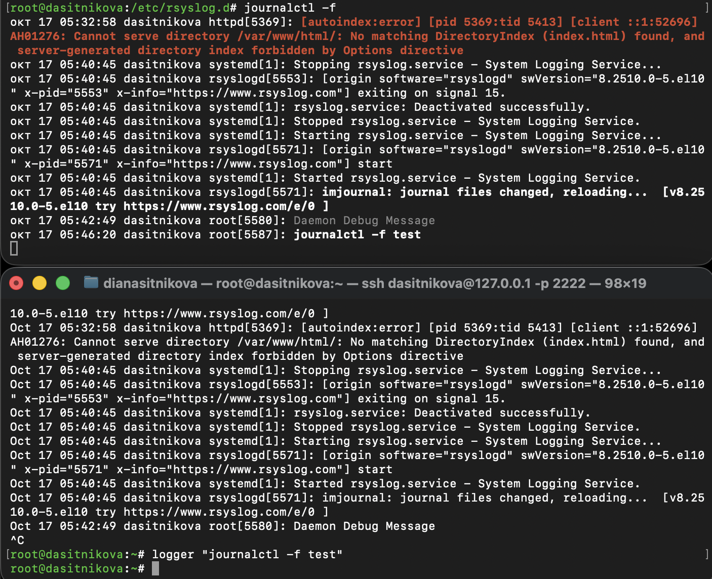{#fig-014 width=85%}

Команда `journalctl -f` вывела последние записи журнала и продолжила ожидать новых. Сообщение `root[5587]: journalctl -f test`, отправленное из третьей вкладки в 05:46:20, сразу появилось во второй. Просмотр прерван сочетанием Ctrl+C.

Для использования фильтрации просмотра конкретных параметров журнала введена команда `journalctl` и дважды нажата клавиша Tab ([рис. @fig-015]).

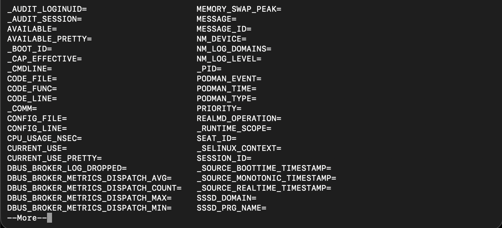{#fig-015 width=85%}

Автодополнение вывело имена полей, по которым можно фильтровать записи: `_BOOT_ID`, `_CMDLINE`, `_COMM`, `CODE_FILE`, `MESSAGE`, `_PID`, `PRIORITY`, `_SELINUX_CONTEXT`, `SESSION_ID` и др. Наряду со стандартными полями в списке есть поля, которые добавляют отдельные программы, например `NM_DEVICE` у NetworkManager и `PODMAN_EVENT` у Podman. Список длинный и выводится постранично (`--More--`).

Просмотрены события для UID 0 ([рис. @fig-016]).

~~~bash
journalctl _UID=0
~~~

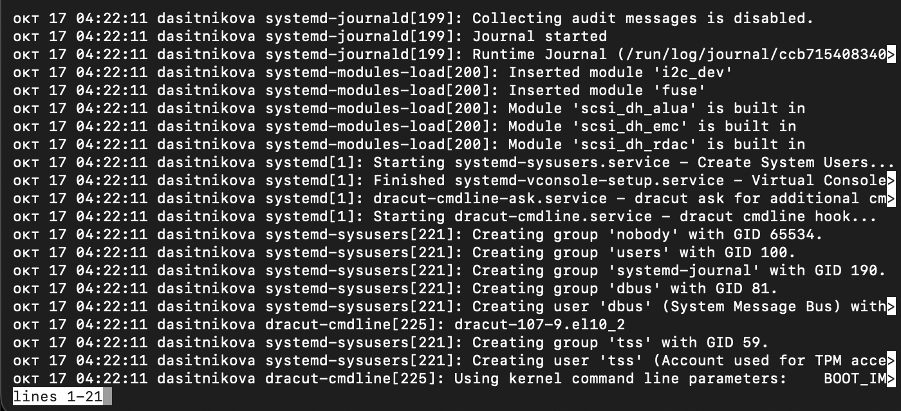{#fig-016 width=85%}

Фильтр `_UID=0` оставил только записи, отправленные процессами пользователя `root`: `systemd-journald`, `systemd-modules-load`, `systemd-sysusers` и др. Сообщения ядра в этот список не входят, поскольку у них нет процесса-отправителя. Служба `systemd-journald` при запуске сообщила, что ведёт временный журнал `Runtime Journal (/run/log/journal/…)`, а `systemd-sysusers` создала группу `systemd-journal` с GID 190.

Выведены последние 20 строк журнала ([рис. @fig-017]).

~~~bash
journalctl -n 20
~~~

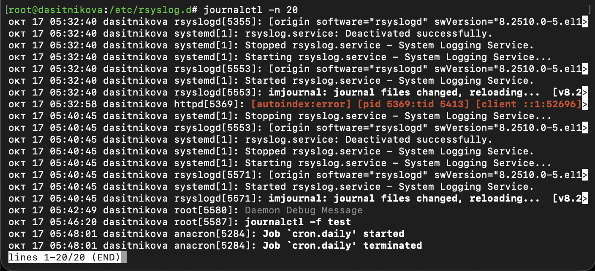{#fig-017 width=85%}

Выведено ровно 20 записей (`lines 1-20/20 (END)`) --- от перезапуска rsyslog в 05:32:40 до задания `cron.daily`, выполненного службой `anacron` в 05:48:01.

Просмотрены только сообщения об ошибках ([рис. @fig-018]).

~~~bash
journalctl -p err
~~~

{#fig-018 width=85%}

Ключ `-p err` выбирает сообщения с приоритетом `err` и более важными. Таких записей шесть: предупреждения ядра о неподдерживаемом драйвере сетевой карты `e1000` и о неполных данных режима диска `sda`, ошибки `gkr-pam` при входе в графическую среду и запуска одного из юнитов сеанса GNOME, а также ошибка Apache `AH01276`. Сообщения ядра с текстом «Warning» имеют приоритет не ниже `err`: приоритет задаёт сам отправитель, независимо от текста сообщения.

Просмотрены все сообщения со вчерашнего дня ([рис. @fig-019]) и сообщения с приоритетом ошибки, зафиксированные со вчерашнего дня ([рис. @fig-020]).

~~~bash
journalctl --since yesterday
journalctl --since yesterday -p err
~~~

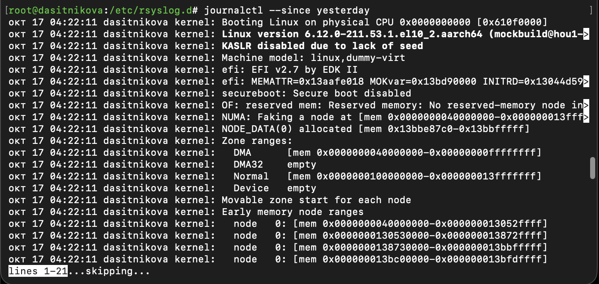{#fig-019 width=85%}

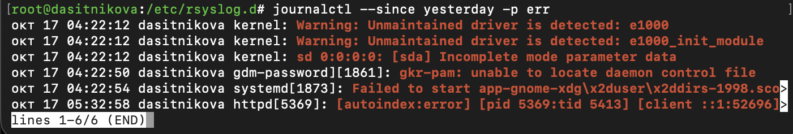{#fig-020 width=85%}

Журнал содержит только записи текущей загрузки, начавшейся сегодня в 04:22:11, поэтому вывод `--since yesterday` совпадает с полным журналом, а вывод `--since yesterday -p err` --- с выводом `-p err`: те же шесть записей.

Просмотрена детальная информация о записях журнала ([рис. @fig-021]).

~~~bash
journalctl -o verbose
~~~

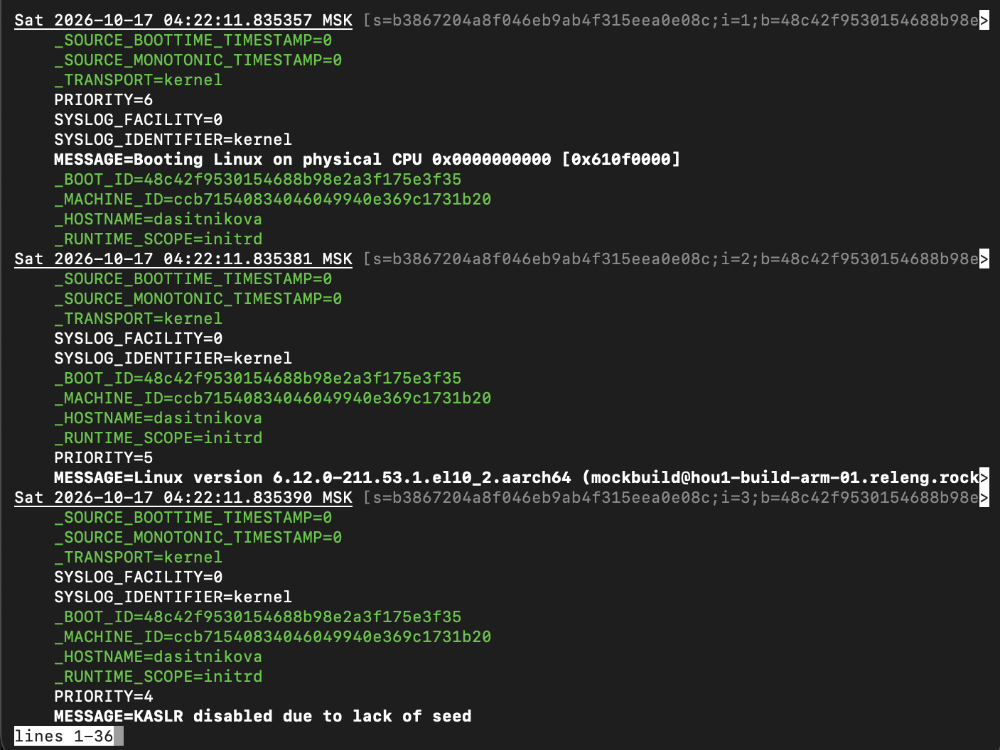{#fig-021 width=85%}

В подробном режиме каждая запись выводится со всеми полями. Заголовок записи содержит точное время и курсор --- уникальную позицию записи в журнале. У первой записи, сообщения ядра о запуске, указаны способ передачи `_TRANSPORT=kernel`, приоритет `PRIORITY=6` (`info`), категория `SYSLOG_FACILITY=0` (`kern`), идентификаторы загрузки `_BOOT_ID` и компьютера `_MACHINE_ID`, имя узла и область `_RUNTIME_SCOPE=initrd`: запись сделана ещё на этапе начальной загрузки. У следующих записей приоритеты 5 (`notice`) и 4 (`warning`).

Просмотрена дополнительная информация о модуле `sshd` ([рис. @fig-022]).

~~~bash
journalctl _SYSTEMD_UNIT=sshd.service
~~~

{#fig-022 width=85%}

Фильтр по полю `_SYSTEMD_UNIT` выбрал записи процессов юнита `sshd.service`. Служба начала принимать подключения на порту 22 по IPv4 и IPv6 в 04:22:28. Четыре процесса `sshd-session` приняли пароль пользователя `dasitnikova` с адреса `10.0.2.2` --- адреса хоста в сети NAT виртуальной машины --- и открыли сеансы. Это подключения окон терминала, в которых выполнялась работа.

## Постоянный журнал journald

Запущен терминал, получены полномочия администратора, и проверено текущее хранение журнала. Затем создан каталог для хранения записей журнала и скорректированы права доступа к нему, чтобы journald смог записывать в него информацию. Для принятия изменений использована команда `killall -USR1 systemd-journald`, после чего выведены сообщения журнала с момента последней загрузки ([рис. @fig-023]).

~~~bash
ls -ld /var/log/journal /run/log/journal
journalctl --list-boots
mkdir -p /var/log/journal
chown root:systemd-journal /var/log/journal
chmod 2755 /var/log/journal
ls -ld /var/log/journal
killall -USR1 systemd-journald
ls -l /var/log/journal
journalctl -b
~~~

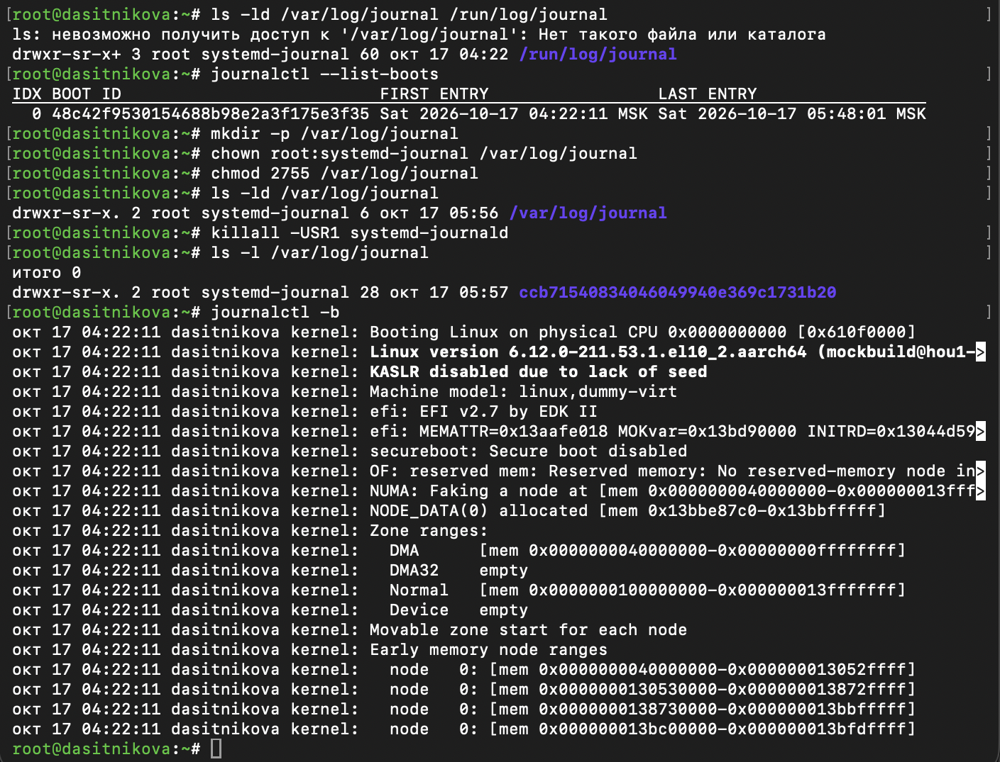{#fig-023 width=85%}

Каталога `/var/log/journal` до начала настройки нет, журнал хранится в `/run/log/journal`, и в нём сохранена одна загрузка. После `chown` и `chmod` каталог принадлежит пользователю `root` и группе `systemd-journal` и имеет права `drwxr-sr-x`, где `s` --- бит SGID. После сигнала SIGUSR1 в каталоге появился подкаталог `ccb71540834046049940e369c1731b20`: это идентификатор компьютера, тот же, что в поле `_MACHINE_ID` записей журнала ([рис. @fig-021]). В нём journald хранит файлы постоянного журнала. Команда `journalctl -b` выводит записи текущей загрузки начиная с 04:22:11: записи из оперативной памяти перенесены на диск.

Для проверки система перезагружена, и выведен список загрузок, сохранённых в журнале ([рис. @fig-024]).

~~~bash
reboot
su -
journalctl --list-boots
~~~

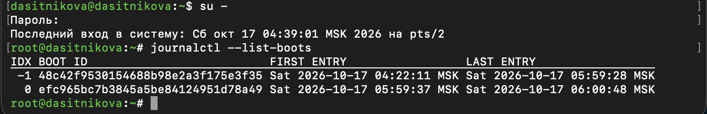{#fig-024 width=85%}

В журнале сохранены две загрузки: предыдущая (индекс `-1`) с записями с 04:22:11 до 05:59:28 и текущая (индекс `0`) с 05:59:37. Записи предыдущей загрузки пережили перезагрузку, следовательно, журнал journald теперь постоянный.

# Выводы

В ходе лабораторной работы получены навыки работы с журналами событий Rocky Linux 10.2. Выполнен мониторинг журнала `/var/log/messages` в реальном времени, на примере неудачной попытки входа показано распределение сообщений между общим журналом и журналом безопасности `/var/log/secure`. Изучен механизм ротации журналов.

Настроена регистрация сообщений об ошибках веб-службы Apache через syslog в отдельном файле с помощью объекта `local1` и собственного правила rsyslog, а также запись всех отладочных сообщений в отдельный журнал. Изучены возможности `journalctl`: просмотр в реальном времени, фильтрация по приоритету, времени и полям записей. Журнал journald сделан постоянным, что подтверждено сохранением записей предыдущей загрузки после перезагрузки системы.

# Контрольные вопросы

1. **Какой файл используется для настройки rsyslogd?**

   `/etc/rsyslog.conf`. Он подключает дополнительные файлы `/etc/rsyslog.d/*.conf`, как те, что созданы для `httpd` и `debug` ([рис. @fig-025]).

   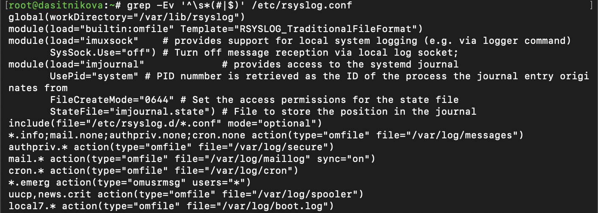{#fig-025 width=85%}

   ~~~bash
   grep -Ev '^\s*(#|$)' /etc/rsyslog.conf
   ~~~

2. **В каком файле журнала rsyslogd содержатся сообщения, связанные с аутентификацией?**

   `/var/log/secure`, по правилу `authpriv.* /var/log/secure`. В `/var/log/messages` они не попадают из-за `authpriv.none` ([рис. @fig-003], [рис. @fig-025]).

3. **Если вы ничего не настроите, то сколько времени потребуется для ротации файлов журналов?**

   Неделя: в `/etc/logrotate.conf` задано `weekly`, хранятся 4 старые копии (`rotate 4`). Файлы rsyslog перечислены в `/etc/logrotate.d/rsyslog` и наследуют эти параметры ([рис. @fig-026]). Сам `logrotate` запускается раз в сутки таймером `logrotate.timer`, но файл ротирует только раз в неделю. Ротация журналов, выполненная после недельного перерыва в работе системы, видна на [рис. @fig-002].

   {#fig-026 width=85%}

   ~~~bash
   grep -Ev '^\s*(#|$)' /etc/logrotate.conf
   cat /etc/logrotate.d/rsyslog
   ~~~

4. **Какую строку следует добавить в конфигурацию для записи всех сообщений с приоритетом info в файл /var/log/messages.info?**

   ~~~
   *.info /var/log/messages.info
   ~~~

   Строку добавить, например, в `/etc/rsyslog.d/info.conf` и выполнить `systemctl restart rsyslog`. Селектор `*.info` означает info и выше; строго только info --- `*.=info`.

5. **Какая команда позволяет вам видеть сообщения журнала в режиме реального времени?**

   `journalctl -f` ([рис. @fig-014]). Для файла rsyslog --- `tail -f /var/log/messages` ([рис. @fig-002]).

6. **Какая команда позволяет вам видеть все сообщения журнала, которые были написаны для PID 1 между 9:00 и 15:00?**

   ~~~bash
   journalctl _PID=1 --since "09:00:00" --until "15:00:00"
   ~~~

   Это за сегодня. За конкретную дату: `--since "2026-10-17 09:00:00" --until "2026-10-17 15:00:00"`. На [рис. @fig-027] выполнен такой же запрос для интервала 00:00--05:00, в который работала система: выведены сообщения systemd о запуске юнитов при загрузке.

   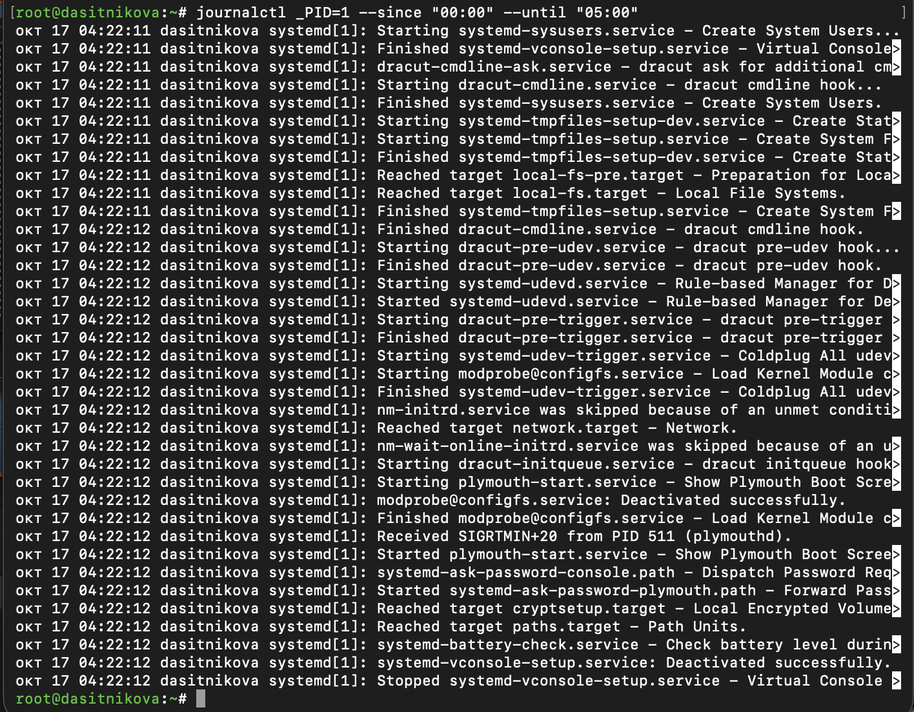{#fig-027 width=85%}

7. **Какая команда позволяет вам видеть сообщения journald после последней перезагрузки системы?**

   `journalctl -b` ([рис. @fig-023]). Предыдущая загрузка --- `journalctl -b -1` (если журнал постоянный).

8. **Какая процедура позволяет сделать журнал journald постоянным?**

   Создать `/var/log/journal`, отдать его группе `systemd-journal` с правами `2755` и перезагрузиться или выполнить `killall -USR1 systemd-journald` (то же самое делает `journalctl --flush`) ([рис. @fig-023], [рис. @fig-024]). Другой способ: в `/etc/systemd/journald.conf` задать `Storage=persistent` и выполнить `systemctl restart systemd-journald`.

   ~~~bash
   mkdir -p /var/log/journal
   chown root:systemd-journal /var/log/journal
   chmod 2755 /var/log/journal
   killall -USR1 systemd-journald
   ~~~

# Список литературы{.unnumbered}

::: {#refs}
:::
