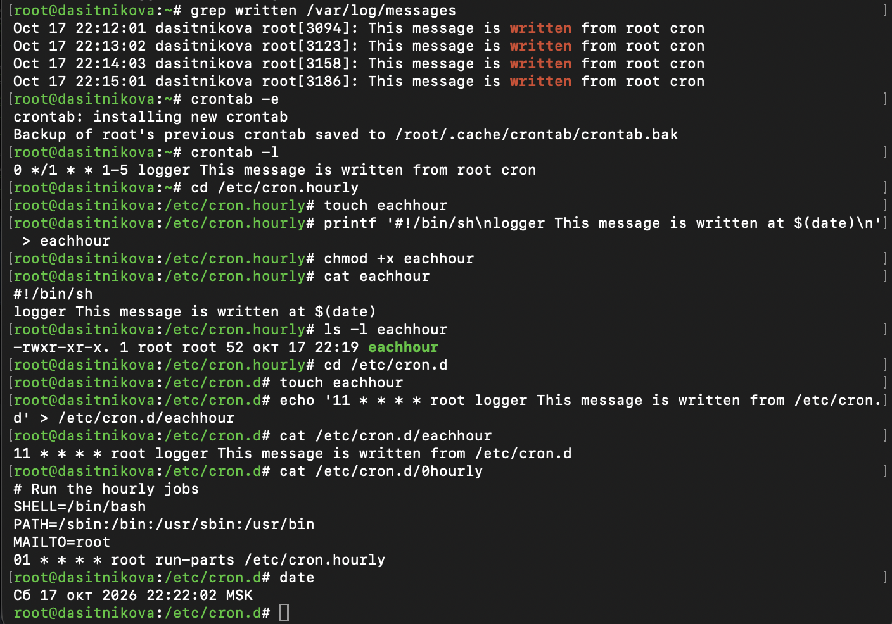

---
## Author
author:
  name: Ситникова Диана Александровна
  degrees: BSc
  email: 1032201746@rudn.ru
  affiliation:
    - name: Российский университет дружбы народов
      country: Российская Федерация
      postal-code: 117198
      city: Москва
      address: ул. Миклухо-Маклая, д. 6
## Title
title: "Лабораторная работа № 8"
subtitle: "Планировщики событий"
institute:
  - "Российский университет дружбы народов им. П. Лумумбы"
  - "Преподаватель: д.ф.-м.н., профессор Кулябов Дмитрий Сергеевич"
license: CC BY
date: today
date-format: "YYYY-MM-DD"
---

# Информация

## Докладчик

:::::::::::::: {.columns align=center}
::: {.column width="68%"}

- Ситникова Диана Александровна
- направление 09.03.03 «Прикладная информатика»
- Российский университет дружбы народов
- [1032201746@rudn.ru](mailto:1032201746@rudn.ru)

:::
::: {.column width="32%"}

{width=100%}

:::
::::::::::::::

# Вводная часть

## Актуальность

- Резервное копирование, ротация журналов, очистка временных файлов повторяются по расписанию.
- Выполнять их вручную долго и ненадёжно: администратор может забыть или не успеть.
- Планировщики запускают команды сами --- регулярно или один раз в нужный момент.

## Объект, предмет, цель и задачи

**Объект** --- задания по расписанию в Rocky Linux 10.2.

**Предмет** --- планировщики событий cron и at.

**Цель** --- получение навыков работы с планировщиками событий cron и at.

**Задачи:** выполнить задания по планированию задач с помощью crond и с помощью atd.

## Материалы и методы

| Компонент | Значение |
|---|---|
| Стенд | Rocky Linux 10.2, cronie 1.7.0 |
| Регулярные задания | `crontab -e`, `/etc/cron.d`, `/etc/cron.hourly` |
| Однократные задания | `at`, `atq` |
| Проверка | `logger`, `/var/log/messages`, `/var/log/cron` |

# Содержание исследования

## cron --- по расписанию, at --- один раз

```{mermaid}
%%| fig-width: 4.6
%%| fig-height: 2.4
flowchart LR
  A["crontab -e"] --> C(("crond"))
  B["/etc/cron.d"] --> C
  C --> R["регулярно"]
  D["at 22:27"] --> E(("atd"))
  E --> F["один раз"]
```

## Строка crontab: пять полей времени и команда

| минута | час | день | месяц | день недели | когда выполняется |
|:---:|:---:|:---:|:---:|:---:|---|
| `*/1` | `*` | `*` | `*` | `*` | каждую минуту |
| `0` | `*/1` | `*` | `*` | `1-5` | в начале часа по будням |
| `11` | `*` | `*` | `*` | `*` | в 11 минут каждого часа |
| `01` | `*` | `*` | `*` | `*` | `/etc/cron.hourly` в 1 минуту часа |

## Задание каждую минуту --- запись каждую минуту

:::::::::::::: {.columns align=center}
::: {.column width="35%"}

`*/1 * * * *` → сообщение в 22:12, 22:13, 22:14, 22:15.

Затем запись заменена на `0 */1 * * 1-5`.

Созданы ежечасные задания в `cron.hourly` и `cron.d`.

:::
::: {.column width="65%"}

{width=100%}

:::
::::::::::::::

## Ежечасные задания сработали по расписанию

:::::::::::::: {.columns align=center}
::: {.column width="35%"}

`eachhour` из `cron.hourly`: 23:01, 00:01, 01:01.

`/etc/cron.d/eachhour`: 23:11, 00:11.

Будничная запись не сработала: суббота и воскресенье.

:::
::: {.column width="65%"}

{height=78%}

:::
::::::::::::::

## at выполнил задание ровно в 22:27

:::::::::::::: {.columns align=center}
::: {.column width="35%"}

`at 22:27` → задание 1 в очереди `a`.

В 22:27:00 в журнале `message from at`.

После выполнения `atq` пуст.

:::
::: {.column width="65%"}

{width=100%}

:::
::::::::::::::

## Кому можно пользоваться cron

:::::::::::::: {.columns align=center}
::: {.column width="35%"}

`crontab -u alice -e` --- расписание для другого пользователя.

`bob` в `/etc/cron.deny` --- cron ему запрещён.

:::
::: {.column width="65%"}

{width=80%}

{width=95%}

:::
::::::::::::::

# Результаты

## Задания выполнены по расписанию

- Расписание root выполнялось каждую минуту, затем заменено будничным.
- Ежечасные задания из `cron.hourly` и `cron.d` срабатывали каждый час.
- Задание at выполнено один раз точно в назначенное время.
- Назначено расписание для alice, cron запрещён для bob.

## Вывод

cron подходит для регулярных задач, at --- для однократных.

Журнал показывает, что каждое задание выполнено точно в назначенную минуту.
