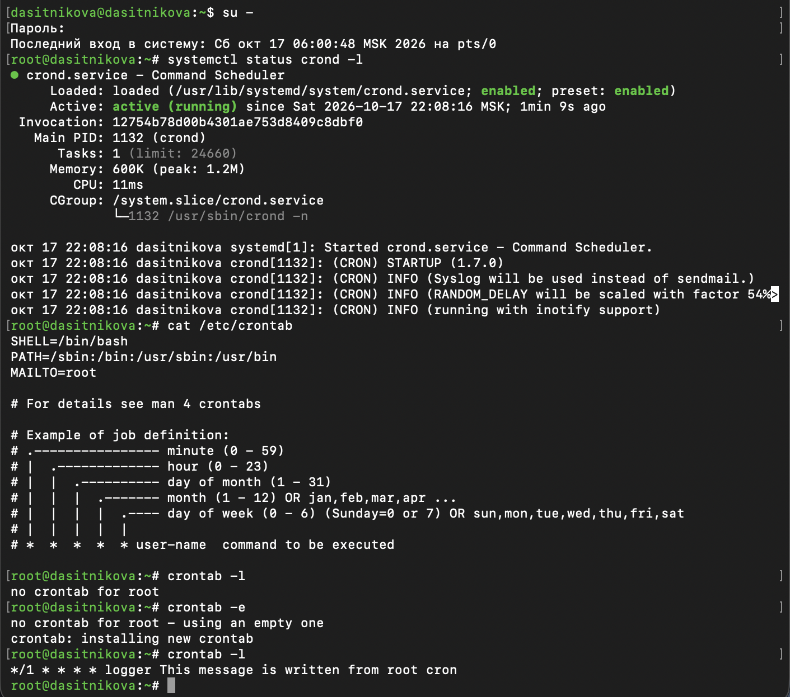
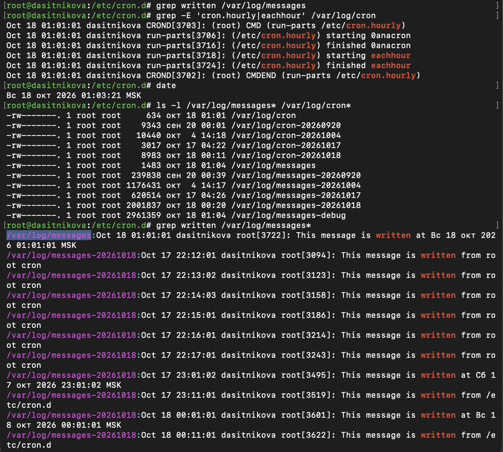
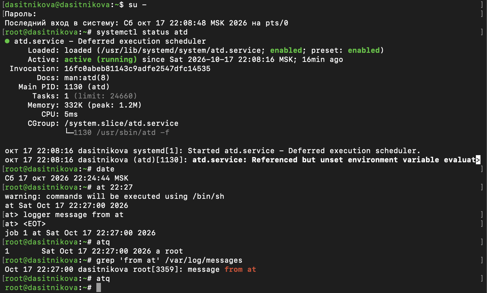
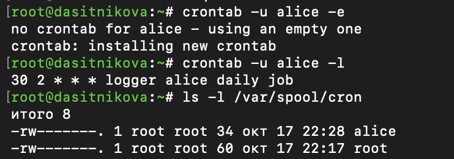
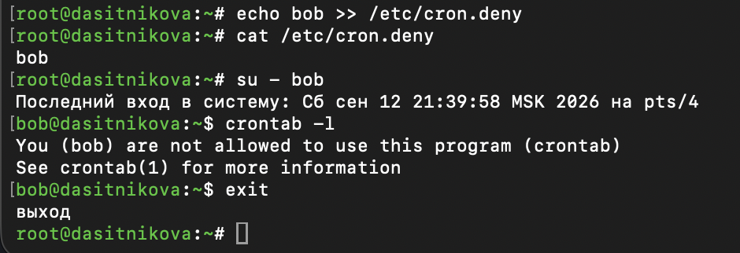

---
## Author
author:
  name: Ситникова Диана Александровна
  degrees: BSc
  email: 1032201746@rudn.ru
  affiliation:
    - name: Российский университет дружбы народов
      country: Российская Федерация
      postal-code: 117198
      city: Москва
      address: ул. Миклухо-Маклая, д. 6

## Title
title: "Отчёт по лабораторной работе №8"
subtitle: "Планировщики событий"
license: "CC BY"
bibliography: bib/cite.bib
---

# Цель работы

Целью данной работы является получение навыков работы с планировщиками событий cron и at.

# Задание

- Выполнить задания по планированию задач с помощью crond.
- Выполнить задания по планированию задач с помощью atd.

# Теоретическое введение

## Планировщики задач в Unix

Многие задачи администрирования повторяются по расписанию --- резервное копирование, ротация журналов, обновление баз данных, очистка временных файлов --- или должны быть выполнены один раз, но в определённый момент, например ночью, когда система не загружена. Для их автоматизации в Unix существуют планировщики --- службы, которые сами запускают команды в назначенное время [@nemeth_book_unix-linux-admin_ru; @loukides_book_unix-power-tools_en].

Служба cron, название которой происходит от греческого χρόνος (время), появилась в Version 7 Unix в 1979 году. Первая версия была предельно простой: раз в минуту она читала единственный файл расписания `/usr/lib/crontab` и запускала команды, время которых наступило. В Unix System V cron получил расписания для каждого пользователя и программу `crontab` для их редактирования. В 1987 году Пол Викси написал свою реализацию, Vixie cron, которая стала основой для cron в Linux и BSD [@robachevsky_book_unix_ru]. В Fedora, Red Hat Enterprise Linux и Rocky Linux используется cronie --- развитие Vixie cron, которое поддерживает Red Hat и в которое входит также anacron [@cronie_man]. В Rocky Linux 10 установлена версия cronie 1.7.0.

Программа `at` для однократного запуска команд также появилась в Version 7 Unix; используемая в Linux реализация с демоном `atd` написана Томасом Кёнигом [@at_man]. В системах с systemd задачи по расписанию можно выполнять и таймерами systemd --- юнитами типа `.timer` [@systemd_timer_man]. Сравнение планировщиков приведено в [табл. @tbl-schedulers].

| Планировщик | Задачи | Если система была выключена | Где задаются задания |
|---------------|-------------------|------------------------------|---------------------------|
| cron | регулярные, с точностью до минуты | запуск пропускается | `crontab -e`, `/etc/crontab`, `/etc/cron.d` |
| anacron | регулярные, раз в N дней | выполняется после загрузки | `/etc/anacrontab` |
| at | однократные | выполняется после загрузки, если время прошло | команда `at` |
| таймеры systemd | регулярные и однократные | выполняется при `Persistent=true` | юниты `.timer` |

: Планировщики задач в Linux {#tbl-schedulers}

## Формат расписания cron

Расписание cron (crontab) --- текстовый файл, каждая строка которого описывает одно задание: пять полей времени и команду. Поля разделяются пробелами или табуляцией; строки, начинающиеся с `#`, считаются комментариями [@cronie_man]. Поля времени приведены в [табл. @tbl-fields].

| Поле | Допустимые значения |
|----------------|------------------------------------------------------|
| минута | 0--59 |
| час | 0--23 |
| день месяца | 1--31 |
| месяц | 1--12 или `jan`--`dec` |
| день недели | 0--7 (0 и 7 --- воскресенье) или `sun`--`sat` |

: Поля времени в расписании cron {#tbl-fields}

В каждом поле можно указать одно значение, список через запятую (`1,15`), диапазон через дефис (`1-5`), звёздочку `*` --- любое значение --- или шаг через косую черту: `*/2` означает каждое второе значение из всего диапазона, `0-30/10` --- значения 0, 10, 20, 30. Вместо пяти полей можно использовать специальные строки `@reboot` (при запуске crond), `@hourly`, `@daily`, `@weekly`, `@monthly` и `@yearly`.

Задание выполняется в ту минуту, которая удовлетворяет всем полям. Исключение составляют дни: если ограничены и день месяца, и день недели, задание выполняется, когда выполнено **любое** из этих условий. Например, `0 0 1 * 1` срабатывает и первого числа каждого месяца, и каждый понедельник.

Команда выполняется оболочкой `/bin/sh` с минимальным окружением: переменные `HOME`, `LOGNAME` и `SHELL` берутся из учётной записи, а `PATH` содержит только основные каталоги. Поэтому в заданиях лучше указывать полные пути к программам. В начале файла расписания можно задать переменные окружения, например `SHELL`, `PATH` и `MAILTO` --- адрес, на который отправляется вывод заданий. Знак `%` в команде имеет особый смысл --- перевод строки --- и должен экранироваться: `\%`.

## Где хранятся расписания

Демон `crond` при запуске читает все расписания и затем раз в минуту проверяет, какие задания нужно запустить. Изменения файлов расписаний он отслеживает через механизм ядра inotify и учитывает их без перезапуска. Расписания делятся на пользовательские и системные ([табл. @tbl-crontabs]).

| Расписание | Формат строки | Как изменяется |
|------------------------------|--------------------------------|------------------------------|
| `/var/spool/cron/‹пользователь›` | время, команда | `crontab -e`, `crontab -u ‹пользователь› -e` |
| `/etc/crontab` | время, пользователь, команда | редактирование файла |
| `/etc/cron.d/*` | время, пользователь, команда | файлы пакетов и администратора |
| `/etc/cron.hourly` | исполняемые сценарии | раз в час через `run-parts` |
| `/etc/cron.daily`, `weekly`, `monthly` | исполняемые сценарии | через anacron |

: Расписания cron в Rocky Linux 10 {#tbl-crontabs}

Пользовательское расписание выполняется от имени владельца, поэтому поля пользователя в нём нет. Файлы в `/var/spool/cron` принадлежат пользователю `root` и недоступны остальным; редактировать их можно только программой `crontab`, которая проверяет синтаксис перед установкой. Ключ `-l` выводит расписание, `-e` открывает его в редакторе из переменной `VISUAL` или `EDITOR` (по умолчанию `vi`), `-r` удаляет его, а `-u` позволяет администратору работать с расписанием другого пользователя. В системных расписаниях после полей времени указывается пользователь, от имени которого выполняется команда.

Доступ к `crontab` регулируют файлы `/etc/cron.allow` и `/etc/cron.deny`. Если существует `cron.allow`, программой могут пользоваться только перечисленные в нём пользователи. Иначе запрещено тем, кто указан в `cron.deny`. В Rocky Linux по умолчанию есть только пустой файл `/etc/cron.deny`, поэтому `crontab` доступен всем пользователям.

## Ежечасные сценарии, run-parts и anacron

Сценарии в каталогах `/etc/cron.hourly`, `/etc/cron.daily`, `/etc/cron.weekly` и `/etc/cron.monthly` не содержат времени запуска: его определяет то, как вызывается каталог. Программа `run-parts` выполняет по очереди в алфавитном порядке все **исполняемые** файлы каталога, пропуская остальные, и записывает в журнал `/var/log/cron` начало и конец работы каждого сценария.

Каталог `/etc/cron.hourly` запускает cron по строке `01 * * * * root run-parts /etc/cron.hourly` из файла `/etc/cron.d/0hourly`, то есть в первую минуту каждого часа. Среди ежечасных сценариев есть `0anacron`, который запускает anacron.

Anacron (от англ. anachronistic --- «несвоевременный») создан в 1998 году для компьютеров, которые не работают круглосуточно. Он выполняет задания не в определённое время, а раз в заданное число дней, и хранит дату последнего запуска каждого задания в каталоге `/var/spool/anacron`. Если система была выключена, когда задание должно было выполниться, anacron выполнит его после загрузки. Задания описаны в файле `/etc/anacrontab` строками из четырёх полей: период в днях, задержка в минутах, идентификатор и команда. В Rocky Linux так запускаются каталоги `cron.daily` (раз в день), `cron.weekly` (раз в 7 дней) и `cron.monthly` (раз в месяц), причём только с 3 до 22 часов (`START_HOURS_RANGE=3-22`) и со случайной задержкой до 45 минут (`RANDOM_DELAY=45`), чтобы задания разных компьютеров не начинались одновременно. Общая схема работы планировщиков показана на [рис. @fig-scheme].

```{mermaid}
%%| label: fig-scheme
%%| fig-cap: "Планировщики cron и at"
%%| fig-width: 5
flowchart LR
  A["crontab -e"] --> C(("crond"))
  B["/etc/cron.d"] --> C
  C --> R["регулярно"]
  D["at 22:27"] --> E(("atd"))
  E --> F["один раз"]
```

## Однократные задания: at

Команда `at время` читает со стандартного ввода команды до признака конца файла (Ctrl+D) и сохраняет их как задание в каталоге `/var/spool/at` [@at_man]. Вместе с командами сохраняются текущий каталог, маска прав и переменные окружения, поэтому задание выполняется в той же обстановке, в которой создано. В назначенное время демон `atd` выполняет задание оболочкой `/bin/sh` от имени создавшего его пользователя и удаляет его.

Время задаётся в разных формах: `14:30`, `2:30pm`, `noon`, `midnight`, `teatime` (16:00), с датой (`14:30 2026-10-20`, `tomorrow`) или относительно текущего момента: `now + 10 minutes`, `now + 2 days`. Если указанное время сегодня уже прошло, задание назначается на завтра.

Задания распределяются по очередям, обозначенным буквами: `at` использует очередь `a`, а команда `batch` --- очередь `b`. Задания `batch` выполняются не в определённое время, а когда средняя загрузка системы опустится ниже порога. Команды управления заданиями приведены в [табл. @tbl-at].

| Команда | Действие |
|-------------------|------------------------------------------------------|
| `at время` | создать задание |
| `batch` | создать задание, которое выполнится при низкой загрузке |
| `atq` (`at -l`) | вывести запланированные задания: номер, время, очередь, пользователь |
| `at -c номер` | вывести полный текст задания |
| `atrm номер` (`at -r`) | удалить задание |

: Управление заданиями at {#tbl-at}

Доступ к `at` регулируют файлы `/etc/at.allow` и `/etc/at.deny` по тем же правилам, что и для cron.

## Журналирование и вывод заданий

Cron записывает сведения о запуске заданий в журнал с категорией `cron`, которая в Rocky Linux направляется в файл `/var/log/cron`. Сами задания в данной работе записывают сообщения командой `logger` в системный журнал, откуда они попадают в `/var/log/messages`.

Всё, что задание выводит в стандартные потоки вывода и ошибок, cron по умолчанию отправляет письмом владельцу расписания или на адрес из `MAILTO`. Если в системе не установлен почтовый сервер, cronie записывает вывод заданий в системный журнал.

# Выполнение лабораторной работы

Работа выполнена в виртуальной машине с Rocky Linux 10.2 в терминале, подключённом к гостевой системе по SSH; полномочия администратора получены командой `su -`.

## Планирование задач с помощью cron

Запущен терминал и получены полномочия администратора. Просмотрены статус демона `crond`, содержимое файла конфигурации `/etc/crontab` и список заданий в расписании. Затем файл расписания открыт на редактирование, в него добавлена строка, записывающая сообщение в системный журнал, и список заданий просмотрен повторно ([рис. @fig-001]).

~~~bash
su -
systemctl status crond -l
cat /etc/crontab
crontab -l
crontab -e
crontab -l
~~~

{#fig-001 width=85%}

Демон `crond` работает (`active (running)`) и включён в автозапуск. Он запущен вместе с системой в 22:08:16, и в журнале записаны сообщения о его запуске: версия cronie 1.7.0, вывод заданий будет записываться в системный журнал вместо отправки почты (`Syslog will be used instead of sendmail`), изменения расписаний отслеживаются через inotify.

Файл `/etc/crontab` задаёт переменные окружения для системных заданий --- оболочку `/bin/bash`, путь поиска программ и получателя вывода `MAILTO=root` --- и содержит закомментированную подсказку по формату строки. Заданий в нём нет: системные задания Rocky Linux размещаются в каталоге `/etc/cron.d`.

Расписания у пользователя `root` сначала не было (`no crontab for root`). Команда `crontab -e` открыла пустой файл в редакторе vi, после сохранения установила расписание (`installing new crontab`), и в списке появилась запись:

~~~
*/1 * * * * logger This message is written from root cron
~~~

В поле минут указан шаг `*/1` --- каждая минута из диапазона 0--59, а в остальных полях --- `*`, любое значение. Следовательно, задание выполняется каждую минуту каждого часа каждого дня. Команда `logger` записывает текст в системный журнал. Поля пользователя в записи нет: пользовательское расписание выполняется от имени его владельца.

Через несколько минут просмотрен журнал системных событий. Затем запись в расписании изменена, просмотрен список заданий, в каталоге `/etc/cron.hourly` создан исполняемый сценарий `eachhour`, а в каталоге `/etc/cron.d` --- файл расписания `eachhour` ([рис. @fig-002]).

~~~bash
grep written /var/log/messages
crontab -e
crontab -l
cd /etc/cron.hourly
touch eachhour
printf '#!/bin/sh\nlogger This message is written at $(date)\n' > eachhour
chmod +x eachhour
cat eachhour
ls -l eachhour
cd /etc/cron.d
touch eachhour
echo '11 * * * * root logger This message is written from /etc/cron.d' > /etc/cron.d/eachhour
cat /etc/cron.d/eachhour
cat /etc/cron.d/0hourly
date
~~~

{#fig-002 width=85%}

В журнале `/var/log/messages` записи `root[…]: This message is written from root cron` появляются каждую минуту --- в 22:12, 22:13, 22:14 и 22:15, --- каждая от нового процесса с новым PID. Сообщения подписаны именем `root`, поскольку команда выполнена от имени владельца расписания. Секунды в метках времени (:01--:03) показывают, что cron запускает задания в начале минуты.

Запись в расписании заменена на следующую:

~~~
0 */1 * * 1-5 logger This message is written from root cron
~~~

Здесь `0` в поле минут означает начало часа, `*/1` в поле часов --- каждый час, `*` в полях дня месяца и месяца --- любой день и месяц, а диапазон `1-5` в поле дня недели --- дни с понедельника по пятницу. Следовательно, задание выполняется в начале каждого часа по будням. При установке нового расписания cronie сохранил предыдущее в файле `/root/.cache/crontab/crontab.bak`.

Полный текст сценария `/etc/cron.hourly/eachhour`:

~~~bash
#!/bin/sh
logger This message is written at $(date)
~~~

Первая строка указывает интерпретатор сценария. Подстановка `$(date)` записана в файл как есть и вычисляется при каждом запуске, поэтому каждое сообщение содержит время запуска. Сценарий сделан исполняемым (`-rwxr-xr-x`): `run-parts` выполняет только исполняемые файлы.

Полный текст расписания `/etc/cron.d/eachhour`:

~~~
11 * * * * root logger This message is written from /etc/cron.d
~~~

Это строка системного расписания: в 11 минут каждого часа каждого дня выполняется команда `logger` от имени пользователя `root`, указанного после полей времени. Файл `/etc/cron.d/0hourly` содержит строку `01 * * * * root run-parts /etc/cron.hourly`, поэтому сценарий `eachhour` из каталога `/etc/cron.hourly` должен запускаться в первую минуту каждого часа. Ежечасные задания созданы в 22:22.

Спустя три часа просмотрены журнал системных событий и журнал cron ([рис. @fig-003]).

~~~bash
grep written /var/log/messages
grep -E 'cron.hourly|eachhour' /var/log/cron
date
ls -l /var/log/messages* /var/log/cron*
grep written /var/log/messages*
~~~

{#fig-003 width=85%}

В журнале cron в 01:01:01 записан запуск каталога `/etc/cron.hourly`: процесс `CROND` выполнил `run-parts`, который по очереди запустил и завершил сценарии `0anacron` и `eachhour`.

Поиск в текущем файле `/var/log/messages` результатов не дал: в ночь на воскресенье выполнена еженедельная ротация журналов, и записи за прошедшие часы находятся в файлах `messages-20261018` и `cron-20261018`. Поиск по всем файлам журнала показывает всю историю заданий:

- с 22:12 до 22:17 --- сообщения `written from root cron` каждую минуту; в 22:17 расписание `*/1` было заменено, и запуски прекратились;
- в 23:01:02, 00:01:01 и 01:01:01 --- сообщения сценария `eachhour` из `/etc/cron.hourly`, каждое со своим временем: `This message is written at Сб 17 окт 2026 23:01:02 MSK` и т. д.;
- в 23:11:01 и 00:11:01 --- сообщения `written from /etc/cron.d`.

Таким образом, сценарий `eachhour` запускался в соответствии с расписанием --- в первую минуту каждого часа, --- а задание из `/etc/cron.d` --- в 11 минут каждого часа. Задание `0 */1 * * 1-5` не выполнялось ни разу: работа проводилась в субботу и воскресенье, которые не входят в диапазон дней недели 1--5.

## Планирование заданий с помощью at

Получены полномочия администратора и проверено, что служба `atd` загружена и включена. Задано выполнение команды `logger message from at` через две минуты после текущего времени, проверено, что задание запланировано, и после наступления назначенного времени просмотрен журнал ([рис. @fig-004]).

~~~bash
su -
systemctl status atd
date
at 22:27
atq
grep 'from at' /var/log/messages
atq
~~~

{#fig-004 width=85%}

Служба `atd` (Deferred execution scheduler) работает и включена в автозапуск. Команда `at 22:27` предупредила, что команды будут выполнены оболочкой `/bin/sh`, и вывела приглашение `at>`, на котором введена команда `logger message from at`. Ввод завершён сочетанием Ctrl+D (`<EOT>`), и создано задание `job 1 at Sat Oct 17 22:27:00 2026`.

Команда `atq` вывела задание: номер 1, время выполнения, очередь `a` и пользователя `root`. В журнале в 22:27:00, ровно в назначенное время, записано сообщение `root[3359]: message from at`. После выполнения список заданий пуст: задание at выполняется один раз и удаляется.

# Выводы

В ходе лабораторной работы получены навыки работы с планировщиками событий cron и at Rocky Linux 10.2. Создано пользовательское расписание cron с заданиями, выполняющимися каждую минуту и каждый час по будням, а также системные ежечасные задания в каталогах `/etc/cron.hourly` и `/etc/cron.d`. По журналам `/var/log/messages` и `/var/log/cron` подтверждено, что все задания выполнялись в соответствии с расписанием.

С помощью at запланировано однократное задание, которое выполнено точно в назначенное время и затем удалено из очереди. Изучены также назначение расписания другому пользователю и запрет использования cron.

# Контрольные вопросы

1. **Как настроить задание cron, чтобы оно выполнялось раз в 2 недели?**

   Отдельного поля для этого в cron нет. Точный способ --- запускать раз в неделю и проверять чётность номера недели:

   ~~~
   0 3 * * 1 [ $(( $(date +\%V) \% 2 )) -eq 0 ] && команда
   ~~~

   Знак `%` в crontab экранируется как `\%`. Приблизительно --- `0 3 */14 * *`: 1-го, 15-го и 29-го числа, но с началом месяца отсчёт сбивается.

2. **Как настроить задание cron, чтобы оно выполнялось 1-го и 15-го числа каждого месяца в 2 часа ночи?**

   ~~~
   0 2 1,15 * * команда
   ~~~

3. **Как настроить задание cron, чтобы оно выполнялось каждые 2 минуты каждый день?**

   ~~~
   */2 * * * * команда
   ~~~

4. **Как настроить задание cron, чтобы оно выполнялось 19 сентября ежегодно?**

   ~~~
   0 0 19 9 * команда
   ~~~

   Это в 00:00; можно задать любое время, `9` --- месяц сентябрь.

5. **Как настроить задание cron, чтобы оно выполнялось каждый четверг сентября ежегодно?**

   ~~~
   0 0 * 9 4 команда
   ~~~

   `4` --- четверг (0 и 7 --- воскресенье), можно писать `* sep thu`. День месяца должен быть `*`: если заданы и день месяца, и день недели, cron срабатывает при выполнении **любого** из условий.

6. **Какая команда позволяет вам назначить задание cron для пользователя alice? Приведите подтверждающий пример.**

   От root: `crontab -u alice -e`, проверка --- `crontab -u alice -l`. Расписание сохраняется в `/var/spool/cron/alice` ([рис. @fig-005]).

   ~~~bash
   crontab -u alice -e
   crontab -u alice -l
   ls -l /var/spool/cron
   ~~~

   {#fig-005 width=60%}

7. **Как указать, что пользователю bob никогда не разрешено назначать задания через cron? Приведите подтверждающий пример.**

   Добавить `bob` в `/etc/cron.deny`. После этого `crontab` от имени `bob` отвечает `You (bob) are not allowed to use this program` ([рис. @fig-006]). Если существует `/etc/cron.allow`, cron разрешён только перечисленным в нём пользователям.

   ~~~bash
   echo bob >> /etc/cron.deny
   su - bob
   crontab -l
   ~~~

   {#fig-006 width=70%}

8. **Вам нужно убедиться, что задание выполняется каждый день, даже если сервер во время выполнения временно недоступен. Как это сделать?**

   Использовать anacron: положить сценарий в `/etc/cron.daily` или добавить строку в `/etc/anacrontab`. Anacron запоминает дату последнего запуска и после включения сервера выполняет пропущенное задание. Альтернатива --- таймер systemd с `Persistent=true`.

9. **Какая команда позволяет узнать, запланированы ли какие-либо задания на выполнение планировщиком atd?**

   `atq` (то же самое --- `at -l`) ([рис. @fig-004]). Содержимое конкретного задания показывает `at -c номер`.

# Список литературы{.unnumbered}

::: {#refs}
:::
