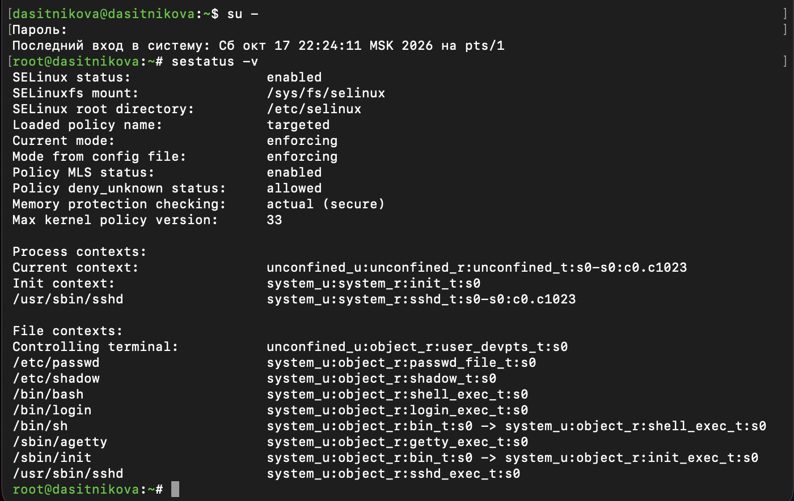
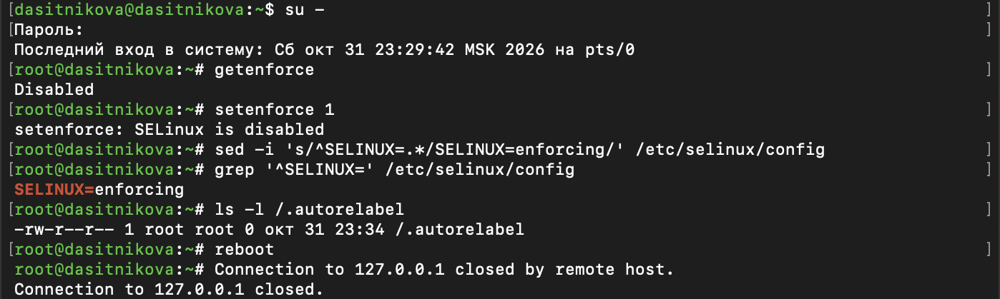
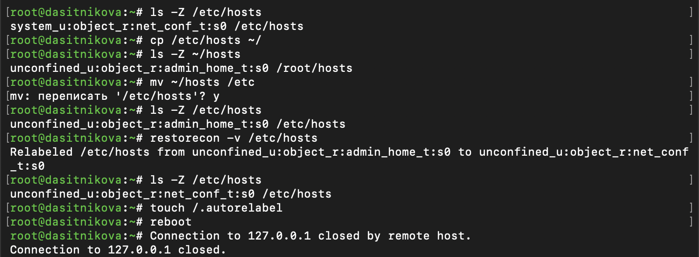
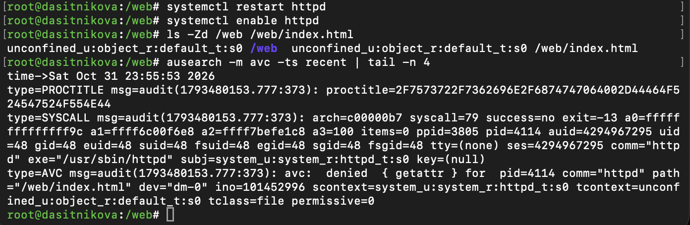
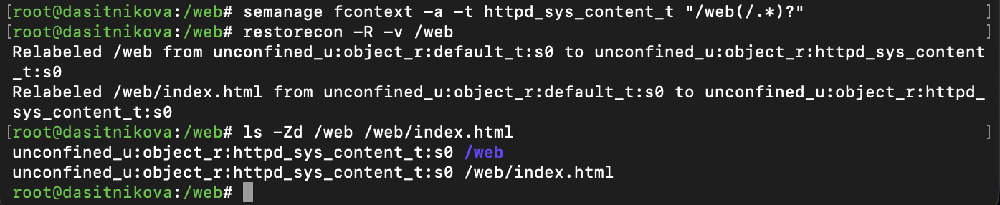
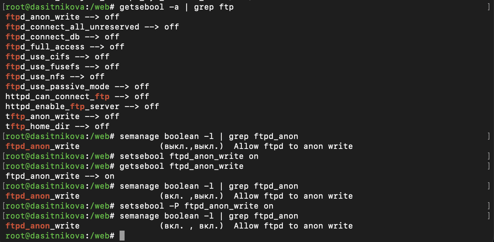

---
## Author
author:
  name: Ситникова Диана Александровна
  degrees: BSc
  email: 1032201746@rudn.ru
  affiliation:
    - name: Российский университет дружбы народов
      country: Российская Федерация
      postal-code: 117198
      city: Москва
      address: ул. Миклухо-Маклая, д. 6
## Title
title: "Лабораторная работа № 9"
subtitle: "Управление SELinux"
institute:
  - "Российский университет дружбы народов им. П. Лумумбы"
  - "Преподаватель: д.ф.-м.н., профессор Кулябов Дмитрий Сергеевич"
license: CC BY
date: today
date-format: "YYYY-MM-DD"
header-includes:
  - \usepackage{tikz}
---

# Информация

## Докладчик

:::::::::::::: {.columns align=center}
::: {.column width="68%"}

- Ситникова Диана Александровна
- направление 09.03.03 «Прикладная информатика»
- Российский университет дружбы народов
- [1032201746@rudn.ru](mailto:1032201746@rudn.ru)

:::
::: {.column width="32%"}

{width=100%}

:::
::::::::::::::

# Вводная часть

## Актуальность

- Права Unix задаёт владелец файла, и взломанная служба получает все права своего пользователя.
- SELinux ограничивает каждую службу политикой, которую нельзя обойти изнутри.
- Типичная проблема администратора: «права верные, а служба не видит файл» --- это SELinux.

## Объект, предмет, цель и задачи

**Объект** --- мандатное управление доступом в Rocky Linux 10.2.

**Предмет** --- контексты безопасности, режимы и переключатели SELinux.

**Цель** --- получить навыки работы с контекстом безопасности и политиками SELinux.

**Задачи:** управлять режимами SELinux; восстанавливать контекст безопасности; настроить контекст для нестандартного каталога веб-службы; работать с переключателями.

## Материалы и методы

| Компонент | Значение |
|---|---|
| Стенд | Rocky Linux 10.2, политика `targeted` |
| Режимы | `sestatus`, `getenforce`, `setenforce`, `/etc/selinux/config` |
| Контексты | `ls -Z`, `restorecon`, `semanage fcontext` |
| Переключатели | `getsebool`, `setsebool`, `semanage boolean` |
| Журнал | `/var/log/audit/audit.log`, `ausearch` |

# Содержание исследования

## Метка SELinux --- четыре поля

| Поле | `/etc/hosts` | процесс `httpd` |
|---|---|---|
| пользователь | `system_u` | `system_u` |
| роль | `object_r` | `system_r` |
| **тип** | **`net_conf_t`** | **`httpd_t`** |
| уровень | `s0` | `s0` |

Политика `targeted` решает по типу: какой домен процесса какие типы файлов может читать.

## SELinux включён и работает в режиме enforcing

:::::::::::::: {.columns align=center}
::: {.column width="35%"}

Политика `targeted`, режим `enforcing`.

Оболочка root --- в домене `unconfined_t`, `sshd` --- в `sshd_t`.

У каждого файла свой тип: `passwd_file_t`, `shadow_t`.

:::
::: {.column width="65%"}

{width=100%}

:::
::::::::::::::

## Из disabled не выйти без перезагрузки

:::::::::::::: {.columns align=center}
::: {.column width="35%"}

`setenforce 0` --- permissive сразу.

После `SELINUX=disabled` и перезагрузки `setenforce 1` отказывает: политика не загружена.

Обратно --- перезагрузка и перемаркировка всех файлов.

:::
::: {.column width="65%"}

{width=100%}

:::
::::::::::::::

## mv сохраняет метку, restorecon её исправляет

:::::::::::::: {.columns align=center}
::: {.column width="35%"}

Копия в `/root` --- `admin_home_t`.

После `mv` в `/etc` тип остался `admin_home_t`.

`restorecon` вернул `net_conf_t` по базе контекстов.

:::
::: {.column width="65%"}

{width=100%}

:::
::::::::::::::

## Веб-сервер читает только файлы своего типа

\begin{center}
\resizebox{\linewidth}{!}{%
\begin{tikzpicture}[font=\scriptsize]
  \draw[thick] (0,0.6) rectangle (2.6,2.0);
  \node[align=center] at (1.3,1.3) {\texttt{httpd}\\\texttt{httpd\_t}};
  \draw[->,thick] (2.65,1.3) -- (4.15,1.3);
  \draw[thick] (4.2,0.6) rectangle (7.2,2.0);
  \node[align=center] at (5.7,1.3) {политика\\SELinux};
  \draw[->,thick] (7.25,1.75) -- (9.35,2.2) node[midway,above,font=\tiny] {разрешено};
  \draw[->,thick,dashed] (7.25,0.85) -- (9.35,0.4) node[midway,below,font=\tiny] {отказ, AVC};
  \draw[thick] (9.4,1.75) rectangle (12.8,2.65);
  \node[align=center,font=\tiny] at (11.1,2.2) {\texttt{index.html}\\\texttt{httpd\_sys\_content\_t}};
  \draw[thick] (9.4,-0.05) rectangle (12.8,0.85);
  \node[align=center,font=\tiny] at (11.1,0.4) {\texttt{index.html}\\\texttt{default\_t}};
\end{tikzpicture}%
}
\end{center}

Права Unix у файла одинаковые в обоих случаях --- решает только тип в метке.

## Каталог /web получил тип default_t --- отказ

{width=95%}

- Новый каталог в корне не описан в базе контекстов --- тип `default_t`.
- `avc: denied { getattr }`: `httpd_t` не может обратиться к `default_t`.
- Вместо страницы --- тестовая страница Apache.

## semanage + restorecon --- страница открылась

{width=95%}

- `semanage fcontext` добавил правило для `/web(/.*)?` в базу контекстов.
- `restorecon -R` применил его: `default_t` → `httpd_sys_content_t`.
- `lynx http://localhost` --- «Welcome to my web-server».

## Переключатель: текущее и постоянное значение

:::::::::::::: {.columns align=center}
::: {.column width="35%"}

`setsebool` --- `(вкл., выкл.)`: до перезагрузки.

`setsebool -P` --- `(вкл., вкл.)`: навсегда.

Поведение политики меняется без её перекомпиляции.

:::
::: {.column width="65%"}

{width=100%}

:::
::::::::::::::

# Результаты

## SELinux настроен и проверен

- Проверены режимы enforcing, permissive и disabled и возврат из disabled.
- Метка `/etc/hosts` восстановлена командой `restorecon`.
- Веб-сервер обслуживает нестандартный каталог `/web` с типом `httpd_sys_content_t`.
- Переключатель `ftpd_anon_write` включён до перезагрузки и постоянно.

## Вывод

SELinux решает не по правам Unix, а по типу в метке: служба видит только файлы, тип которых разрешён её домену.

Если «права верные, а доступа нет» --- смотрим `ls -Z` и журнал аудита.
