---
## Author
author:
  name: Ситникова Диана Александровна
  degrees: BSc
  email: 1032201746@rudn.ru
  affiliation:
    - name: Российский университет дружбы народов
      country: Российская Федерация
      postal-code: 117198
      city: Москва
      address: ул. Миклухо-Маклая, д. 6

## Title
title: "Отчёт по лабораторной работе №9"
subtitle: "Управление SELinux"
license: "CC BY"
bibliography: bib/cite.bib
---

# Цель работы

Целью данной работы является получение навыков работы с контекстом безопасности и политиками SELinux.

# Задание

- Продемонстрировать навыки по управлению режимами SELinux.
- Продемонстрировать навыки по восстановлению контекста безопасности SELinux.
- Настроить контекст безопасности для нестандартного расположения файлов веб-службы.
- Продемонстрировать навыки работы с переключателями SELinux.

# Теоретическое введение

## Дискреционное и мандатное управление доступом

Традиционная модель прав Unix --- дискреционное управление доступом (DAC): права на файл определяет его владелец, а процесс получает все права пользователя, от имени которого запущен [@nemeth_book_unix-linux-admin_ru]. Если веб-сервер, работающий от имени пользователя `apache`, будет взломан, злоумышленник сможет прочитать любой файл, доступный этому пользователю на чтение, а процесс суперпользователя не ограничен ничем.

Мандатное управление доступом (MAC) решает эту проблему: правила доступа задаёт не владелец файла, а централизованная политика безопасности, которую не могут изменить ни пользователи, ни их программы. Каждому процессу разрешено ровно то, что нужно для его работы, и взломанная служба остаётся запертой в своих границах.

SELinux (Security-Enhanced Linux) --- реализация MAC в ядре Linux. Её разработало Агентство национальной безопасности США на основе исследовательской архитектуры Flask и в 2000 году опубликовало как открытый проект [@mayer_book_selinux-example_en]. Для подключения модулей безопасности в ядро был добавлен интерфейс Linux Security Modules (LSM), и в 2003 году SELinux вошёл в ядро 2.6. В Red Hat Enterprise Linux SELinux включён по умолчанию начиная с версии 4 (2005 год) [@vermeulen_book_selinux-admin_en]. Альтернативная реализация MAC, AppArmor, используется в SUSE и Ubuntu.

Проверки SELinux выполняются после обычных проверок прав Unix: доступ разрешается, только если его разрешают и DAC, и политика SELinux. Решения политики кешируются в ядре в кеше векторов доступа (Access Vector Cache, AVC), поэтому сообщения о запретах SELinux называются сообщениями AVC.

## Контекст безопасности

SELinux присваивает каждому процессу и каждому файлу метку --- контекст безопасности вида `пользователь:роль:тип:уровень` ([табл. @tbl-context]) [@fedora_selinux_guide_ru]. Метки файлов хранятся в расширенных атрибутах файловой системы `security.selinux`, метки процессов --- в ядре. Просмотреть их можно ключом `-Z`: `ls -Z` для файлов, `ps -eZ` для процессов, `id -Z` для текущего пользователя.

| Поле | Пример | Назначение |
|---------------|------------------|--------------------------------------------------|
| пользователь | `system_u`, `unconfined_u` | пользователь SELinux, не совпадает с учётной записью Linux |
| роль | `system_r`, `object_r` | набор доступных типов (RBAC); у файлов всегда `object_r` |
| тип | `httpd_t`, `net_conf_t` | основа проверок: домен процесса или тип файла |
| уровень | `s0`, `s0-s0:c0.c1023` | уровень и категории MLS/MCS |

: Поля контекста безопасности SELinux {#tbl-context}

Главную роль в политике targeted играет тип. Механизм проверки по типам называется Type Enforcement: тип процесса называется доменом, и политика содержит правила вида «домен `httpd_t` может читать файлы типа `httpd_sys_content_t`». Всё, что не разрешено явно, запрещено. Процесс получает домен при запуске программы: например, systemd в домене `init_t`, запуская файл `/usr/sbin/sshd` с типом `sshd_exec_t`, переводит новый процесс в домен `sshd_t`.

## Политики и режимы работы

Политика SELinux --- скомпилированный набор правил, загружаемый в ядро при загрузке системы. В Rocky Linux используется политика `targeted`: она ограничивает системные службы, для которых написаны правила, а процессы пользователей выполняются в неограниченном домене `unconfined_t`. Существует также политика `mls` с многоуровневой моделью секретности.

Режим работы SELinux определяет, что происходит при нарушении политики ([табл. @tbl-modes]). Текущий режим выводит команда `getenforce`, подробное состояние --- `sestatus`, переключение между `enforcing` и `permissive` выполняет `setenforce 1` и `setenforce 0` до перезагрузки. Режим при загрузке задаётся параметром `SELINUX` в файле `/etc/selinux/config`, на который ссылается `/etc/sysconfig/selinux`, а политика --- параметром `SELINUXTYPE`.

| Режим | Нарушения политики | Применение |
|---------------|--------------------------------------|------------------------------------|
| `enforcing` | блокируются и записываются в журнал | рабочий режим |
| `permissive` | разрешаются, но записываются в журнал | поиск причин отказов, отладка политики |
| `disabled` | политика не загружается | не рекомендуется |

: Режимы работы SELinux {#tbl-modes}

Из режима `disabled` нельзя перейти в другой режим без перезагрузки: политика не загружена в ядро. Пока SELinux отключён, новые файлы создаются без меток, поэтому служба `selinux-autorelabel-mark` создаёт файл `/.autorelabel`. Если при загрузке этот файл существует, служба `selinux-autorelabel` до запуска остальных служб присваивает всем файлам метки по базе контекстов и снова перезагружает систему. Начиная с RHEL 9 значение `SELINUX=disabled` лишь запрещает загрузку политики, а полностью отключить SELinux в ядре можно параметром загрузки `selinux=0` [@rhel10_selinux].

## Метки файлов и их восстановление

Новый файл получает тип каталога, в котором он создан, если политика не задаёт иное. Поэтому копия файла (`cp`) получает метку каталога назначения, а перемещённый в пределах одной файловой системы (`mv`) файл сохраняет свою прежнюю метку: перемещение лишь меняет запись в каталоге.

Какие метки должны иметь файлы, описано в базе контекстов --- списке регулярных выражений путей с соответствующими контекстами (`/etc/selinux/targeted/contexts/files/file_contexts`). Средства работы с метками приведены в [табл. @tbl-label-tools]. Команда `chcon` меняет метку файла напрямую, но такое изменение будет отменено при следующей перемаркировке. Правильный способ --- добавить правило в базу командой `semanage fcontext` и применить его командой `restorecon`.

| Команда | Действие |
|------------------------------|------------------------------------------------------|
| `ls -Z`, `ps -eZ`, `id -Z` | показать контекст файлов, процессов, пользователя |
| `restorecon -R -v путь` | восстановить метки по базе контекстов |
| `semanage fcontext -a -t тип "путь"` | добавить правило в базу контекстов |
| `semanage fcontext -l` | вывести правила базы контекстов |
| `chcon -t тип файл` | временно изменить метку файла |
| `touch /.autorelabel` | перемаркировать все файлы при следующей загрузке |

: Средства работы с метками файлов {#tbl-label-tools}

## Переключатели SELinux

Переключатели (booleans) --- заранее предусмотренные в политике варианты, которые включаются и выключаются без её перекомпиляции. Например, `httpd_enable_homedirs` разрешает веб-серверу читать домашние каталоги пользователей, а `ftpd_anon_write` --- анонимную запись на FTP-сервер. Команда `getsebool -a` выводит все переключатели и их текущие значения, `semanage boolean -l` --- их описания, текущие и постоянные значения. Команда `setsebool` изменяет значение до перезагрузки, а с ключом `-P` записывает его в политику постоянно.

## Журнал SELinux

Сообщения о запретах SELinux записываются службой аудита `auditd` в файл `/var/log/audit/audit.log` как записи типа `AVC`. В записи указаны запрошенное действие (`{ read }`), процесс, путь к объекту, контекст процесса `scontext`, контекст объекта `tcontext`, класс объекта `tclass` и признак разрешающего режима `permissive`. Искать такие записи удобно командой `ausearch -m avc`. Пакет `setroubleshoot-server` разбирает записи AVC и формирует понятные сообщения с рекомендациями, которые выводит команда `sealert`. Программа `audit2why` объясняет причину отказа, `audit2allow` предлагает правило политики, которое его устранит.

# Выполнение лабораторной работы

Работа выполнена в виртуальной машине с Rocky Linux 10.2 в двух терминалах, подключённых к гостевой системе по SSH; полномочия администратора получены командой `su -`. Сообщения при загрузке системы и текстовый браузер `lynx` наблюдались в окне виртуальной машины.

## Управление режимами SELinux

Запущен терминал, получены полномочия администратора и просмотрена текущая информация о состоянии SELinux ([рис. @fig-001]).

~~~bash
su -
sestatus -v
~~~

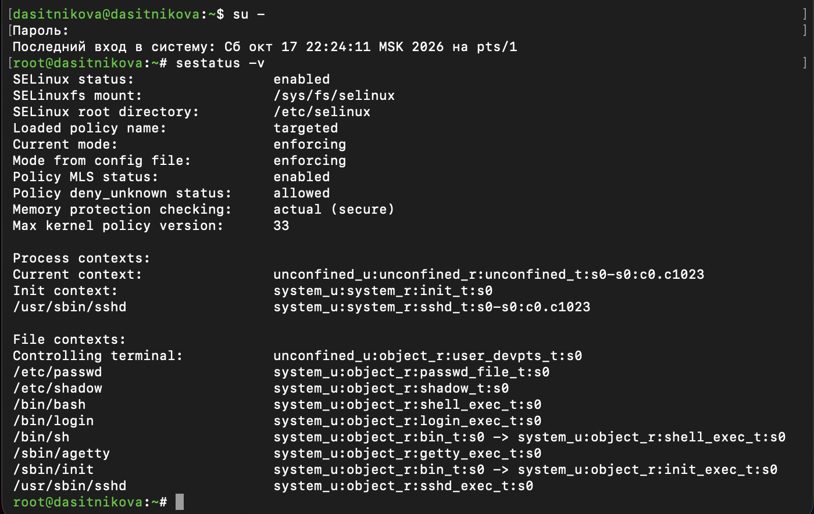{#fig-001 width=85%}

Построчное пояснение выведенной информации:

- `SELinux status: enabled` --- SELinux включён в ядре.
- `SELinuxfs mount: /sys/fs/selinux` --- точка монтирования псевдофайловой системы selinuxfs, через которую программы обращаются к SELinux в ядре: загружают политику, меняют режим и значения переключателей.
- `SELinux root directory: /etc/selinux` --- каталог с файлом настройки и политиками.
- `Loaded policy name: targeted` --- загружена политика `targeted`.
- `Current mode: enforcing` --- текущий режим --- принудительного исполнения.
- `Mode from config file: enforcing` --- режим, заданный в `/etc/selinux/config` и устанавливаемый при загрузке.
- `Policy MLS status: enabled` --- политика поддерживает уровни MLS/MCS, поэтому контексты содержат поле уровня.
- `Policy deny_unknown status: allowed` --- действия с классами объектов, которые неизвестны политике, разрешаются; это важно, если ядро новее политики.
- `Memory protection checking: actual (secure)` --- при изменении прав на области памяти SELinux проверяет фактически устанавливаемые ядром права, а не запрошенные программой.
- `Max kernel policy version: 33` --- максимальная версия формата политики, которую поддерживает ядро.
- `Process contexts` --- контексты процессов: текущая оболочка суперпользователя работает в неограниченном домене `unconfined_t` с диапазоном категорий `s0-s0:c0.c1023`, процесс init (systemd) --- в домене `init_t`, сервер SSH --- в домене `sshd_t` с ролью `system_r`.
- `File contexts` --- контексты файлов: терминал имеет тип `user_devpts_t`, `/etc/passwd` --- `passwd_file_t`, `/etc/shadow` --- `shadow_t`, исполняемые файлы `bash`, `login`, `agetty`, `sshd` --- типы `shell_exec_t`, `login_exec_t`, `getty_exec_t`, `sshd_exec_t`. Для символических ссылок `/bin/sh` и `/sbin/init` выведены две метки: самой ссылки (`bin_t`) и файла, на который она указывает (`shell_exec_t` и `init_exec_t`).

Просмотрен режим работы SELinux, режим изменён на разрешающий, после чего в файле настройки установлено значение `SELINUX=disabled` ([рис. @fig-002]).

~~~bash
getenforce
setenforce 0
getenforce
ls -l /etc/sysconfig/selinux /etc/selinux/config
sed -i 's/^SELINUX=.*/SELINUX=disabled/' /etc/selinux/config
grep '^SELINUX=' /etc/selinux/config
~~~

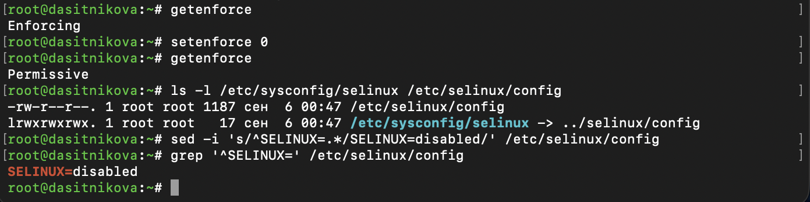{#fig-002 width=85%}

SELinux работает в режиме `Enforcing`, после `setenforce 0` --- в режиме `Permissive`. Файл `/etc/sysconfig/selinux` является символической ссылкой на `../selinux/config`, поэтому значение изменено в файле `/etc/selinux/config`. После этого система перезагружена.

После перезагрузки проверен статус SELinux и выполнена попытка переключить режим работы. Затем в файле настройки установлено значение `SELINUX=enforcing`, и система перезагружена ([рис. @fig-003]).

~~~bash
su -
getenforce
setenforce 1
sed -i 's/^SELINUX=.*/SELINUX=enforcing/' /etc/selinux/config
grep '^SELINUX=' /etc/selinux/config
ls -l /.autorelabel
reboot
~~~

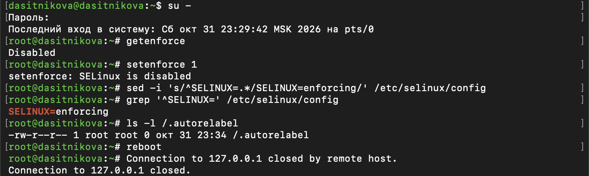{#fig-003 width=85%}

SELinux отключён: `getenforce` выводит `Disabled`, а `setenforce 1` отвечает `SELinux is disabled`. Политика не загружена в ядро, и включить SELinux без перезагрузки невозможно. Во время загрузки в отключённом режиме система создала пустой файл `/.autorelabel` (23:34), поэтому при следующей загрузке с включённым SELinux все файлы были автоматически перемаркированы, после чего система ещё раз перезагрузилась.

После перезагрузки просмотрена информация о состоянии SELinux ([рис. @fig-004]).

~~~bash
sestatus -v
~~~

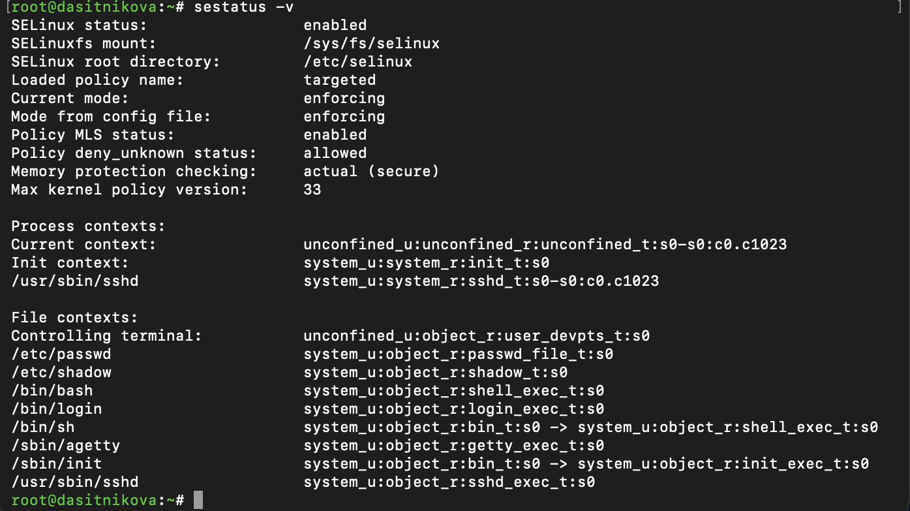{#fig-004 width=85%}

Система работает в режиме принудительного исполнения `enforcing`, и вывод совпадает с исходным: политика `targeted` загружена, контексты процессов и файлов восстановлены.

## Использование restorecon для восстановления контекста безопасности

Просмотрен контекст безопасности файла `/etc/hosts`, файл скопирован в домашний каталог, и проверен контекст копии. Затем копия перемещена обратно в `/etc` с заменой исходного файла, контекст проверен, исправлен командой `restorecon` и проверен повторно ([рис. @fig-005]).

~~~bash
ls -Z /etc/hosts
cp /etc/hosts ~/
ls -Z ~/hosts
mv ~/hosts /etc
ls -Z /etc/hosts
restorecon -v /etc/hosts
ls -Z /etc/hosts
touch /.autorelabel
reboot
~~~

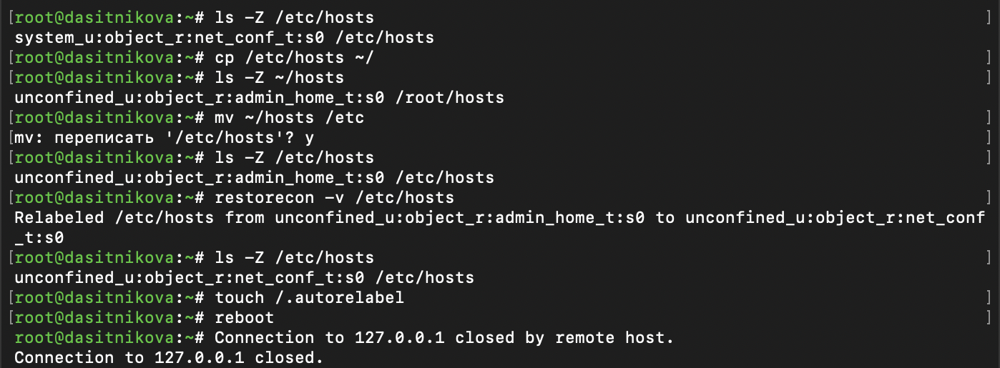{#fig-005 width=85%}

Файл `/etc/hosts` имеет тип `net_conf_t` --- тип файлов сетевой конфигурации. Копия в домашнем каталоге суперпользователя `/root/hosts` получила тип `admin_home_t`: копирование создаёт новый файл, и он наследует тип каталога, в котором создан. После `mv` файл `/etc/hosts` сохранил тип `admin_home_t`, поскольку перемещение не создаёт новый файл. С такой меткой файл недоступен службам, которым политика разрешает читать только `net_conf_t`.

Команда `restorecon -v` сравнила метку с базой контекстов и сообщила об изменении: `Relabeled /etc/hosts from unconfined_u:object_r:admin_home_t:s0 to unconfined_u:object_r:net_conf_t:s0`. Тип файла снова `net_conf_t`. Поле пользователя SELinux `unconfined_u` при этом сохранилось: `restorecon` по умолчанию исправляет только тип.

Для массового исправления контекста безопасности создан файл `/.autorelabel`, и система перезагружена. Сообщения загрузки, выведенные в окне виртуальной машины после нажатия Esc, приведены на [рис. @fig-006].

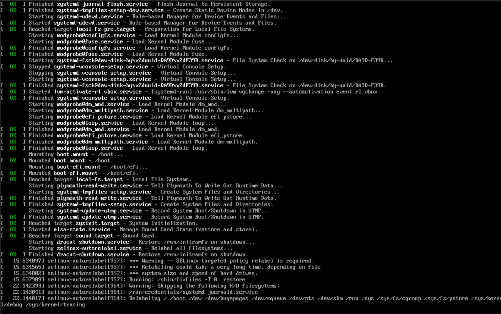{#fig-006 width=90%}

После монтирования локальных файловых систем запущена служба `selinux-autorelabel` («Relabel all filesystems»). Она вывела предупреждение `*** Warning -- SELinux targeted policy relabel is required` и сообщение о том, что перемаркировка может занять много времени, после чего выполнила команду `/sbin/fixfiles -T 0 restore` для всех файловых систем, кроме доступных только для чтения: `/`, `/boot`, `/dev`, `/run`, `/sys` и др. По окончании система перезагрузилась.

## Настройка контекста безопасности для нестандартного расположения файлов веб-сервера

Установлено необходимое программное обеспечение, создано хранилище `/web` для файлов веб-сервера с файлом `index.html`, а в файле конфигурации `/etc/httpd/conf/httpd.conf` заменён корневой каталог сайта и правила доступа к нему ([рис. @fig-007]).

~~~bash
dnf -y install httpd
dnf -y install lynx
mkdir /web
cd /web
touch index.html
echo "Welcome to my web-server" > /web/index.html
cp /etc/httpd/conf/httpd.conf /etc/httpd/conf/httpd.conf.bak
sed -i 's|^DocumentRoot "/var/www/html"|#DocumentRoot "/var/www/html"\nDocumentRoot "/web"|' /etc/httpd/conf/httpd.conf
sed -i '/^<Directory "\/var\/www">/,/^<\/Directory>/ s/^/#/' /etc/httpd/conf/httpd.conf
printf '<Directory "/web">\n    AllowOverride None\n    Require all granted\n</Directory>\n' >> /etc/httpd/conf/httpd.conf
httpd -t
~~~

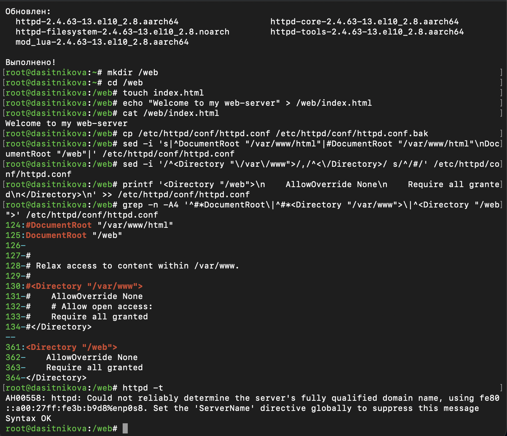{#fig-007 width=85%}

Пакеты веб-сервера обновлены до версии `2.4.63-13.el10_2.8`, установлен текстовый браузер `lynx`. В файле конфигурации строка `DocumentRoot "/var/www/html"` закомментирована, под ней добавлена строка `DocumentRoot "/web"`, раздел `<Directory "/var/www">` закомментирован, а в конец файла добавлен раздел:

~~~
<Directory "/web">
    AllowOverride None
    Require all granted
</Directory>
~~~

Проверка синтаксиса `httpd -t` завершилась сообщением `Syntax OK`.

Веб-служба перезапущена с новой конфигурацией и добавлена в автозапуск. Под учётной записью своего пользователя выполнено обращение к веб-серверу текстовым браузером `lynx` ([рис. @fig-008]).

~~~bash
systemctl restart httpd
systemctl enable httpd
lynx http://localhost
~~~

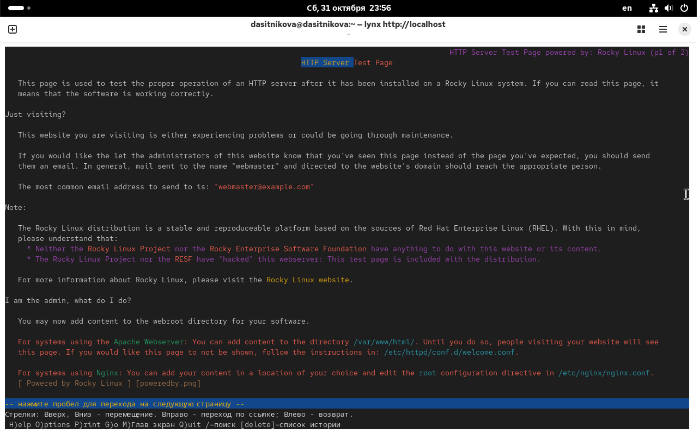{#fig-008 width=85%}

Вместо созданного файла `index.html` отображается тестовая страница Rocky Linux «HTTP Server Test Page». Причина видна по контексту каталога `/web` и журналу аудита ([рис. @fig-009]).

~~~bash
ls -Zd /web /web/index.html
ausearch -m avc -ts recent | tail -n 4
~~~

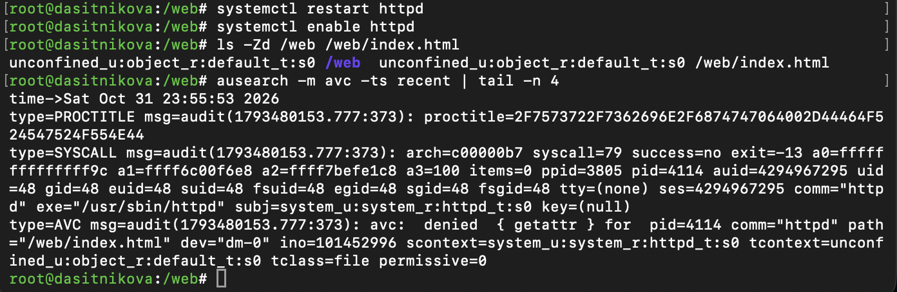{#fig-009 width=85%}

Каталог `/web` создан в корне файловой системы, для которого в базе контекстов нет подходящего правила, поэтому он и файл `index.html` получили тип `default_t`. В журнале аудита записан отказ: `avc: denied { getattr } for pid=4114 comm="httpd" path="/web/index.html" scontext=system_u:system_r:httpd_t:s0 tcontext=unconfined_u:object_r:default_t:s0 tclass=file permissive=0`. Процесс веб-сервера в домене `httpd_t` попытался получить атрибуты файла с типом `default_t`, политика это не разрешает, и в режиме принудительного исполнения (`permissive=0`) доступ запрещён. Связанная запись `SYSCALL` показывает, что системный вызов завершился неудачей (`success=no exit=-13`, код ошибки `EACCES`) и выполнялся от имени пользователя `apache` (`uid=48`). Не найдя доступного индексного файла, Apache вернул ошибку 403, и для корня сайта вместо неё была показана тестовая страница.

Права Unix при этом не мешали доступу: файл доступен на чтение всем. Запрет наложен только политикой SELinux.

Для каталога `/web` и всего его содержимого добавлено правило в базу контекстов, и контекст безопасности восстановлен ([рис. @fig-010]).

~~~bash
semanage fcontext -a -t httpd_sys_content_t "/web(/.*)?"
restorecon -R -v /web
ls -Zd /web /web/index.html
~~~

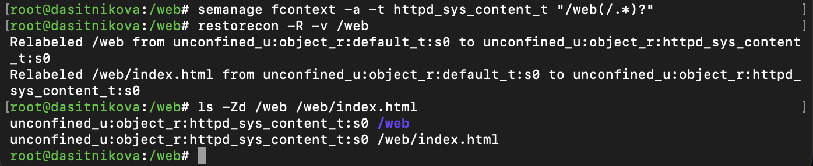{#fig-010 width=85%}

Регулярное выражение `/web(/.*)?` соответствует самому каталогу и всем путям внутри него. Команда `restorecon -R` применила новое правило рекурсивно: каталог `/web` и файл `index.html` перемаркированы из `default_t` в `httpd_sys_content_t` --- тип содержимого, которое веб-сервер может читать.

Под учётной записью своего пользователя снова выполнено обращение к веб-серверу ([рис. @fig-011]).

~~~bash
lynx http://localhost
~~~

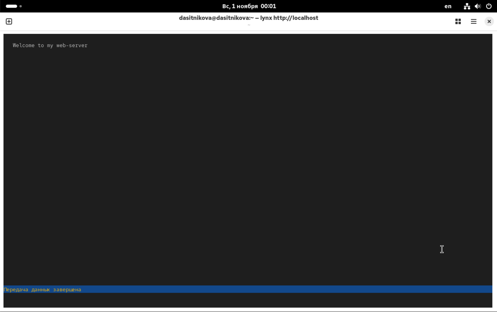{#fig-011 width=85%}

Отображается запись «Welcome to my web-server»: веб-сервер получил доступ к файлам в нестандартном каталоге без перезапуска и без изменения прав Unix.

## Работа с переключателями SELinux

Просмотрен список переключателей SELinux для службы ftp и описание переключателя `ftpd_anon_write`. Затем текущее значение переключателя изменено на `on`, проверено, после чего изменено постоянное значение ([рис. @fig-012]).

~~~bash
getsebool -a | grep ftp
semanage boolean -l | grep ftpd_anon
setsebool ftpd_anon_write on
getsebool ftpd_anon_write
semanage boolean -l | grep ftpd_anon
setsebool -P ftpd_anon_write on
semanage boolean -l | grep ftpd_anon
~~~

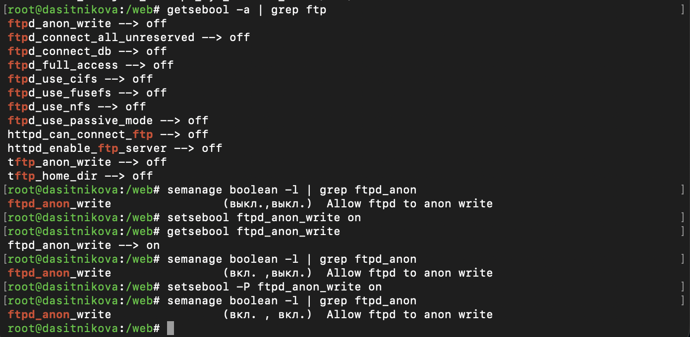{#fig-012 width=85%}

Для FTP в политике предусмотрено 12 переключателей, все выключены: анонимная запись `ftpd_anon_write`, полный доступ `ftpd_full_access`, работа с NFS и CIFS, пассивный режим и др. Команда `semanage boolean -l` описывает `ftpd_anon_write` как «Allow ftpd to anon write» и показывает в скобках два значения: текущее и постоянное.

После `setsebool ftpd_anon_write on` текущее значение стало `on`, а `semanage` показывает `(вкл., выкл.)`: переключатель включён до перезагрузки, а постоянное значение по-прежнему выключено. После `setsebool -P ftpd_anon_write on` переключатель имеет состояние `(вкл., вкл.)` --- он включён и сейчас, и постоянно, то есть останется включённым после перезагрузки.

# Выводы

В ходе лабораторной работы получены навыки работы с контекстом безопасности и политиками SELinux в Rocky Linux 10.2. Выполнено переключение между режимами `enforcing`, `permissive` и `disabled` и показано, что из отключённого режима нельзя вернуться без перезагрузки и перемаркировки файлов. На примере файла `/etc/hosts` показано, что перемещённый файл сохраняет прежнюю метку, и метка восстановлена командой `restorecon`.

Настроен контекст безопасности для нестандартного каталога веб-сервера: по журналу аудита установлена причина отказа в доступе, а тип `httpd_sys_content_t` назначен каталогу командами `semanage fcontext` и `restorecon`. Изучены переключатели SELinux и различие между их текущим и постоянным значением.

# Контрольные вопросы

1. **Вы хотите временно поставить SELinux в разрешающем режиме. Какую команду вы используете?**

   `setenforce 0` --- действует до перезагрузки, проверка `getenforce` → `Permissive` ([рис. @fig-002]). Вернуть `setenforce 1`. Чтобы режим сохранился после перезагрузки --- `SELINUX=permissive` в `/etc/selinux/config`.

2. **Вам нужен список всех доступных переключателей SELinux. Какую команду вы используете?**

   `getsebool -a` --- имена и текущие значения ([рис. @fig-013]: в системе 328 переключателей). `semanage boolean -l` --- то же с описанием и постоянным значением.

   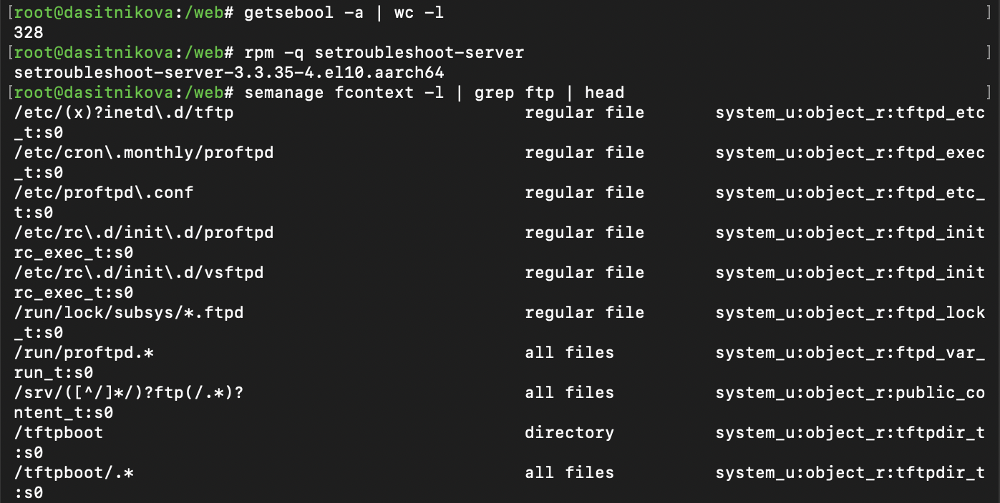{#fig-013 width=85%}

3. **Каково имя пакета, который требуется установить для получения легко читаемых сообщений журнала SELinux в журнале аудита?**

   `setroubleshoot-server` ([рис. @fig-013]). Он разбирает записи AVC из журнала аудита и пишет понятные сообщения «SELinux is preventing…» с советом, как исправить. Подробный разбор --- `sealert -a /var/log/audit/audit.log`.

4. **Какие команды вам нужно выполнить, чтобы применить тип контекста httpd_sys_content_t к каталогу /web?**

   Первая записывает правило в политику, вторая применяет его к уже существующим файлам ([рис. @fig-010]). `chcon -t` тоже меняет тип, но временно: при перемаркировке он сбросится.

   ~~~bash
   semanage fcontext -a -t httpd_sys_content_t "/web(/.*)?"
   restorecon -R -v /web
   ~~~

5. **Какой файл вам нужно изменить, если вы хотите полностью отключить SELinux?**

   `/etc/selinux/config`, строка `SELINUX=disabled` (в старых системах --- через ссылку `/etc/sysconfig/selinux`), затем перезагрузка ([рис. @fig-002], [рис. @fig-003]). В Rocky Linux 10 так политика не загружается, а полностью SELinux отключается параметром ядра `selinux=0`: `grubby --update-kernel ALL --args selinux=0`.

6. **Где SELinux регистрирует все свои сообщения?**

   В журнале аудита `/var/log/audit/audit.log`, записи типа `AVC` ([рис. @fig-009], [рис. @fig-014]). Искать удобно через `ausearch -m avc`. Если служба `auditd` не работает, сообщения уходят в журнал ядра, то есть в journald и `/var/log/messages`.

   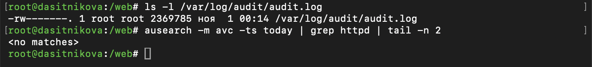{#fig-014 width=85%}

7. **Вы не знаете, какие типы контекстов доступны для службы ftp. Какая команда позволяет получить более конкретную информацию?**

   `semanage fcontext -l | grep ftp` --- какие типы назначаются каким путям ([рис. @fig-013]). Ещё `seinfo -t | grep ftp` из пакета `setools-console` и `man ftpd_selinux` из пакета `selinux-policy-doc` --- там описаны типы и переключатели ftp.

8. **Ваш сервис работает не так, как ожидалось, и вы хотите узнать, связано ли это с SELinux или чем-то ещё. Какой самый простой способ узнать?**

   Временно перевести SELinux в разрешающий режим `setenforce 0` и повторить действие. Если заработало --- виновата политика SELinux; это подтвердят записи `ausearch -m avc -ts recent` ([рис. @fig-009]) или `sealert`. Потом обязательно вернуть `setenforce 1`.

# Список литературы{.unnumbered}

::: {#refs}
:::
