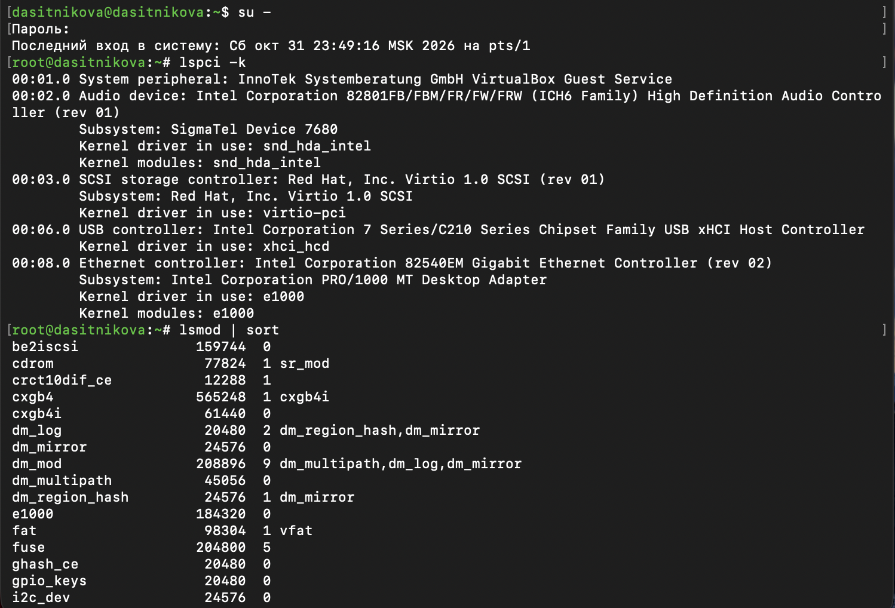
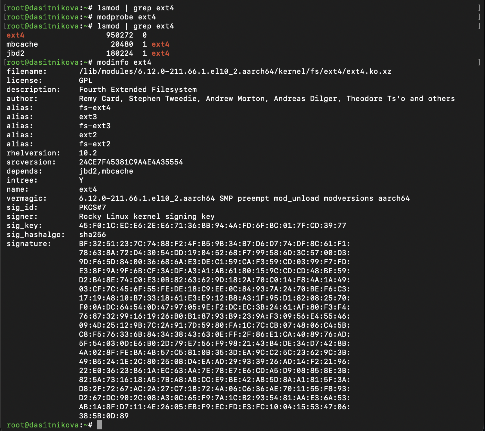
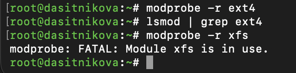
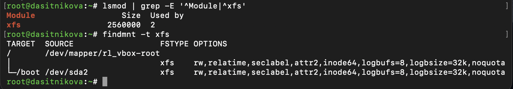
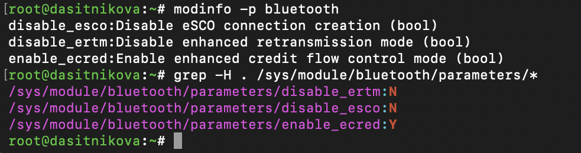
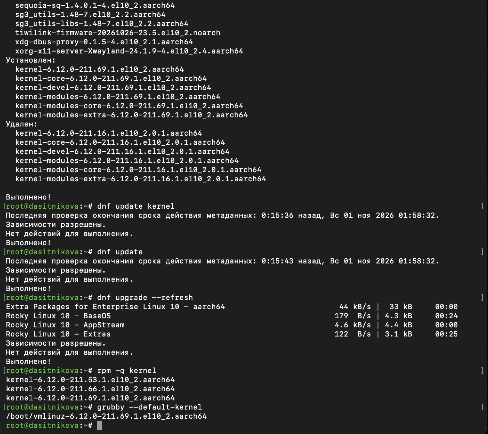
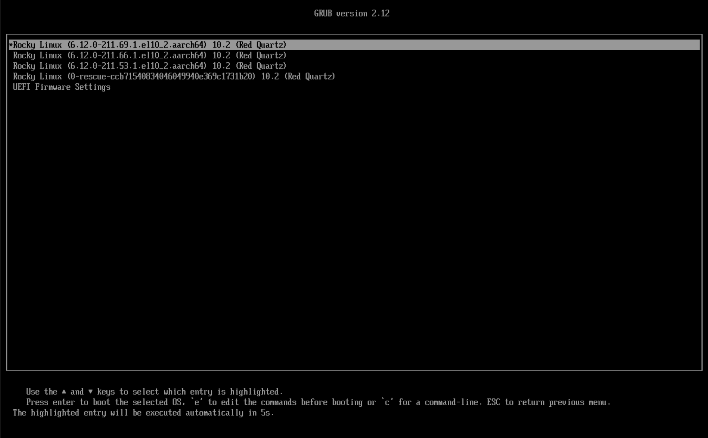
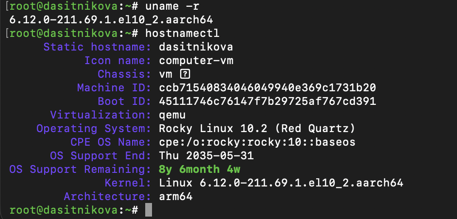

---
## Author
author:
  name: Ситникова Диана Александровна
  degrees: BSc
  email: 1032201746@rudn.ru
  affiliation:
    - name: Российский университет дружбы народов
      country: Российская Федерация
      postal-code: 117198
      city: Москва
      address: ул. Миклухо-Маклая, д. 6
## Title
title: "Лабораторная работа № 10"
subtitle: "Основы работы с модулями ядра операционной системы"
institute:
  - "Российский университет дружбы народов им. П. Лумумбы"
  - "Преподаватель: д.ф.-м.н., профессор Кулябов Дмитрий Сергеевич"
license: CC BY
date: today
date-format: "YYYY-MM-DD"
header-includes:
  - \usepackage{tikz}
---

# Информация

## Докладчик

:::::::::::::: {.columns align=center}
::: {.column width="68%"}

- Ситникова Диана Александровна
- направление 09.03.03 «Прикладная информатика»
- Российский университет дружбы народов
- [1032201746@rudn.ru](mailto:1032201746@rudn.ru)

:::
::: {.column width="32%"}

{width=100%}

:::
::::::::::::::

# Вводная часть

## Актуальность

- Драйверы, файловые системы и сетевые протоколы Linux --- это модули ядра.
- Администратор подключает оборудование, настраивает драйверы параметрами и выясняет, почему модуль не выгружается.
- Ядро регулярно обновляется исправлениями безопасности --- и обновление не должно лишать систему возможности загрузиться.

## Объект, предмет, цель и задачи

**Объект** --- ядро Rocky Linux 10.2 и его модули.

**Предмет** --- утилиты управления модулями и обновление ядра.

**Цель** --- получить навыки работы с утилитами управления модулями ядра операционной системы.

**Задачи:** продемонстрировать навыки управления модулями ядра и загрузки модулей ядра с параметрами.

## Материалы и методы

| Компонент | Значение |
|---|---|
| Стенд | Rocky Linux 10.2, ядро 6.12, aarch64 |
| Устройства и модули | `lspci -k`, `lsmod` |
| Управление модулями | `modprobe`, `modprobe -r`, `modinfo` |
| Модули в опытах | `ext4`, `xfs`, `bluetooth` |
| Обновление ядра | `dnf`, `grubby`, GRUB, `uname -r` |

# Содержание исследования

## modprobe загружает модуль вместе с зависимостями

\begin{center}
\resizebox{\linewidth}{!}{%
\begin{tikzpicture}[font=\scriptsize]
  \draw[thick] (0,0.6) rectangle (2.6,2.0);
  \node at (1.3,1.3) {\texttt{modprobe ext4}};
  \draw[->,thick] (2.65,1.3) -- (4.15,1.3);
  \draw[thick] (4.2,0.6) rectangle (7.2,2.0);
  \node[align=center] at (5.7,1.3) {\texttt{modules.dep}\\\texttt{ext4: jbd2 mbcache}};
  \draw[->,thick] (7.25,1.75) -- (9.35,2.2) node[midway,above,font=\tiny] {1. зависимости};
  \draw[->,thick] (7.25,0.85) -- (9.35,0.4) node[midway,below,font=\tiny] {2. сам модуль};
  \draw[thick] (9.4,1.75) rectangle (12.8,2.65);
  \node at (11.1,2.2) {\texttt{jbd2}, \texttt{mbcache}};
  \draw[thick] (9.4,-0.05) rectangle (12.8,0.85);
  \node at (11.1,0.4) {\texttt{ext4}};
\end{tikzpicture}%
}
\end{center}

`modprobe -r ext4` выгружает всё в обратном порядке --- если зависимости больше никому не нужны.

## У каждого устройства свой драйвер

:::::::::::::: {.columns align=center}
::: {.column width="35%"}

Сеть --- модуль `e1000`, звук --- `snd_hda_intel`.

Диски virtio и USB --- драйверы встроены в ядро: без них система не загрузится.

Загружено 77 модулей.

:::
::: {.column width="65%"}

{width=100%}

:::
::::::::::::::

## ext4 загружен вместе с jbd2 и mbcache

:::::::::::::: {.columns align=center}
::: {.column width="35%"}

`depends: jbd2,mbcache` --- загружены автоматически.

`alias: ext2, ext3` --- один модуль на три файловые системы.

Подпись ключом Rocky Linux, параметров нет.

:::
::: {.column width="65%"}

{height=78%}

:::
::::::::::::::

## Используемый модуль выгрузить нельзя

{width=45%}

{width=85%}

- `ext4` выгружен молча, вместе с зависимостями.
- `xfs`: `Used by 2` --- на нём смонтированы `/` и `/boot`.

## Параметры модуля bluetooth

{width=80%}

- Три логических параметра: eSCO для голоса, ERTM и ECRED протокола L2CAP.
- Текущие значения --- в `/sys/module/bluetooth/parameters/`.
- Задать: `modprobe bluetooth disable_esco=1` или `options` в `/etc/modprobe.d`.

## Новое ядро ставится рядом со старыми

:::::::::::::: {.columns align=center}
::: {.column width="35%"}

Установлено `211.69.1`, удалено самое старое `211.16.1`.

Хранятся три ядра: `installonly_limit=3`.

По умолчанию загрузится новое.

:::
::: {.column width="65%"}

{height=78%}

:::
::::::::::::::

## GRUB позволяет выбрать любое из ядер

:::::::::::::: {.columns align=center}
::: {.column width="55%"}

{width=100%}

:::
::: {.column width="45%"}

{width=100%}

:::
::::::::::::::

В меню три ядра и аварийное, загрузилось новое: `6.12.0-211.69.1`.

# Результаты

## Модули и ядро под контролем

- Определены драйверы устройств и загруженные модули.
- `ext4` загружен и выгружен вместе с зависимостями, `xfs` выгрузить нельзя --- он используется.
- Определены параметры модуля `bluetooth` и их текущие значения.
- Ядро обновлено до `6.12.0-211.69.1`, старые ядра сохранены.

## Вывод

Ядро Linux монолитное, но модульное: драйверы подключаются по мере надобности, а `modprobe` сам разбирается с зависимостями.

Модуль нельзя выгрузить, пока он используется, а новое ядро ставится рядом со старым --- система защищает себя от ошибок администратора.
