---
## Author
author:
  name: Ситникова Диана Александровна
  degrees: BSc
  email: 1032201746@rudn.ru
  affiliation:
    - name: Российский университет дружбы народов
      country: Российская Федерация
      postal-code: 117198
      city: Москва
      address: ул. Миклухо-Маклая, д. 6

## Title
title: "Отчёт по лабораторной работе №10"
subtitle: "Основы работы с модулями ядра операционной системы"
license: "CC BY"
bibliography: bib/cite.bib
---

# Цель работы

Целью данной работы является получение навыков работы с утилитами управления модулями ядра операционной системы.

# Задание

- Продемонстрировать навыки работы по управлению модулями ядра.
- Продемонстрировать навыки работы по загрузке модулей ядра с параметрами.

# Теоретическое введение

## Монолитное ядро и загружаемые модули

Ядро --- центральная часть операционной системы, которая работает в привилегированном режиме процессора и управляет оборудованием, памятью, процессами и файловыми системами [@tanenbaum_book_modern-os_ru]. По устройству ядра делятся на монолитные, в которых все подсистемы и драйверы выполняются в едином адресном пространстве ядра, и микроядра, в которых в ядре остаётся лишь минимум, а драйверы и файловые системы работают как отдельные процессы. Монолитное ядро быстрее, поскольку его части вызывают друг друга напрямую, а микроядро надёжнее, поскольку сбой драйвера не обрушивает систему.

Linux --- монолитное ядро, однако модульное [@love_book_linux-kernel_en]. Большая часть драйверов, файловых систем и сетевых протоколов собирается не в образ ядра, а в отдельные файлы --- загружаемые модули ядра. Модуль загружается в работающее ядро, когда он нужен, и выполняется в том же адресном пространстве, что и остальное ядро, с теми же привилегиями. Поддержка загружаемых модулей появилась в Linux в середине 1990-х годов. Модульность позволяет держать в памяти только драйверы реально присутствующего оборудования и обновлять или добавлять драйверы без пересборки ядра. Часть кода, необходимого для загрузки системы, встраивается непосредственно в образ ядра: такие драйверы нельзя выгрузить, и для них нет отдельных файлов модулей.

## Файлы модулей и программы управления

Модули хранятся в каталоге `/lib/modules/‹версия ядра›/` в виде объектных файлов с расширением `.ko` (kernel object), в Rocky Linux сжатых: `.ko.xz`. Модуль собирается под конкретную версию ядра, и строка `vermagic`, записанная в модуле, должна совпадать с параметрами работающего ядра, иначе модуль не будет загружен [@corbet_book_ldd3_en]. Поэтому у каждого установленного ядра свой каталог модулей.

Программа `depmod` анализирует модули и создаёт в том же каталоге служебные файлы: `modules.dep` --- зависимости модулей друг от друга, `modules.alias` --- псевдонимы, по которым модули ищутся для оборудования, `modules.builtin` --- список встроенных в ядро драйверов. Для управления модулями используется набор программ kmod ([табл. @tbl-tools]) [@kmod_man].

| Команда | Действие |
|---------------------|--------------------------------------------------------------|
| `lsmod` | список загруженных модулей (содержимое `/proc/modules`) |
| `modinfo модуль` | сведения о модуле: файл, описание, зависимости, параметры |
| `modprobe модуль` | загрузить модуль вместе с зависимостями |
| `modprobe -r модуль` | выгрузить модуль и ставшие ненужными зависимости |
| `insmod файл.ko` | загрузить один файл модуля без учёта зависимостей |
| `rmmod модуль` | выгрузить один модуль |
| `depmod` | пересчитать зависимости и псевдонимы модулей |

: Программы управления модулями ядра {#tbl-tools}

Команда `modprobe` предпочтительнее `insmod` и `rmmod`: она находит файл модуля по имени, по файлу `modules.dep` определяет и загружает все модули, от которых он зависит, применяет параметры из файлов настройки, а при выгрузке удаляет и зависимости, которые больше никем не используются.

## Автоматическая загрузка модулей

Вручную модули загружают редко: обычно ядро и система загружают их сами. Каждое устройство на шинах PCI и USB сообщает идентификаторы производителя и модели, из которых ядро формирует строку `modalias`. Служба `udev`, получив сообщение о новом устройстве, вызывает `modprobe` с этой строкой, и `modprobe` по файлу `modules.alias` находит подходящий драйвер. Аналогично работают и другие псевдонимы: при монтировании файловой системы ядро запрашивает модуль `fs-‹тип›`, при открытии сетевого сокета --- модуль `net-pf-‹номер семейства›`.

Настройка загрузки модулей хранится в файлах каталогов ([табл. @tbl-files]).

| Путь | Назначение |
|------------------------------------|--------------------------------------------------------|
| `/lib/modules/‹версия›/kernel/` | файлы модулей, разложенные по подсистемам |
| `/lib/modules/‹версия›/modules.dep` | зависимости модулей |
| `/proc/modules` | загруженные модули |
| `/sys/module/‹модуль›/parameters/` | текущие значения параметров загруженного модуля |
| `/etc/modprobe.d/*.conf` | параметры (`options`), запреты (`blacklist`), псевдонимы |
| `/etc/modules-load.d/*.conf` | модули, загружаемые при старте системы |

: Файлы и каталоги, связанные с модулями ядра {#tbl-files}

## Параметры модулей

Модуль может объявлять параметры, которые изменяют его поведение: например, отключают отдельные функции или задают размер буферов. Список параметров с описанием и типом значения выводит `modinfo` в строках `parm:`, а `modinfo -p` --- только параметры. Значения задаются при загрузке модуля (`modprobe модуль параметр=значение`) или постоянно строкой `options модуль параметр=значение` в файле каталога `/etc/modprobe.d`. Для драйверов, встроенных в ядро, параметр передаётся в командной строке ядра в виде `модуль.параметр=значение` [@kernel_admin_guide]. Текущие значения параметров загруженного модуля доступны в виде файлов каталога `/sys/module/‹модуль›/parameters/`.

## Счётчик использования и выгрузка

Ядро ведёт для каждого модуля счётчик использования --- число ссылок на него со стороны других модулей и самого ядра: например, смонтированных файловых систем, открытых устройств, зависящих модулей. Счётчик выводится в столбце `Used by` программы `lsmod` вместе со списком модулей, которые используют данный. Модуль с ненулевым счётчиком выгрузить нельзя: `modprobe -r` и `rmmod` сообщают, что модуль используется. Принудительная выгрузка `rmmod -f` возможна только в ядрах, собранных с соответствующей поддержкой, и опасна, поскольку код, который ещё используется, исчезает из памяти.

Чтобы модуль не загружался автоматически, его вносят в чёрный список строкой `blacklist модуль` в каталоге `/etc/modprobe.d`; если модуль загружается при запуске системы из образа initramfs, этот образ необходимо пересобрать.

## Подпись модулей

Поскольку модуль выполняется с полными привилегиями ядра, загрузка постороннего модуля равносильна полному захвату системы. Поэтому модули ядер дистрибутивов подписываются ключом производителя: подпись хранится в конце файла модуля, и при загрузке ядро её проверяет [@kernel_admin_guide]. При включённой безопасной загрузке UEFI (Secure Boot) неподписанные модули не загружаются вовсе, в остальных случаях загрузка такого модуля помечает ядро как «загрязнённое» (tainted): признак записывается в `/proc/sys/kernel/tainted` и в сообщения об ошибках ядра, поскольку разработчики не могут отвечать за поведение стороннего кода.

## Пакеты ядра и его обновление

Rocky Linux собирается из исходных текстов Red Hat Enterprise Linux. Ядро RHEL основано на одной долгосрочной версии ядра Linux, в течение всего срока поддержки выпуска сохраняет её номер и стабильный двоичный интерфейс для модулей (kABI), а исправления ошибок и безопасности переносятся в него из новых версий [@rhel10_kernel]. Поэтому строка версии ядра состоит из нескольких частей ([табл. @tbl-version]).

| Часть | Значение |
|--------------------|------------------------------------------------------|
| `6.12.0` | версия исходного ядра Linux |
| `211.69.1` | номер сборки ядра дистрибутивом, растёт с каждым обновлением |
| `el10_2` | Enterprise Linux 10, выпуск 10.2 |
| `aarch64` | архитектура процессора ARM64 |

: Строка версии ядра 6.12.0-211.69.1.el10_2.aarch64 {#tbl-version}

Ядро разделено на несколько пакетов: `kernel-core` содержит образ ядра и основные модули, `kernel-modules-core`, `kernel-modules` и `kernel-modules-extra` --- остальные модули, от наиболее важных до редко используемых, `kernel-devel` --- заголовочные файлы для сборки сторонних модулей, а пакет `kernel` объединяет их. Пакеты ядра относятся к пакетам «только для установки» (installonly): `dnf` не заменяет старое ядро новым, а устанавливает новое рядом с ним. По умолчанию хранятся три ядра (`installonly_limit=3` в `/etc/dnf/dnf.conf`), и при установке четвёртого удаляется самое старое. Благодаря этому, если новое ядро не загрузится, можно выбрать в меню загрузчика предыдущее.

Записи меню загрузчика GRUB для каждого ядра хранятся отдельными файлами в каталоге `/boot/loader/entries` по спецификации Boot Loader Specification. Ядро по умолчанию показывает команда `grubby --default-kernel` и изменяет `grubby --set-default`. Кроме обычных ядер, в меню есть запись аварийного ядра (`0-rescue-‹machine-id›`) с образом initramfs, содержащим драйверы для любого оборудования. Новое ядро начинает работать только после перезагрузки системы; текущую версию выводит команда `uname -r`.

# Выполнение лабораторной работы

Работа выполнена в виртуальной машине с Rocky Linux 10.2 в терминале, подключённом к гостевой системе по SSH; полномочия администратора получены командой `su -`. Меню загрузчика наблюдалось в окне виртуальной машины.

## Управление модулями ядра из командной строки

Запущен терминал и получены полномочия администратора. Просмотрено, какие устройства имеются в системе и какие модули ядра с ними связаны, затем выведен отсортированный список загруженных модулей ([рис. @fig-001], [рис. @fig-002]).

~~~bash
su -
lspci -k
lsmod | sort
lsmod | wc -l
~~~

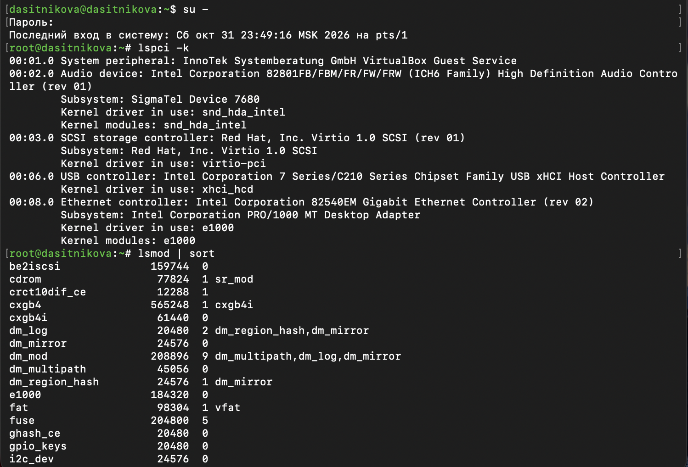{#fig-001 width=85%}

На шине PCI виртуальной машины пять устройств:

- `00:01.0` --- служебное устройство VirtualBox Guest Service, через которое гостевые дополнения обмениваются данными с гипервизором; драйвер к нему не подключён.
- `00:02.0` --- звуковой контроллер Intel High Definition Audio, который эмулирует VirtualBox. С ним работает драйвер `snd_hda_intel`, и строка `Kernel modules` называет тот же модуль: драйвер загружен как модуль.
- `00:03.0` --- контроллер дисков Virtio SCSI. Устройства virtio --- паравиртуальные: они не имитируют реальное оборудование, а предназначены для эффективного обмена данными с гипервизором. С ним работает драйвер шины `virtio-pci`, а строки `Kernel modules` нет: драйвер встроен в ядро, поскольку без него система не смогла бы прочитать диск при загрузке.
- `00:06.0` --- контроллер USB 3.0 Intel xHCI, драйвер `xhci_hcd` также встроен в ядро.
- `00:08.0` --- сетевой адаптер Intel 82540EM Gigabit Ethernet (PRO/1000 MT Desktop), драйвер --- модуль `e1000`.

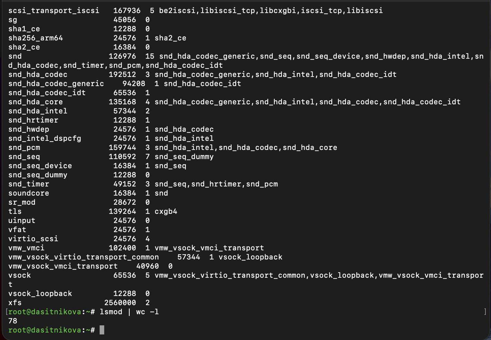{#fig-002 width=85%}

Команда `lsmod` выводит три столбца: имя модуля, его размер в байтах и счётчик использования со списком модулей, которые используют данный. Всего загружено 77 модулей (78 строк вывода минус строка заголовка). Например, модуль `dm_mod` (Device Mapper) используется 9 раз: на нём построены логические тома LVM, в том числе корневой том; модуль `snd` --- ядро звуковой подсистемы --- используется 15 модулями `snd_*`; `vfat` и `fat` обслуживают раздел EFI `/boot/efi`; `virtio_scsi` --- драйвер дисков на шине virtio. Модуль `xfs` используется 2 раза. Нулевой счётчик у `e1000` означает лишь, что на модуль не ссылаются другие модули: выгрузить его можно, но вместе с ним пропадёт сеть.

Проверено, загружен ли модуль `ext4`, модуль загружен, и выведена информация о нём ([рис. @fig-003]).

~~~bash
lsmod | grep ext4
modprobe ext4
lsmod | grep ext4
modinfo ext4
~~~

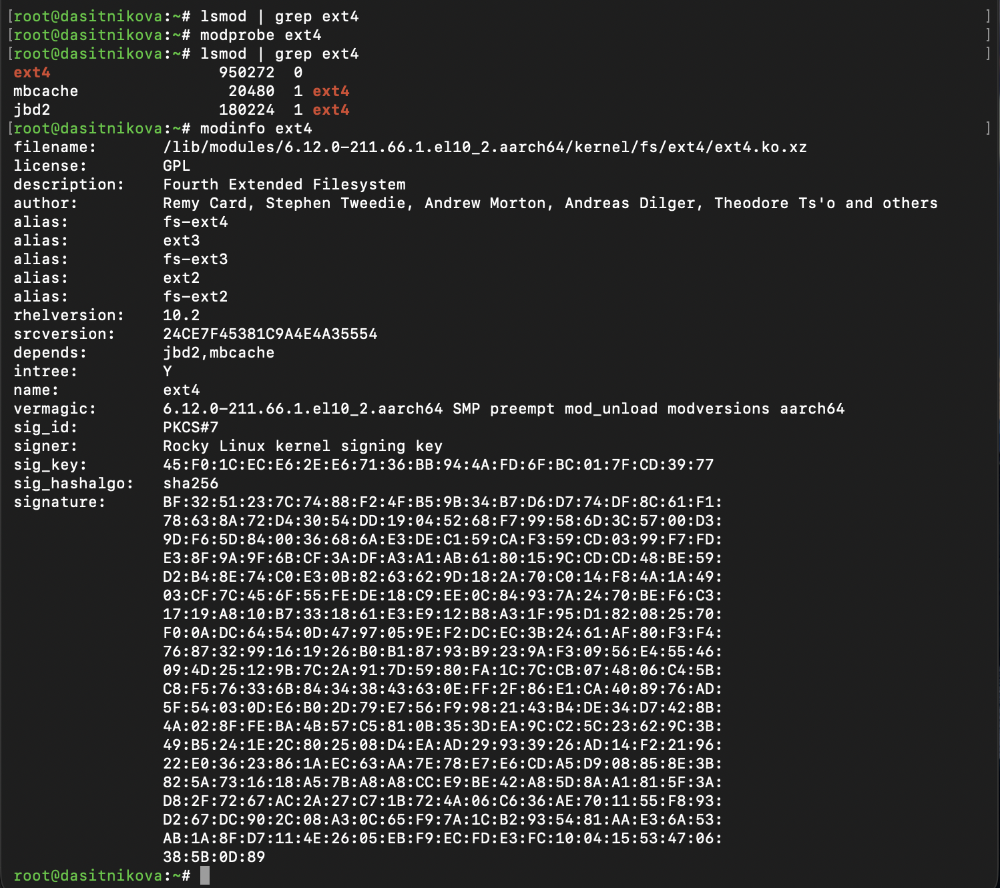{#fig-003 width=85%}

До выполнения `modprobe` модуль `ext4` не загружен: корневая файловая система и `/boot` используют XFS. После загрузки в списке три модуля: `ext4` и модули журналирования `jbd2` и кэша расширенных атрибутов `mbcache`, которые `modprobe` загрузил автоматически как зависимости; у них счётчик 1 и пользователь `ext4`.

Пояснение выведенной информации о модуле `ext4`:

- `filename` --- файл модуля `/lib/modules/6.12.0-211.66.1.el10_2.aarch64/kernel/fs/ext4/ext4.ko.xz` в каталоге работающего ядра;
- `license: GPL` --- лицензия модуля; модули с несвободной лицензией помечают ядро как «загрязнённое»;
- `description` и `author` --- назначение (Fourth Extended Filesystem) и авторы;
- `alias` --- псевдонимы `fs-ext4`, `ext3`, `fs-ext3`, `ext2`, `fs-ext2`: этот же модуль обслуживает файловые системы ext2 и ext3 и загружается автоматически при их монтировании;
- `rhelversion: 10.2` и `srcversion` --- выпуск дистрибутива и контрольная сумма исходного кода модуля;
- `depends: jbd2,mbcache` --- модули, которые должны быть загружены раньше;
- `intree: Y` --- модуль входит в дерево исходных текстов ядра, а не поставляется отдельно;
- `name` --- имя модуля;
- `vermagic` --- версия и параметры сборки ядра, для которого собран модуль: `6.12.0-211.66.1.el10_2.aarch64 SMP preempt mod_unload modversions aarch64` --- многопроцессорное ядро с вытеснением и поддержкой выгрузки модулей;
- `sig_id`, `signer`, `sig_key`, `sig_hashalgo`, `signature` --- цифровая подпись модуля формата PKCS#7, созданная ключом Rocky Linux kernel signing key с хеш-функцией SHA-256.

Строк `parm:` в выводе нет: параметров у модуля `ext4` нет. Параметры монтирования файловой системы задаются не модулю, а при монтировании.

Модуль `ext4` выгружен, затем выполнена попытка выгрузить модуль `xfs` ([рис. @fig-004]).

~~~bash
modprobe -r ext4
lsmod | grep ext4
modprobe -r xfs
~~~

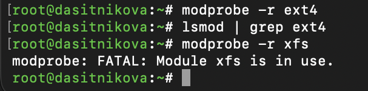{#fig-004 width=60%}

Команда `modprobe -r ext4` выполнилась без сообщений: при успешном выполнении система ничего не выводит. Список загруженных модулей больше не содержит ни `ext4`, ни его зависимостей `jbd2` и `mbcache`: `modprobe` выгрузил и их, поскольку они стали не нужны. Попытка выгрузить `xfs` завершилась ошибкой `modprobe: FATAL: Module xfs is in use.`: модуль используется. Кем именно, показывают счётчик модуля и список смонтированных файловых систем этого типа ([рис. @fig-005]).

~~~bash
lsmod | grep -E '^Module|^xfs'
findmnt -t xfs
~~~

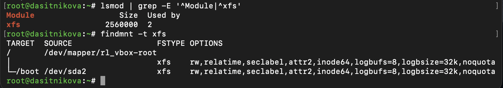{#fig-005 width=85%}

Счётчик использования `xfs` равен 2 --- по числу смонтированных файловых систем XFS: корневой (`/`, логический том `/dev/mapper/rl_vbox-root`) и `/boot` (раздел `/dev/sda2`). Пока они смонтированы, модуль выгрузить невозможно.

## Загрузка модулей ядра с параметрами

Проверено, загружен ли модуль `bluetooth`, модуль загружен, просмотрен список модулей, отвечающих за работу с Bluetooth, и выведена информация о модуле ([рис. @fig-006]).

~~~bash
lsmod | grep bluetooth
modprobe bluetooth
lsmod | grep bluetooth
modinfo bluetooth
~~~

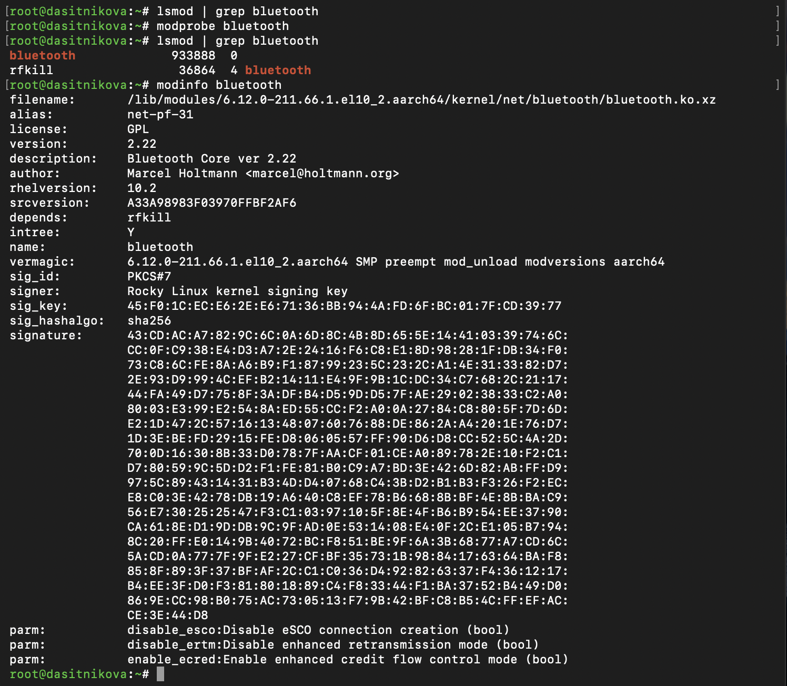{#fig-006 width=85%}

До загрузки модуля нет. После `modprobe` загружен модуль `bluetooth` --- ядро стека Bluetooth версии 2.22 (Bluetooth Core), автор Марсель Хольтманн, --- и используемый им модуль `rfkill`, через который ядро включает и выключает беспроводные передатчики. Псевдоним `net-pf-31` означает, что модуль загружается автоматически при создании сокета семейства протоколов 31 --- `AF_BLUETOOTH`.

Для работы модуля могут быть установлены три параметра логического типа (`bool`). Их список и текущие значения выведены отдельно ([рис. @fig-007]).

~~~bash
modinfo -p bluetooth
grep -H . /sys/module/bluetooth/parameters/*
~~~

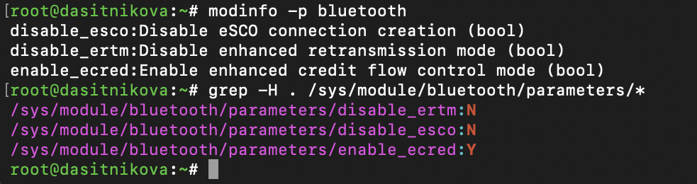{#fig-007 width=75%}

- `disable_esco` --- запретить создание соединений eSCO (Extended Synchronous Connection-Oriented). Это синхронные каналы для передачи голоса, например к гарнитуре, с повторной передачей потерянных пакетов; при запрете используются более простые соединения SCO. Текущее значение `N`.
- `disable_ertm` --- отключить расширенный режим повторной передачи (Enhanced Retransmission Mode) протокола L2CAP, обеспечивающий надёжную доставку данных. Отключают его для совместимости со старыми устройствами. Текущее значение `N`.
- `enable_ecred` --- включить режим управления потоком на основе кредитов (Enhanced Credit Based Flow Control) протокола L2CAP из спецификации Bluetooth 5.2, который используется, например, для передачи звука по Bluetooth Low Energy. Текущее значение `Y`.

Параметры задаются при загрузке, например `modprobe bluetooth disable_esco=1`, или строкой `options bluetooth disable_esco=1` в файле каталога `/etc/modprobe.d`.

Модуль ядра `bluetooth` выгружен ([рис. @fig-008]).

~~~bash
modprobe -r bluetooth
lsmod | grep bluetooth
~~~

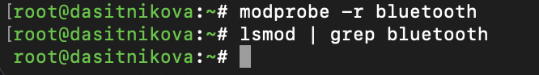{#fig-008 width=55%}

Список модулей Bluetooth пуст: модуль выгружен.

## Обновление ядра системы

Просмотрены версия ядра и список пакетов ядра, система обновлена, после чего обновлены ядро и система, выведены установленные ядра и ядро, которое будет загружено по умолчанию ([рис. @fig-009]).

~~~bash
uname -r
dnf list kernel
dnf upgrade --refresh
dnf update kernel
dnf update
dnf upgrade --refresh
rpm -q kernel
grubby --default-kernel
~~~

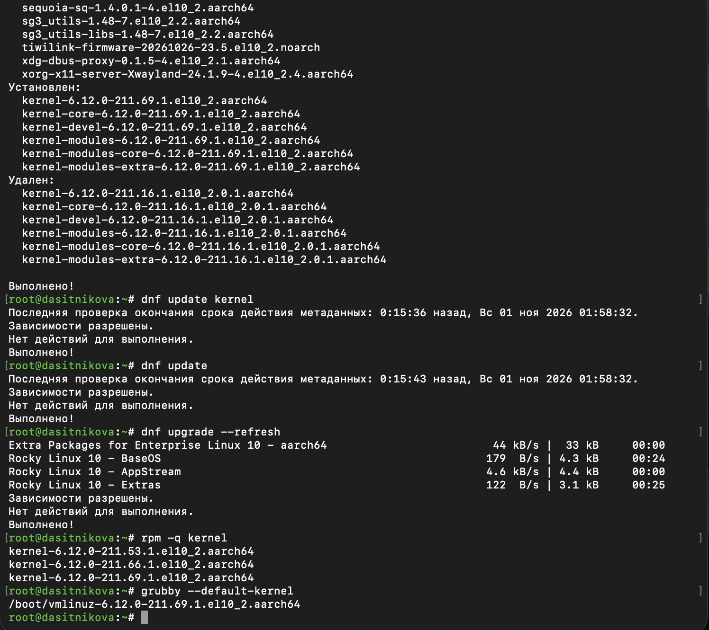{#fig-009 width=85%}

До обновления работало ядро `6.12.0-211.66.1.el10_2.aarch64`: эта версия указана в пути к файлам модулей и в строке `vermagic` ([рис. @fig-003]). Обновление системы установило ядро `6.12.0-211.69.1` --- пакеты `kernel`, `kernel-core`, `kernel-devel`, `kernel-modules`, `kernel-modules-core` и `kernel-modules-extra` --- и удалило те же пакеты самого старого ядра `6.12.0-211.16.1`: в системе хранится не более трёх ядер. Последующие команды `dnf update kernel`, `dnf update` и `dnf upgrade --refresh` сообщили, что действий для выполнения нет: все пакеты уже обновлены. Установлены ядра `211.53.1`, `211.66.1` и `211.69.1`, и по умолчанию будет загружено новое ядро `211.69.1`.

Система перезагружена, и при загрузке выбрано новое ядро ([рис. @fig-010]).

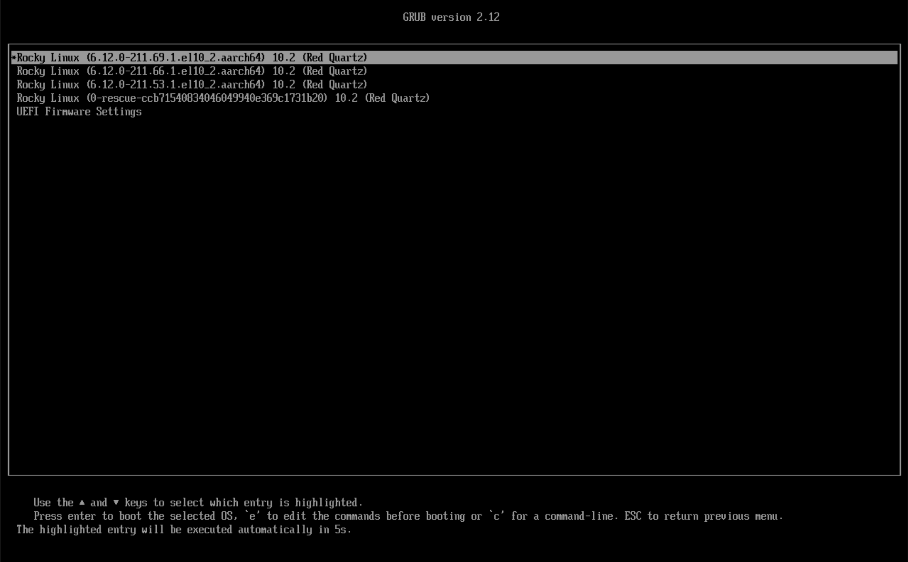{#fig-010 width=85%}

Меню загрузчика GRUB 2.12 содержит три установленных ядра Rocky Linux 10.2 (Red Quartz), запись аварийного ядра `0-rescue-ccb71540834046049940e369c1731b20`, где после `rescue` указан идентификатор компьютера, и пункт перехода в настройки прошивки UEFI. Выделено и отмечено звёздочкой новое ядро `6.12.0-211.69.1`; если не нажимать клавиш, оно будет загружено через 5 секунд.

После загрузки выведена версия используемого ядра и сведения о системе ([рис. @fig-011]).

~~~bash
uname -r
hostnamectl
~~~

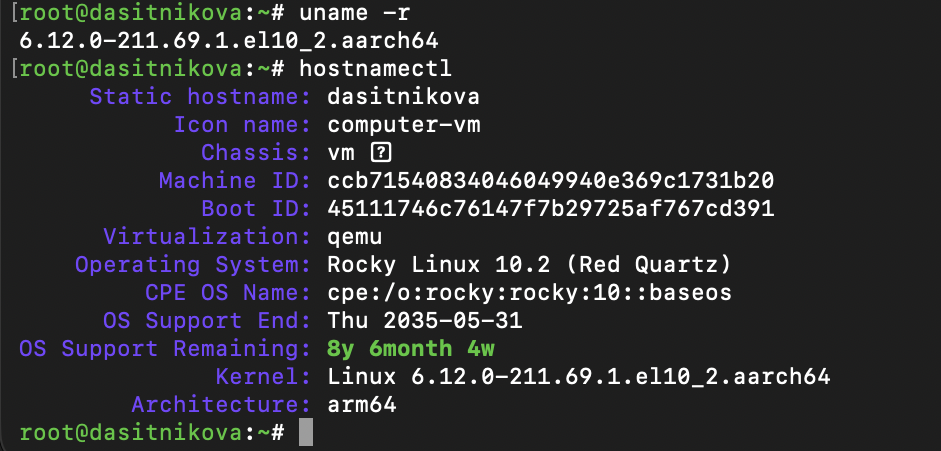{#fig-011 width=75%}

Система работает с ядром `6.12.0-211.69.1.el10_2.aarch64`. Команда `hostnamectl` выводит имя узла `dasitnikova`, тип корпуса `vm`, идентификаторы компьютера и текущей загрузки, обнаруженную виртуализацию `qemu`, операционную систему Rocky Linux 10.2 (Red Quartz), дату окончания поддержки выпуска --- 31 мая 2035 года --- и оставшийся срок поддержки, версию ядра и архитектуру `arm64`.

# Выводы

В ходе лабораторной работы получены навыки работы с утилитами управления модулями ядра Rocky Linux 10.2. Определены драйверы устройств системы, просмотрен список загруженных модулей, модуль `ext4` загружен вместе с зависимостями и выгружен, а на примере модуля `xfs` показано, что модуль, который используется смонтированной файловой системой, выгрузить нельзя.

Загружен модуль `bluetooth`, определены его параметры и их текущие значения. Ядро системы обновлено до версии `6.12.0-211.69.1`, при этом предыдущие ядра сохранены и доступны в меню загрузчика.

# Контрольные вопросы

1. **Какая команда показывает текущую версию ядра, которая используется на вашей системе?**

   `uname -r` ([рис. @fig-011]).

   ~~~bash
   uname -r
   ~~~

2. **Как можно посмотреть более подробную информацию о текущей версии ядра операционной системы?**

   `uname -a` --- версия, дата сборки, архитектура; `hostnamectl` --- ядро вместе с ОС и оборудованием ([рис. @fig-011]); `cat /proc/version` --- с какой версией компилятора собрано; `rpm -qi kernel-core-$(uname -r)` --- сведения о пакете ядра.

3. **Какая команда показывает список загруженных модулей ядра?**

   `lsmod`, она в удобном виде показывает содержимое `/proc/modules` ([рис. @fig-001], [рис. @fig-002]).

4. **Какая команда позволяет вам определять параметры модуля ядра?**

   `modinfo модуль` (строки `parm:`) или `modinfo -p модуль` --- только параметры. Текущие значения загруженного модуля лежат в `/sys/module/модуль/parameters/` ([рис. @fig-006], [рис. @fig-007]).

5. **Как выгрузить модуль ядра?**

   `modprobe -r модуль` --- выгружает модуль и ставшие ненужными зависимости ([рис. @fig-004], [рис. @fig-008]). `rmmod модуль` выгружает только сам модуль.

6. **Что вы можете сделать, если получите сообщение об ошибке при попытке выгрузить модуль ядра?**

   Посмотреть, кто его держит: столбец `Used by` в `lsmod` ([рис. @fig-005]). Затем освободить модуль: выгрузить зависимые модули, остановить службу, которая с ним работает, отмонтировать файловую систему. Если модуль нужен самой системе, как `xfs` для корня, выгрузить его нельзя; тогда можно запретить его загрузку в `/etc/modprobe.d/` (`blacklist модуль`) и перезагрузиться. `rmmod -f` использовать не стоит: он может обрушить систему.

7. **Как определить, какие параметры модуля ядра поддерживаются?**

   `modinfo -p модуль` или строки `parm:` в `modinfo` --- имя, описание и тип каждого параметра ([рис. @fig-007]). Задать параметр при загрузке: `modprobe bluetooth disable_esco=1`, а чтобы он действовал всегда --- строка `options bluetooth disable_esco=1` в файле `/etc/modprobe.d/bluetooth.conf`.

8. **Как установить новую версию ядра?**

   `dnf update kernel` (или `dnf install kernel`) и перезагрузка ([рис. @fig-009], [рис. @fig-010]). Новое ядро ставится рядом со старыми: dnf хранит до трёх ядер (`installonly_limit=3`), чтобы при проблемах можно было загрузить предыдущее из меню GRUB. Ядро по умолчанию показывает и меняет `grubby --default-kernel` и `grubby --set-default`.

   ~~~bash
   dnf update kernel
   grubby --default-kernel
   reboot
   ~~~

# Список литературы{.unnumbered}

::: {#refs}
:::
