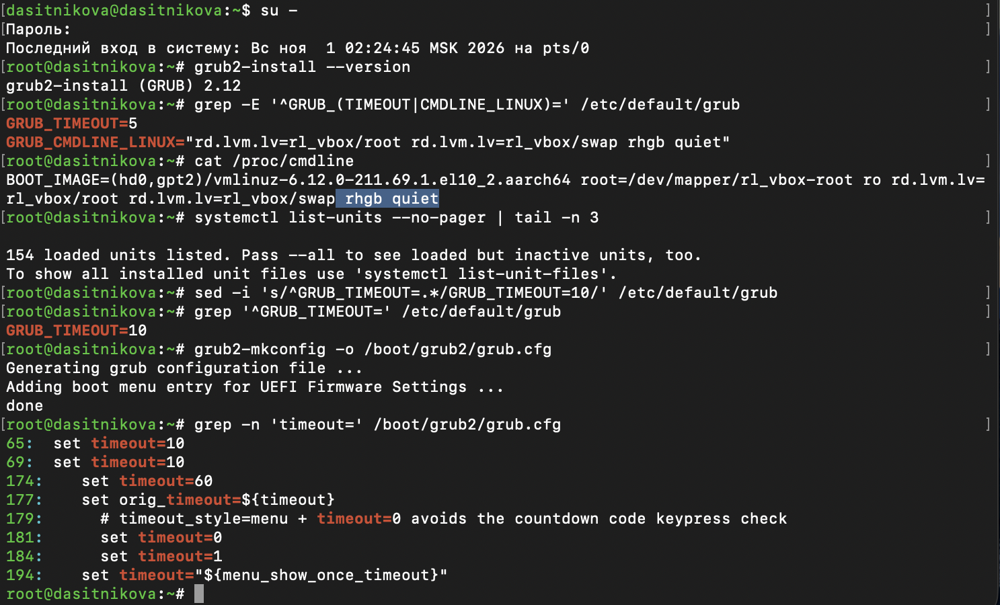
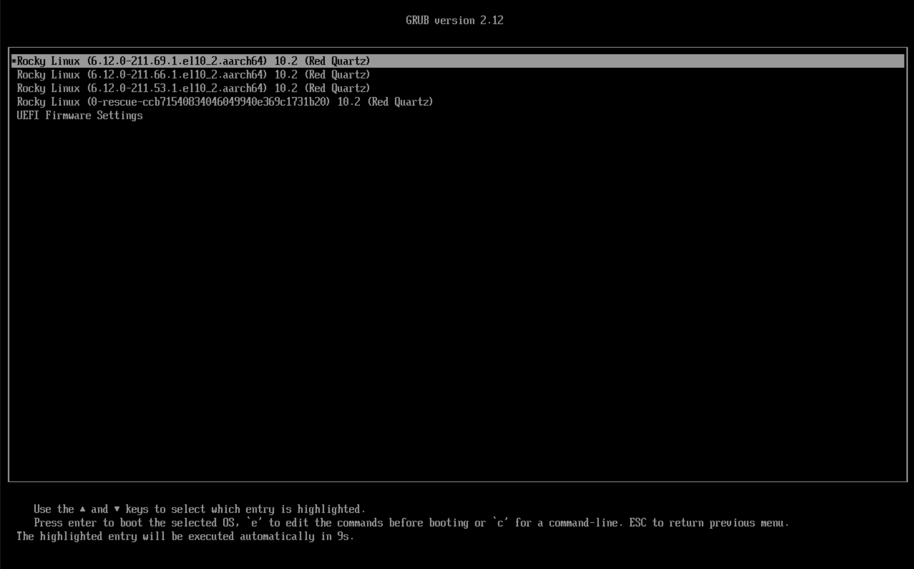
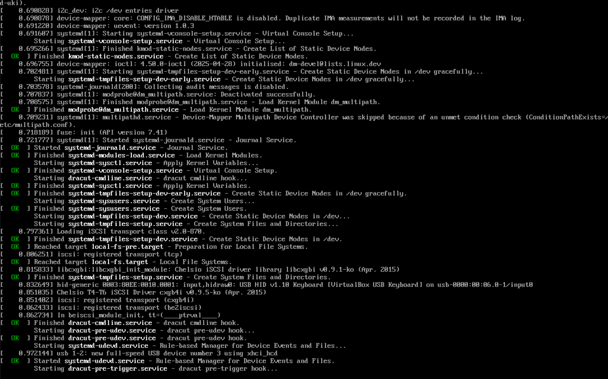
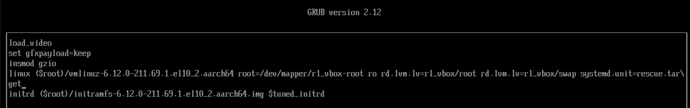
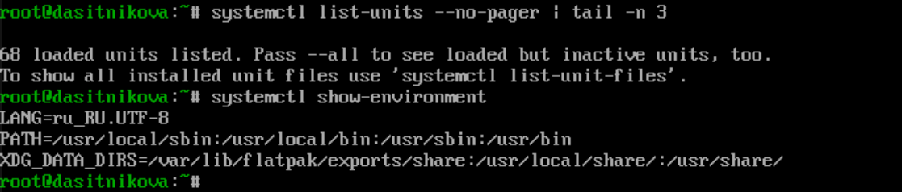
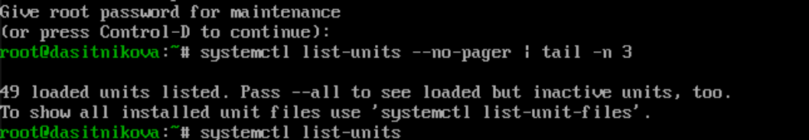
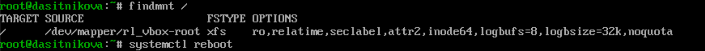
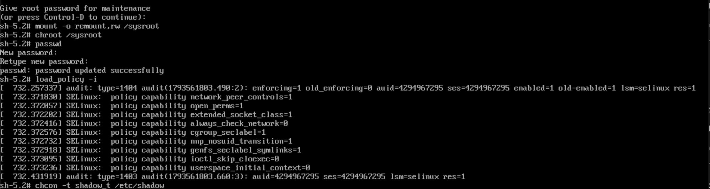
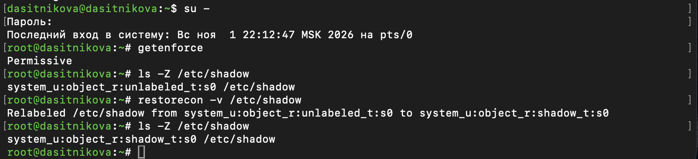
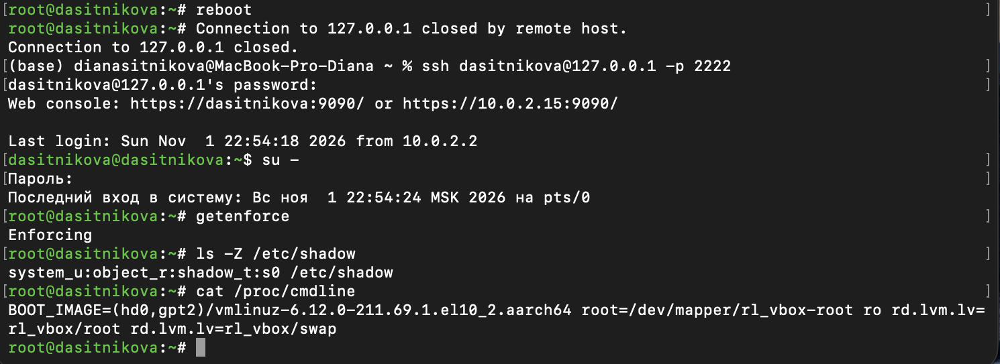

---
## Author
author:
  name: Ситникова Диана Александровна
  degrees: BSc
  email: 1032201746@rudn.ru
  affiliation:
    - name: Российский университет дружбы народов
      country: Российская Федерация
      postal-code: 117198
      city: Москва
      address: ул. Миклухо-Маклая, д. 6
## Title
title: "Лабораторная работа № 11"
subtitle: "Управление загрузкой системы"
institute:
  - "Российский университет дружбы народов им. П. Лумумбы"
  - "Преподаватель: д.ф.-м.н., профессор Кулябов Дмитрий Сергеевич"
license: CC BY
date: today
date-format: "YYYY-MM-DD"
header-includes:
  - \usepackage{tikz}
---

# Информация

## Докладчик

:::::::::::::: {.columns align=center}
::: {.column width="68%"}

- Ситникова Диана Александровна
- направление 09.03.03 «Прикладная информатика»
- Российский университет дружбы народов
- [1032201746@rudn.ru](mailto:1032201746@rudn.ru)

:::
::: {.column width="32%"}

{width=100%}

:::
::::::::::::::

# Вводная часть

## Актуальность

- Если система не загружается, на SSH рассчитывать нельзя --- остаётся только меню загрузчика.
- Из GRUB можно запустить систему в урезанном режиме и починить то, что мешает загрузке.
- Забытый пароль root тоже решается через загрузчик --- поэтому важно понимать и риск.

## Объект, предмет, цель и задачи

**Объект** --- процесс загрузки Rocky Linux 10.2.

**Предмет** --- загрузчик GRUB2 и параметры ядра.

**Цель** --- получить навыки работы с загрузчиком системы GRUB2.

**Задачи:** изменить параметры GRUB и записать их в конфигурацию; устранить неполадки с помощью GRUB; поработать с GRUB без использования root.

## Материалы и методы

| Компонент | Значение |
|---|---|
| Стенд | Rocky Linux 10.2, GRUB 2.12, UEFI |
| Настройка GRUB | `/etc/default/grub`, `grub2-mkconfig`, `grubby` |
| Редактор меню | клавиша `e`, Ctrl+X |
| Режимы | `rescue.target`, `emergency.target`, `rd.break` |
| Проверка | `systemctl list-units`, `ls -Z`, `restorecon` |

# Содержание исследования

## Чем раньше остановка, тем меньше работает

\begin{center}
\resizebox{\linewidth}{!}{%
\begin{tikzpicture}[font=\scriptsize]
  \draw[->,thick] (0,0) -- (14.2,0);
  \foreach \x/\t in {1.2/GRUB, 4.0/initramfs, 6.8/emergency, 9.6/rescue, 12.4/обычная}
    \node[draw,thick,fill=white,minimum width=2.2cm,minimum height=0.8cm] at (\x,0) {\t};
  \node[font=\tiny] at (1.2,0.8) {клавиша \texttt{e}};
  \node[font=\tiny] at (4.0,0.8) {\texttt{rd.break}};
  \node[font=\tiny,align=center] at (6.8,0.95) {\texttt{systemd.unit=}\\\texttt{emergency.target}};
  \node[font=\tiny,align=center] at (9.6,0.95) {\texttt{systemd.unit=}\\\texttt{rescue.target}};
  \node[font=\tiny] at (12.4,0.8) {без параметров};
  \node[font=\tiny,align=center] at (1.2,-0.85) {меню и\\параметры ядра};
  \node[font=\tiny,align=center] at (4.0,-0.85) {корень в \texttt{/sysroot}\\без пароля};
  \node[font=\tiny,align=center] at (6.8,-0.85) {только корень, \texttt{ro}\\49 юнитов};
  \node[font=\tiny,align=center] at (9.6,-0.85) {без сети\\68 юнитов};
  \node[font=\tiny,align=center] at (12.4,-0.85) {всё работает\\154 юнита};
\end{tikzpicture}%
}
\end{center}

Параметр, введённый в меню GRUB, действует только на одну загрузку.

## Настройки GRUB --- в /etc/default/grub

:::::::::::::: {.columns align=center}
::: {.column width="35%"}

`GRUB_TIMEOUT=5` → `10`.

`grub2-mkconfig` собирает `grub.cfg` из этого файла и сценариев `/etc/grub.d`.

Убраны `rhgb quiet` --- заставка вместо сообщений.

:::
::: {.column width="65%"}

{width=100%}

:::
::::::::::::::

## Меню ждёт 10 секунд, загрузка видна

:::::::::::::: {.columns align=center}
::: {.column width="50%"}

{width=100%}

:::
::: {.column width="50%"}

{width=100%}

:::
::::::::::::::

- Отсчёт `…automatically in 9s` --- новое время ожидания.
- Вместо заставки --- сообщения ядра и systemd: видно, что делает система.

## Параметр ядра --- прямо в меню

{width=100%}

- `e` открывает пункт меню, строка `linux` --- ядро и его параметры.
- В конец дописан `systemd.unit=rescue.target`, Ctrl+X --- загрузка.

## rescue и emergency --- два уровня урезанной системы

:::::::::::::: {.columns align=center}
::: {.column width="35%"}

rescue: 68 юнитов, диски смонтированы, сети нет.

emergency: 49 юнитов, корень только для чтения.

Обычно: 154 юнита.

:::
::: {.column width="65%"}

{width=100%}

{width=100%}

{width=100%}

:::
::::::::::::::

## rd.break: новый пароль root без старого

{width=100%}

- Загрузка остановлена в initramfs, оболочка без пароля.
- `mount -o remount,rw /sysroot`, `chroot /sysroot`, `passwd` --- пароль изменён.
- Новый `/etc/shadow` создан без метки SELinux: `unlabeled_t`.

## Метка восстановлена --- вход работает

:::::::::::::: {.columns align=center}
::: {.column width="35%"}

Загрузка с `enforcing=0`, `restorecon`: `unlabeled_t` → `shadow_t`.

После обычной перезагрузки --- `Enforcing`, вход с новым паролем.

:::
::: {.column width="65%"}

{width=100%}

{width=100%}

:::
::::::::::::::

# Результаты

## Загрузка под контролем

- Изменены время показа меню и параметры ядра, конфигурация пересобрана.
- Система загружена в режимах rescue и emergency.
- Пароль root сброшен через `rd.break`, метка `/etc/shadow` восстановлена.

## Вывод

Загрузчик --- это пульт управления загрузкой: одним параметром можно остановить её на любом этапе и починить систему изнутри.

Кто имеет доступ к меню GRUB, тот имеет доступ к root --- поэтому загрузчик тоже нужно защищать.
