---
## Author
author:
  name: Ситникова Диана Александровна
  degrees: BSc
  email: 1032201746@rudn.ru
  affiliation:
    - name: Российский университет дружбы народов
      country: Российская Федерация
      postal-code: 117198
      city: Москва
      address: ул. Миклухо-Маклая, д. 6

## Title
title: "Отчёт по лабораторной работе №11"
subtitle: "Управление загрузкой системы"
license: "CC BY"
bibliography: bib/cite.bib
---

# Цель работы

Целью данной работы является получение навыков работы с загрузчиком системы GRUB2.

# Задание

- Продемонстрировать навыки по изменению параметров GRUB и записи изменений в файл конфигурации.
- Продемонстрировать навыки устранения неполадок при работе с GRUB.
- Продемонстрировать навыки работы с GRUB без использования root.

# Теоретическое введение

## Этапы загрузки системы

Загрузка Linux проходит несколько этапов, на каждом из которых управление передаётся следующей программе ([табл. @tbl-stages]) [@nemeth_book_unix-linux-admin_ru]. После включения компьютера микропрограмма инициализирует оборудование и ищет загрузчик. Старые компьютеры x86 используют BIOS, который читает первый сектор диска; современные компьютеры, в том числе все системы с архитектурой ARM64, --- UEFI, которая загружает исполняемый файл с раздела EFI (в Rocky Linux он смонтирован в `/boot/efi`). При включённой безопасной загрузке (Secure Boot) первым запускается подписанный Microsoft промежуточный загрузчик shim, который проверяет подпись GRUB.

| Этап | Программа | Что делает |
|-------------------|------------------------|--------------------------------------------------|
| микропрограмма | UEFI или BIOS | проверяет оборудование, запускает загрузчик |
| загрузчик | GRUB 2 | показывает меню, загружает ядро и initramfs, передаёт параметры ядра |
| ядро | `vmlinuz-‹версия›` | инициализирует оборудование, распаковывает initramfs |
| initramfs | dracut, systemd | находит и монтирует корневую файловую систему в `/sysroot` |
| система | systemd (PID 1) | переключается на настоящий корень и запускает цель по умолчанию |

: Этапы загрузки Rocky Linux {#tbl-stages}

Образ initramfs --- небольшая файловая система в оперативной памяти, которую загрузчик передаёт ядру вместе с ним. В Rocky Linux его собирает программа dracut. В initramfs находятся драйверы и программы, необходимые для подключения корневой файловой системы: драйверы дисков, средства LVM, RAID и шифрования. Когда корень найден, он монтируется в каталог `/sysroot`, после чего systemd в initramfs выполняет `switch_root`: корнем системы становится `/sysroot`, и запускается основной systemd.

## Загрузчик GRUB 2

GRUB (GRand Unified Bootloader) --- загрузчик проекта GNU [@grub_manual]. Первую версию, ныне называемую GRUB Legacy, в 1995 году создал Эрих Болейн для загрузки ядра GNU Hurd. GRUB 2 написан заново и в 2012 году получил версию 2.00; в Rocky Linux 10 используется GRUB 2.12. GRUB умеет читать распространённые файловые системы, в том числе XFS, ext4 и LVM, поэтому находит ядро по имени файла, а не по номерам блоков на диске. Он показывает меню выбора системы и ядра, позволяет изменить параметры загрузки перед запуском и предоставляет собственную командную строку.

Настройки GRUB 2 хранятся в нескольких местах ([табл. @tbl-files]). Файл, который читает сам загрузчик, --- `/boot/grub2/grub.cfg` --- вручную не редактируют: его создаёт программа `grub2-mkconfig`, выполняя по порядку сценарии каталога `/etc/grub.d` с параметрами из файла `/etc/default/grub`.

| Файл | Назначение |
|----------------------------------|----------------------------------------------------------|
| `/etc/default/grub` | общие параметры: время показа меню, параметры ядра, ядро по умолчанию |
| `/etc/grub.d/` | сценарии, из которых собирается `grub.cfg`: `00_header`, `10_linux`, `30_uefi-firmware`, `40_custom` и др. |
| `/boot/grub2/grub.cfg` | итоговая конфигурация, создаётся `grub2-mkconfig` |
| `/boot/efi/EFI/rocky/grub.cfg` | заглушка на разделе EFI, которая загружает `/boot/grub2/grub.cfg` |
| `/boot/loader/entries/*.conf` | пункты меню для каждого ядра (BLS) |
| `/boot/grub2/grubenv` | переменные GRUB: выбранное ядро, скрытие меню |

: Файлы конфигурации GRUB 2 в Rocky Linux 10 {#tbl-files}

Основные параметры файла `/etc/default/grub` приведены в [табл. @tbl-params].

| Параметр | Значение |
|---------------------------|--------------------------------------------------------------|
| `GRUB_TIMEOUT` | время показа меню в секундах до загрузки пункта по умолчанию |
| `GRUB_DEFAULT` | пункт по умолчанию; `saved` --- последний сохранённый в `grubenv` |
| `GRUB_DISABLE_SUBMENU` | не группировать старые ядра в подменю |
| `GRUB_TERMINAL_OUTPUT` | вывод меню: текстовая консоль или графический режим |
| `GRUB_CMDLINE_LINUX` | параметры, передаваемые всем ядрам |
| `GRUB_DISABLE_RECOVERY` | не создавать отдельные пункты режима восстановления |
| `GRUB_ENABLE_BLSCFG` | брать пункты меню из файлов Boot Loader Specification |

: Основные параметры файла /etc/default/grub {#tbl-params}

## Пункты меню и параметры ядра

Начиная с RHEL 8 пункты меню хранятся не в `grub.cfg`, а в отдельных файлах каталога `/boot/loader/entries` по спецификации Boot Loader Specification (BLS) [@bls_spec]: по одному файлу на каждое установленное ядро. В файле указаны название пункта, путь к ядру и initramfs и строка параметров ядра. Такие файлы создаются и удаляются при установке и удалении ядер, поэтому `grub.cfg` не нужно пересоздавать после каждого обновления. Просматривать и изменять параметры отдельных ядер удобно командой `grubby` [@rhel10_kernel].

Из-за этого параметр `GRUB_CMDLINE_LINUX` действует лишь на новые ядра. Чтобы применить его изменение к уже установленным, в новых выпусках RHEL у `grub2-mkconfig` есть ключ `--update-bls-cmdline`, который переписывает строку параметров во всех файлах BLS. Параметры, с которыми загружено работающее ядро, выводит файл `/proc/cmdline`.

По умолчанию ядру передаются, в частности:

- `root=` --- корневая файловая система, `ro` --- смонтировать её сначала только для чтения;
- `rd.lvm.lv=` --- логические тома LVM, которые initramfs должен активировать;
- `rhgb` (Red Hat Graphical Boot) --- показывать графическую заставку Plymouth вместо сообщений;
- `quiet` --- выводить на консоль только важные сообщения ядра.

В меню GRUB любой пункт можно изменить перед загрузкой клавишей `e`: откроется текст пункта, где строка `linux` задаёт ядро и его параметры. Сочетание Ctrl+X загружает систему с изменёнными параметрами. Такие изменения ничего не записывают на диск и действуют только на одну загрузку. Rocky Linux по умолчанию скрывает меню, если предыдущая загрузка прошла успешно; за это отвечает переменная `menu_auto_hide` в файле `grubenv`.

## Цели восстановления

Если система не загружается обычным образом, ядру можно передать параметр, который остановит загрузку раньше ([табл. @tbl-modes]) [@dracut_cmdline; @systemd_special].

| Параметр ядра | Где останавливается загрузка | Что доступно |
|-------------------------------------|---------------------------------|------------------------------------------|
| `rd.break` | в initramfs, перед `switch_root` | корень в `/sysroot` только для чтения; пароль не нужен |
| `init=/bin/bash` | сразу после ядра и initramfs | оболочка вместо systemd |
| `systemd.unit=emergency.target` | сразу после монтирования корня | корень только для чтения, минимум юнитов |
| `systemd.unit=rescue.target` | после базовой инициализации | все локальные файловые системы, без сети |

: Параметры ядра для восстановления системы {#tbl-modes}

Цель `emergency.target` запускает лишь командную оболочку суперпользователя: корневая файловая система смонтирована только для чтения, другие файловые системы не подключены, службы не запущены. Её используют, когда система не может пройти даже базовую инициализацию, например из-за ошибки в `/etc/fstab`. Цель `rescue.target` поднимает `sysinit.target`: монтируются все локальные файловые системы, работают udev и журнал, но сеть и обычные службы не запускаются. В обоих случаях systemd запрашивает пароль root.

## Сброс пароля root и SELinux

Параметр `rd.break` останавливает загрузку в initramfs ещё до перехода на настоящую корневую файловую систему. Оболочка initramfs не спрашивает пароль, и через неё можно изменить любой файл системы: перемонтировать `/sysroot` для записи, сделать его корнем командой `chroot` и задать новый пароль root командой `passwd` [@rhel9_basic]. Поэтому физический доступ к компьютеру равносилен доступу суперпользователя, и для защиты устанавливают пароль на изменение пунктов меню GRUB (`grub2-setpassword`) и шифруют диски.

В этот момент SELinux ещё не включён. Команда `passwd` записывает новый пароль во временный файл и заменяет им `/etc/shadow`, поэтому новый файл создаётся без метки SELinux и получает тип `unlabeled_t`. Читать такой файл не разрешено службам входа в систему, и после обычной загрузки в режиме `enforcing` никто не сможет войти. Метку восстанавливают одним из способов:

- загрузить политику командой `load_policy -i` и назначить тип командой `chcon -t shadow_t /etc/shadow`;
- создать файл `/.autorelabel`, чтобы при следующей загрузке система перемаркировала все файлы; такой способ рекомендует Red Hat для RHEL 9 и 10;
- загрузить систему в разрешающем режиме параметром ядра `enforcing=0` и выполнить `restorecon /etc/shadow`.

# Выполнение лабораторной работы

Работа выполнена в виртуальной машине с Rocky Linux 10.2 в терминале, подключённом к гостевой системе по SSH; полномочия администратора получены командой `su -`. Меню загрузчика, загрузка в режимах восстановления и сброс пароля выполнялись в окне виртуальной машины.

## Модификация параметров GRUB2

Запущен терминал и получены полномочия администратора. Просмотрены версия загрузчика, текущие параметры GRUB и ядра и число юнитов в обычном режиме работы. Затем в файле `/etc/default/grub` установлено время показа меню 10 секунд, и изменения записаны в GRUB2 ([рис. @fig-001]).

~~~bash
su -
grub2-install --version
grep -E '^GRUB_(TIMEOUT|CMDLINE_LINUX)=' /etc/default/grub
cat /proc/cmdline
systemctl list-units --no-pager | tail -n 3
sed -i 's/^GRUB_TIMEOUT=.*/GRUB_TIMEOUT=10/' /etc/default/grub
grep '^GRUB_TIMEOUT=' /etc/default/grub
grub2-mkconfig -o /boot/grub2/grub.cfg
grep -n 'timeout=' /boot/grub2/grub.cfg
~~~

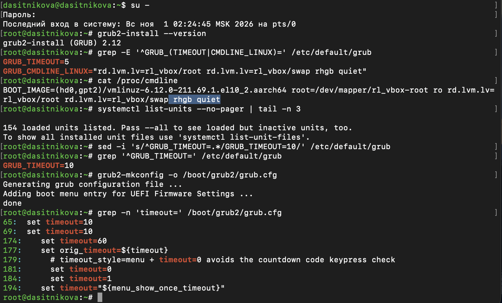{#fig-001 width=85%}

В системе установлен GRUB 2.12. Исходное время показа меню --- 5 секунд, ядру передаются параметры активации логических томов `rd.lvm.lv=rl_vbox/root` и `rd.lvm.lv=rl_vbox/swap`, а также `rhgb quiet`. Строка `/proc/cmdline` дополнительно содержит путь к ядру `BOOT_IMAGE=(hd0,gpt2)/vmlinuz-6.12.0-211.69.1…` --- второй раздел первого диска --- и параметры `root=/dev/mapper/rl_vbox-root ro`. В обычном режиме загружено 154 юнита.

После изменения параметр имеет значение `GRUB_TIMEOUT=10`. Программа `grub2-mkconfig` создала новый файл конфигурации и добавила пункт перехода в настройки прошивки UEFI. В `grub.cfg` время ожидания задано строками `set timeout=10`; остальные строки с `timeout` принадлежат логике скрытия меню.

Из параметра `GRUB_CMDLINE_LINUX` удалены параметры `rhgb` и `quiet`, скрывающие процесс загрузки, и изменения записаны в GRUB2 с обновлением параметров всех ядер ([рис. @fig-002]).

~~~bash
sed -i -E '/^GRUB_CMDLINE_LINUX=/{s/ ?rhgb//;s/ ?quiet//}' /etc/default/grub
grep '^GRUB_CMDLINE_LINUX=' /etc/default/grub
grub2-mkconfig -o /boot/grub2/grub.cfg --update-bls-cmdline
grubby --info=DEFAULT | grep -E '^(kernel|args)'
reboot
~~~

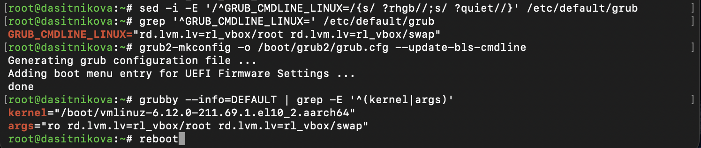{#fig-002 width=85%}

В строке `GRUB_CMDLINE_LINUX` остались только параметры LVM. Ключ `--update-bls-cmdline` перенёс изменение в файлы пунктов меню, и команда `grubby` показывает, что ядро по умолчанию `6.12.0-211.69.1` загружается с параметрами `ro rd.lvm.lv=rl_vbox/root rd.lvm.lv=rl_vbox/swap`.

После перезагрузки система показала меню GRUB ([рис. @fig-003]), а затем сообщения загрузки ([рис. @fig-004]).

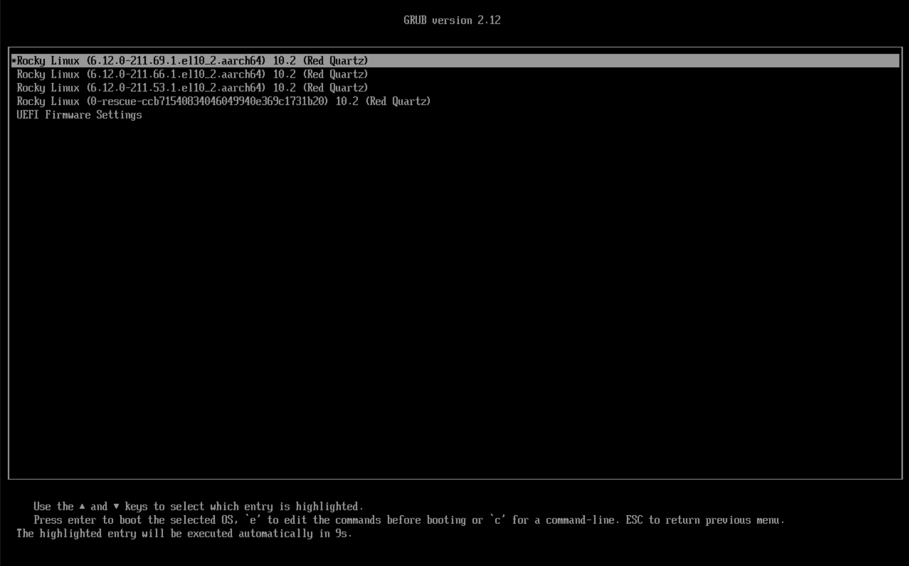{#fig-003 width=85%}

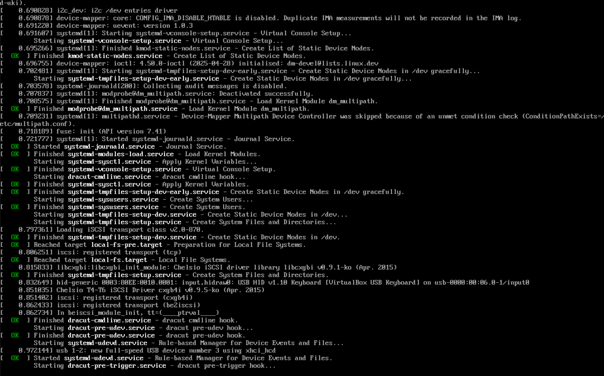{#fig-004 width=85%}

Меню содержит три установленных ядра, аварийное ядро и пункт настроек UEFI; по умолчанию выбрано новое ядро, и до его загрузки остаётся 9 секунд из 10. Вместо графической заставки выводятся сообщения ядра с отметками времени и сообщения systemd о запуске служб `[ OK ] Started …`, `Finished …`, `Reached target …`. Видна работа initramfs: службы dracut (`dracut-cmdline`, `dracut-pre-udev`, `dracut-pre-trigger`), активация устройств, загрузка драйверов iSCSI и подключение клавиатуры VirtualBox.

## Устранение неполадок

Система перезагружена. В меню GRUB выбрана строка с текущей версией ядра и нажата клавиша `e` для редактирования. В конце строки, загружающей ядро, введён параметр `systemd.unit=rescue.target` ([рис. @fig-005]).

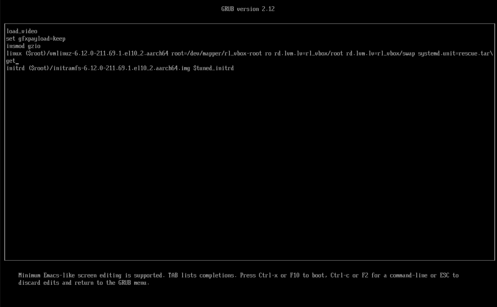{#fig-005 width=85%}

Текст пункта меню состоит из команд GRUB: `load_video` и `set gfxpayload=keep` настраивают вывод изображения, `insmod gzio` подключает модуль распаковки, `linux` загружает ядро `($root)/vmlinuz-6.12.0-211.69.1.el10_2.aarch64` с параметрами, `initrd` --- образ initramfs. Параметров `rhgb` и `quiet` в строке нет. Добавленный параметр указывает systemd запустить вместо цели по умолчанию цель восстановления.

Загрузка продолжена сочетанием Ctrl+X, по запросу введён пароль root. Просмотрен список загруженных юнитов ([рис. @fig-006]), их число и переменные среды ([рис. @fig-007]).

~~~bash
systemctl list-units
systemctl list-units --no-pager | tail -n 3
systemctl show-environment
~~~

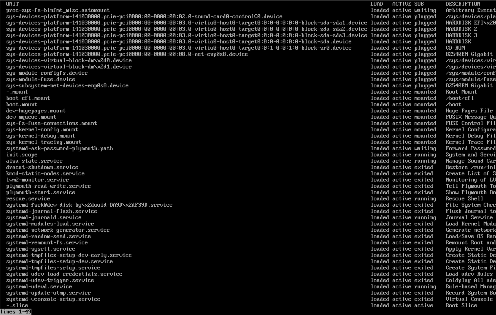{#fig-006 width=85%}

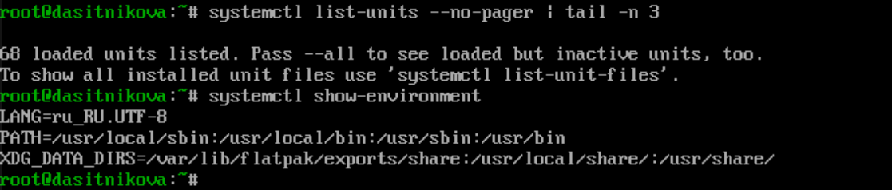{#fig-007 width=85%}

Загружена базовая системная среда: устройства, обнаруженные ядром, точки монтирования `/`, `/boot`, `/boot/efi` и служебных файловых систем, журнал `systemd-journald`, `udevd`, мониторинг LVM, настройка консоли. Служба `rescue.service` (Rescue Shell) работает --- это оболочка, в которой вводятся команды. Сетевых служб, `sshd`, `NetworkManager`, графического входа в списке нет. Всего 68 юнитов против 154 в обычном режиме. В окружении systemd заданы язык `LANG=ru_RU.UTF-8`, путь поиска программ `PATH` и каталоги данных `XDG_DATA_DIRS`.

Система перезагружена командой `systemctl reboot`. В меню GRUB для строки с текущим ядром снова открыт редактор, в конце строки, загружающей ядро, введён параметр `systemd.unit=emergency.target`, загрузка продолжена сочетанием Ctrl+X и введён пароль root. Просмотрены число загруженных юнитов ([рис. @fig-008]) и их список ([рис. @fig-009]), а также состояние корневой файловой системы ([рис. @fig-010]).

~~~bash
systemctl list-units --no-pager | tail -n 3
systemctl list-units
findmnt /
systemctl reboot
~~~

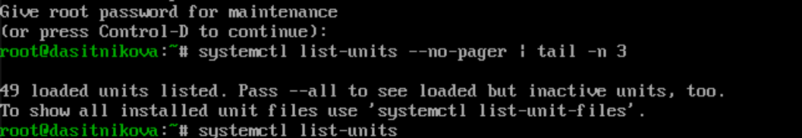{#fig-008 width=75%}

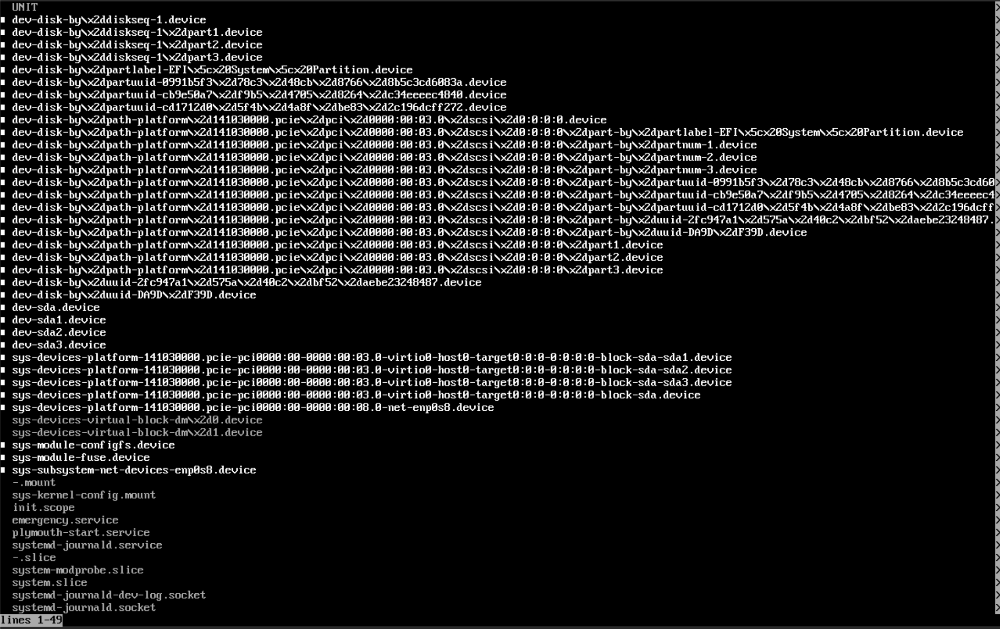{#fig-009 width=85%}

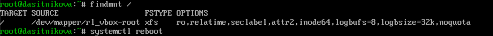{#fig-010 width=85%}

Количество загруженных юнитов уменьшилось до 49. Почти все они --- устройства: диск `sda`, его разделы под разными именами (по номеру, метке, UUID, пути), сетевой адаптер `enp0s8`. Кроме устройств работают лишь `emergency.service`, журнал и его сокеты, точка монтирования корня `-.mount`; разделы `/boot` и `/boot/efi` не смонтированы. Корневая файловая система смонтирована только для чтения: в столбце `OPTIONS` указано `ro`. В таком режиме можно исправлять ошибки, которые мешают даже базовой инициализации системы, предварительно перемонтировав корень для записи. После этого система перезагружена.

## Сброс пароля root

Система перезагружена, в меню GRUB для строки с текущим ядром открыт редактор, и в конце строки, загружающей ядро, введён параметр `rd.break` ([рис. @fig-011]).

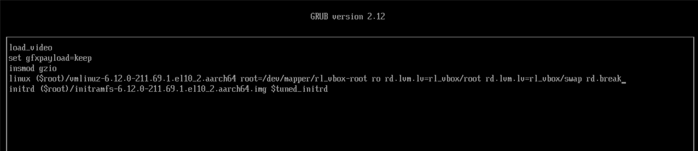{#fig-011 width=85%}

После нажатия Ctrl+X загрузка остановилась в initramfs перед монтированием корневой файловой системы в каталоге `/`. Системный образ перемонтирован для чтения и записи, каталог `/sysroot` сделан новым корневым каталогом, и задан новый пароль root. Затем загружена политика SELinux и выполнена попытка установить тип контекста файла `/etc/shadow` ([рис. @fig-012]).

~~~bash
mount -o remount,rw /sysroot
chroot /sysroot
passwd
load_policy -i
chcon -t shadow_t /etc/shadow
~~~

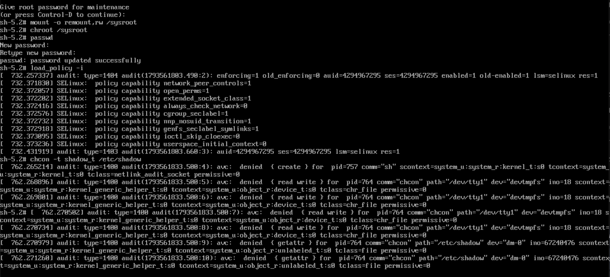{#fig-012 width=85%}

Команда `passwd` сообщила `password updated successfully`. Команда `load_policy -i` загрузила политику SELinux и включила режим принудительного исполнения: запись аудита содержит `enforcing=1 old_enforcing=0`, далее перечислены возможности загруженной политики. Процессы, запущенные из оболочки initramfs, после этого работают в домене `kernel_generic_helper_t`, и политика запрещает им доступ и к терминалу, и к файлу `/etc/shadow`: команда `chcon` получила отказы `avc: denied { getattr }`. В этих записях видна метка файла `tcontext=system_u:object_r:unlabeled_t:s0`: новый `/etc/shadow`, созданный командой `passwd` до включения SELinux, действительно не имеет метки.

Поэтому метка восстановлена после загрузки системы. Выполнен выход из оболочки командой `exit`, система перезапущена, и в меню GRUB к строке, загружающей ядро, добавлен параметр `enforcing=0`, загружающий SELinux в разрешающем режиме. После загрузки выполнен вход с новым паролем root и восстановлен контекст безопасности `/etc/shadow` ([рис. @fig-013]).

~~~bash
su -
getenforce
ls -Z /etc/shadow
restorecon -v /etc/shadow
ls -Z /etc/shadow
reboot
~~~

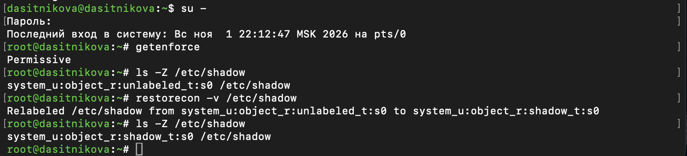{#fig-013 width=85%}

SELinux работает в разрешающем режиме `Permissive`, поэтому вход по новому паролю выполнен, хотя файл паролей имеет тип `unlabeled_t`. Команда `restorecon` сверила метку с базой контекстов и изменила её: `Relabeled /etc/shadow from system_u:object_r:unlabeled_t:s0 to system_u:object_r:shadow_t:s0`.

После обычной перезагрузки проверены вход в систему с изменённым паролем root, режим SELinux, контекст файла паролей и параметры загрузки ядра ([рис. @fig-014]).

~~~bash
su -
getenforce
ls -Z /etc/shadow
cat /proc/cmdline
~~~

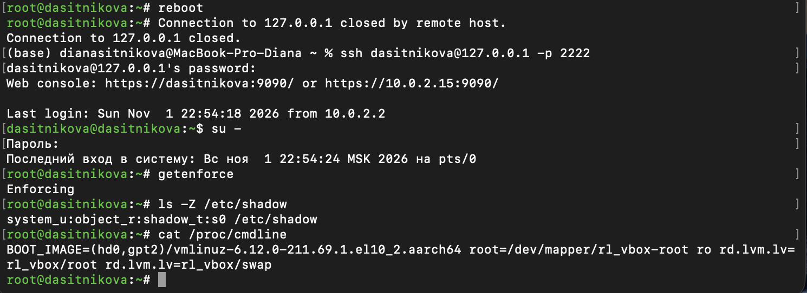{#fig-014 width=85%}

Вход по SSH и получение полномочий администратора с новым паролем выполнены успешно. SELinux работает в режиме `Enforcing`, файл `/etc/shadow` имеет тип `shadow_t`. Параметры ядра не содержат ни `rd.break`, ни `enforcing=0`: изменения, сделанные в редакторе GRUB, действовали только на одну загрузку. Пароль root сброшен без знания прежнего пароля.

# Выводы

В ходе лабораторной работы получены навыки работы с загрузчиком системы GRUB2 в Rocky Linux 10.2. Изменены время показа меню загрузки и параметры ядра в файле `/etc/default/grub`, изменения записаны в конфигурацию GRUB2 командой `grub2-mkconfig`, после чего при загрузке отображаются меню и сообщения загрузки.

С помощью параметров ядра, заданных в редакторе меню GRUB, система загружена в режиме восстановления и в аварийном режиме: число загруженных юнитов уменьшилось со 154 до 68 и 49 соответственно. С помощью параметра `rd.break` сброшен пароль root, а контекст безопасности файла `/etc/shadow` восстановлен командой `restorecon`.

# Контрольные вопросы

1. **Какой файл конфигурации следует изменить для применения общих изменений в GRUB2?**

   `/etc/default/grub`. В нём задаются общие параметры: время показа меню `GRUB_TIMEOUT`, параметры ядра `GRUB_CMDLINE_LINUX`, ядро по умолчанию и т. д. ([рис. @fig-001], [рис. @fig-015]). Тонкая настройка меню --- сценарии в каталоге `/etc/grub.d`.

   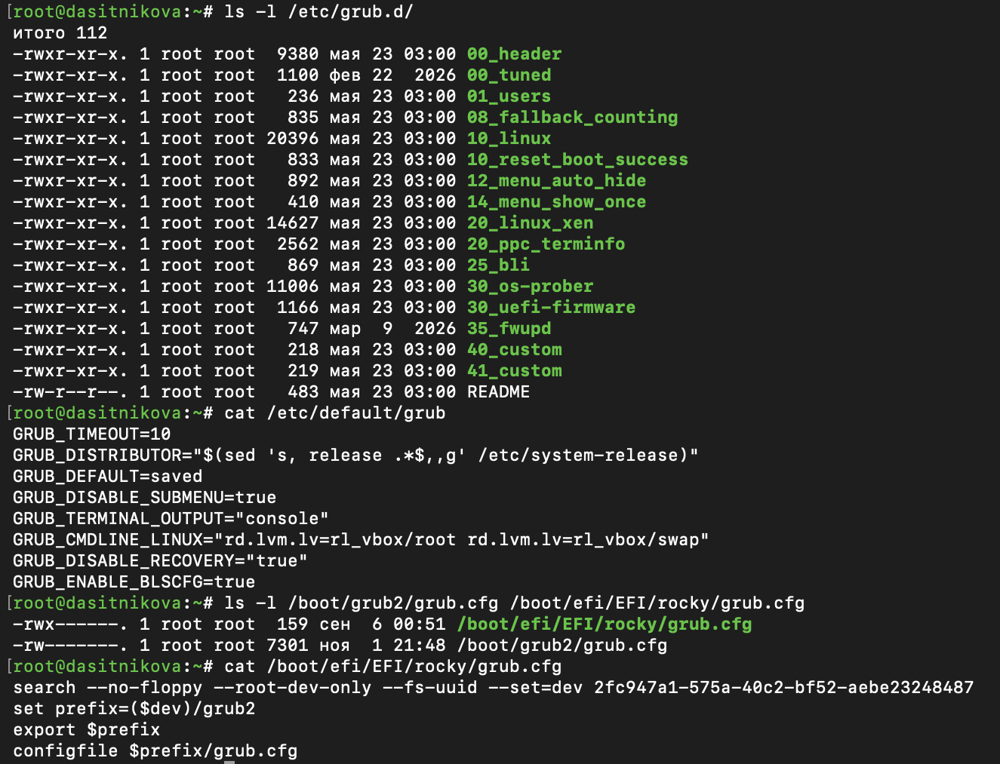{#fig-015 width=85%}

2. **Как называется конфигурационный файл GRUB2, в котором вы применяете изменения для GRUB2?**

   `/boot/grub2/grub.cfg`. Его генерирует `grub2-mkconfig` из `/etc/default/grub` и сценариев `/etc/grub.d`, вручную его не правят: при следующей генерации правки пропадут. В системах с UEFI на разделе EFI лежит ещё `/boot/efi/EFI/rocky/grub.cfg`, но это лишь заглушка, которая находит раздел `/boot` по UUID и подгружает основной файл ([рис. @fig-015]).

3. **После внесения изменений в конфигурацию GRUB2, какую команду вы должны выполнить, чтобы изменения сохранились и воспринялись при загрузке системы?**

   ~~~bash
   grub2-mkconfig -o /boot/grub2/grub.cfg
   ~~~

   В Rocky Linux 10 параметры ядра хранятся отдельно для каждого ядра в `/boot/loader/entries`. Чтобы изменения `GRUB_CMDLINE_LINUX` дошли и до них, добавляют ключ `--update-bls-cmdline` или меняют параметры командой `grubby --update-kernel=ALL --args=…` / `--remove-args=…` ([рис. @fig-002]).

# Список литературы{.unnumbered}

::: {#refs}
:::
