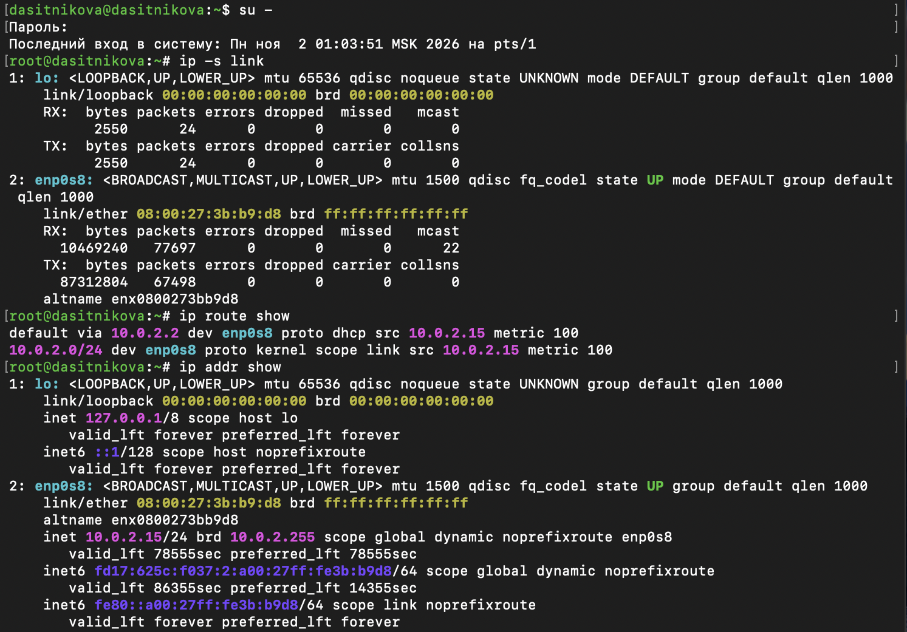
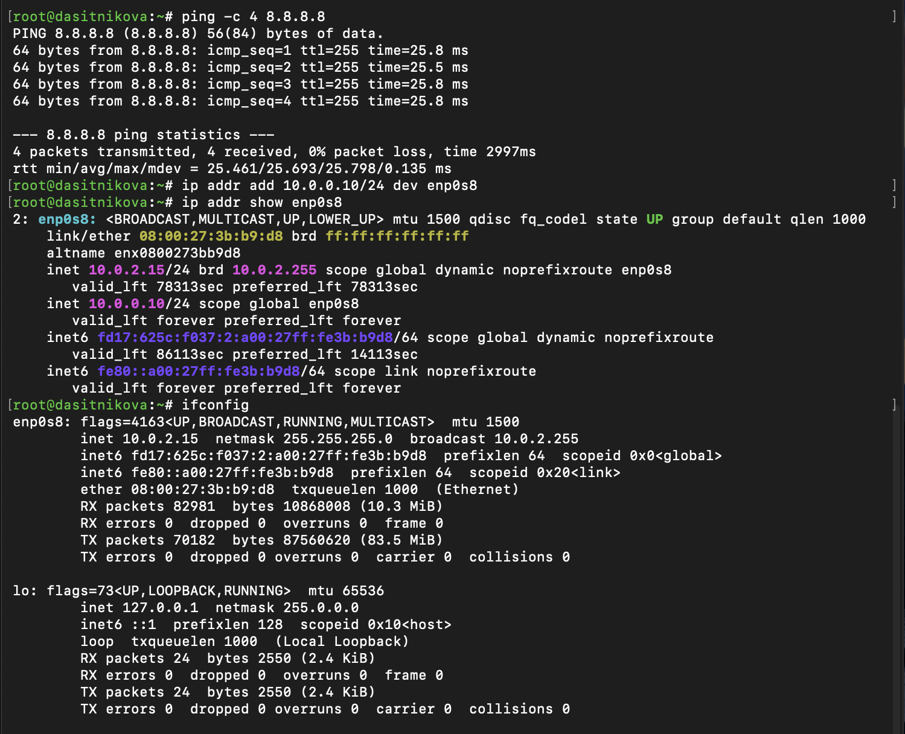
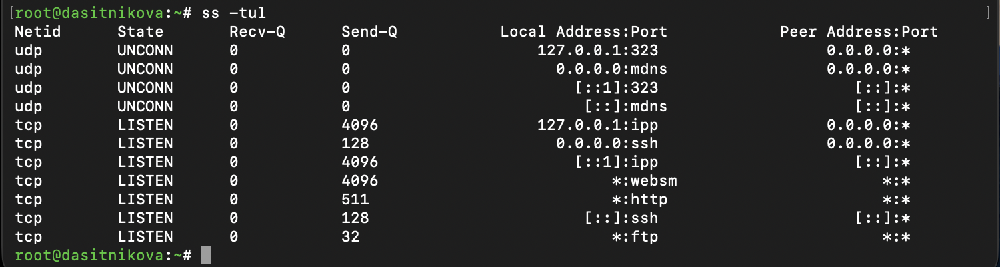
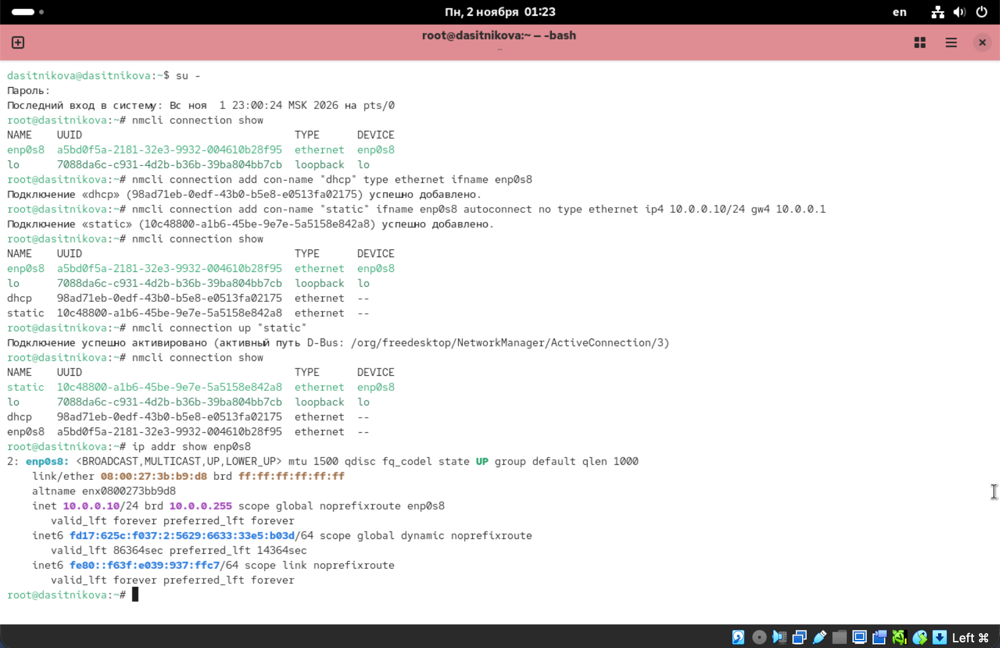
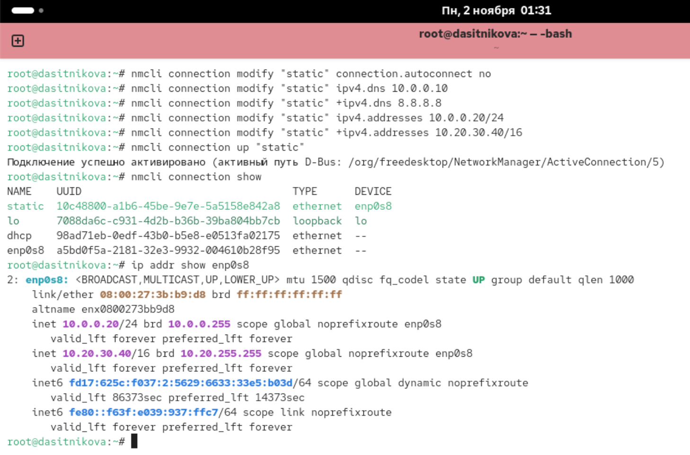
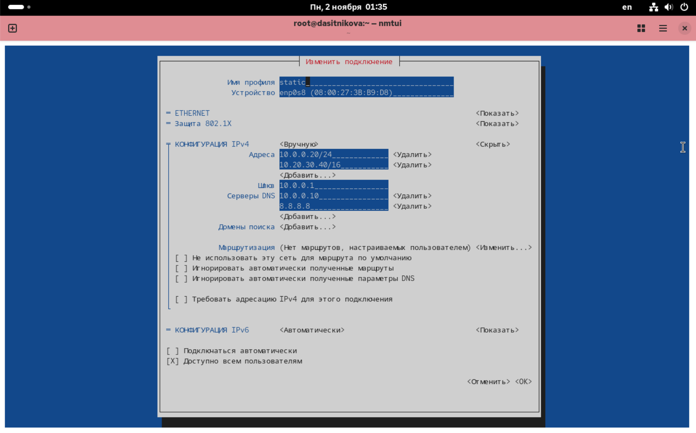
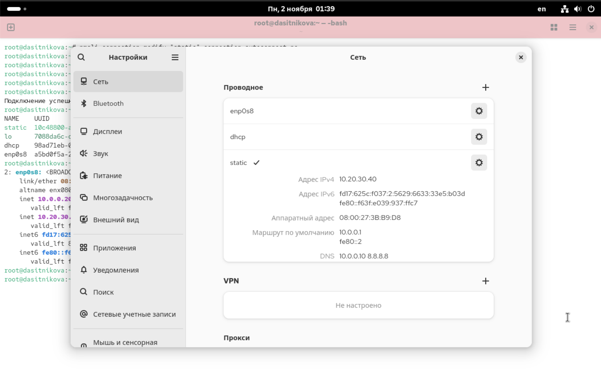

---
## Author
author:
  name: Ситникова Диана Александровна
  degrees: BSc
  email: 1032201746@rudn.ru
  affiliation:
    - name: Российский университет дружбы народов
      country: Российская Федерация
      postal-code: 117198
      city: Москва
      address: ул. Миклухо-Маклая, д. 6
## Title
title: "Лабораторная работа № 12"
subtitle: "Настройки сети в Linux"
institute:
  - "Российский университет дружбы народов им. П. Лумумбы"
  - "Преподаватель: д.ф.-м.н., профессор Кулябов Дмитрий Сергеевич"
license: CC BY
date: today
date-format: "YYYY-MM-DD"
header-includes:
  - \usepackage{tikz}
---

# Информация

## Докладчик

:::::::::::::: {.columns align=center}
::: {.column width="68%"}

- Ситникова Диана Александровна
- направление 09.03.03 «Прикладная информатика»
- Российский университет дружбы народов
- [1032201746@rudn.ru](mailto:1032201746@rudn.ru)

:::
::: {.column width="32%"}

{width=100%}

:::
::::::::::::::

# Вводная часть

## Актуальность

- Сервер без сети бесполезен, а ошибка в сетевых настройках отрезает к нему удалённый доступ.
- Администратору нужно быстро понять, какой адрес у машины, куда уходят пакеты и какие службы открыты.
- Сетевые настройки должны переживать перезагрузку --- значит, их надо сохранять, а не просто задавать.

## Объект, предмет, цель и задачи

**Объект** --- сетевая подсистема Rocky Linux 10.2.

**Предмет** --- утилиты `ip`, `ss` и `nmcli`, служба NetworkManager.

**Цель** --- получить навыки настройки сетевых параметров системы.

**Задачи:** продемонстрировать навыки использования утилит `ip` и `nmcli`.

## Материалы и методы

| Компонент | Значение |
|---|---|
| Стенд | Rocky Linux 10.2, сеть NAT VirtualBox |
| Интерфейс | `enp0s8`, адрес по DHCP `10.0.2.15/24` |
| Просмотр | `ip link`, `ip addr`, `ip route`, `ss`, `ifconfig` |
| Настройка | `nmcli`, `nmtui`, настройки GNOME |

# Содержание исследования

## Одно устройство --- несколько соединений

\begin{center}
\resizebox{\linewidth}{!}{%
\begin{tikzpicture}[font=\scriptsize]
  \draw[thick] (0,1.2) rectangle (2.8,2.4);
  \node[align=center] at (1.4,1.8) {\texttt{enp0s8}\\устройство};
  \draw[thick] (6.0,2.8) rectangle (9.2,3.6);
  \node at (7.6,3.2) {\texttt{enp0s8} --- DHCP};
  \draw[thick] (6.0,1.4) rectangle (9.2,2.2);
  \node at (7.6,1.8) {\texttt{dhcp} --- DHCP};
  \draw[thick] (6.0,0.0) rectangle (9.2,0.8);
  \node at (7.6,0.4) {\texttt{static} --- вручную};
  \draw[->,thick] (5.95,3.2) -- (2.85,2.1);
  \draw[->,thick,dashed] (5.95,1.8) -- (2.85,1.8);
  \draw[->,thick,dashed] (5.95,0.4) -- (2.85,1.5);
  \node[anchor=west,font=\tiny] at (9.4,3.2) {\texttt{10.0.2.15/24}, шлюз \texttt{10.0.2.2}};
  \node[anchor=west,font=\tiny] at (9.4,1.8) {\texttt{10.0.2.15/24}, шлюз \texttt{10.0.2.2}};
  \node[anchor=west,font=\tiny] at (9.4,0.4) {\texttt{10.0.0.20/24}, \texttt{10.20.30.40/16}};
  \node[font=\tiny] at (4.4,3.0) {активно};
\end{tikzpicture}%
}
\end{center}

Соединение --- набор настроек. Активно всегда одно: `nmcli connection up` подменяет их целиком.

## У интерфейса есть имя, MAC, адреса и маршрут

:::::::::::::: {.columns align=center}
::: {.column width="35%"}

`enp0s8`: Ethernet, шина PCI 0, слот 8.

MAC `08:00:27:…` --- префикс VirtualBox.

`10.0.2.15/24` по DHCP, шлюз `10.0.2.2`.

:::
::: {.column width="65%"}

{width=100%}

:::
::::::::::::::

## ifconfig видит не всё

:::::::::::::: {.columns align=center}
::: {.column width="35%"}

`ip addr add` --- второй адрес `10.0.0.10/24`, `forever`.

`ifconfig` показывает только `10.0.2.15`.

`ping 8.8.8.8` --- 4 из 4, интернет есть.

:::
::: {.column width="65%"}

{height=78%}

:::
::::::::::::::

## ss показывает, кто ждёт подключений

{width=90%}

- `127.0.0.1` --- только для себя: CUPS (`ipp`), chronyd (`323`).
- `*` и `0.0.0.0` --- для всех: `ssh`, Cockpit (`websm`), `http`, `ftp`.

## static: адрес сменился --- SSH пропал

:::::::::::::: {.columns align=center}
::: {.column width="35%"}

`dhcp` и `static` созданы, но не активны.

`up static` → `10.0.0.10/24`, `10.0.2.15` удалён.

`up dhcp` → снова `10.0.2.15`.

:::
::: {.column width="65%"}

{height=78%}

:::
::::::::::::::

## + добавляет, без + --- заменяет

:::::::::::::: {.columns align=center}
::: {.column width="35%"}

`ipv4.addresses 10.0.0.20/24` --- заменил `10.0.0.10`.

`+ipv4.addresses 10.20.30.40/16` --- добавил второй.

Изменения применяются только после `up`.

:::
::: {.column width="65%"}

{width=100%}

:::
::::::::::::::

## nmtui и GNOME --- тот же профиль

:::::::::::::: {.columns align=center}
::: {.column width="50%"}

{width=100%}

:::
::: {.column width="50%"}

{width=100%}

:::
::::::::::::::

Адреса, шлюз `10.0.0.1`, DNS `10.0.0.10` и `8.8.8.8`, автоподключение выключено.

# Результаты

## Сеть настроена и проверена

- Изучены интерфейсы, адреса, маршруты и открытые порты.
- Показано, что `ip` видит больше, чем `ifconfig`.
- Созданы соединения `dhcp` и `static`, выполнено переключение между ними.
- Параметры `static` изменены через `nmcli` и проверены в `nmtui` и GNOME.

## Вывод

`ip` показывает, что происходит с сетью сейчас, а NetworkManager хранит, какой она должна быть.

Соединения --- это сменные наборы настроек для одного устройства: переключение между ними меняет адрес за секунду.
