---
## Author
author:
  name: Ситникова Диана Александровна
  degrees: BSc
  email: 1032201746@rudn.ru
  affiliation:
    - name: Российский университет дружбы народов
      country: Российская Федерация
      postal-code: 117198
      city: Москва
      address: ул. Миклухо-Маклая, д. 6

## Title
title: "Отчёт по лабораторной работе №12"
subtitle: "Настройки сети в Linux"
license: "CC BY"
bibliography: bib/cite.bib
---

# Цель работы

Целью данной работы является получение навыков настройки сетевых параметров системы.

# Задание

- Продемонстрировать навыки использования утилиты `ip`.
- Продемонстрировать навыки использования утилиты `nmcli`.

# Теоретическое введение

## Уровни сетевого взаимодействия

Сетевое взаимодействие в Linux построено по модели TCP/IP, в которой каждый уровень решает свою задачу и пользуется услугами нижележащего ([табл. @tbl-layers]) [@nemeth_book_unix-linux-admin_ru; @robachevsky_book_unix_ru]. Сетевой интерфейс работает на канальном уровне и имеет MAC-адрес; протокол IP на сетевом уровне адресует узлы и выбирает маршрут; протоколы TCP и UDP на транспортном уровне доставляют данные конкретной программе по номеру порта.

| Уровень | Протоколы | Адресация | Средства просмотра |
|----------------|------------------------|--------------------|----------------------------|
| прикладной | SSH, HTTP, DNS, DHCP | имена узлов | `getent hosts`, `dig` |
| транспортный | TCP, UDP | порты | `ss` |
| сетевой | IPv4, IPv6, ICMP | IP-адреса | `ip addr`, `ip route`, `ping` |
| канальный | Ethernet, Wi-Fi, ARP, NDP | MAC-адреса | `ip link`, `ip neigh` |

: Уровни модели TCP/IP {#tbl-layers}

## Адреса IPv4

Адрес IPv4 --- 32-битное число, записываемое четырьмя десятичными октетами. Адрес состоит из номера сети и номера узла; границу между ними задаёт длина префикса, которую указывают после косой черты (`10.0.2.15/24`) или в виде маски (`255.255.255.0`). Все узлы с одинаковым номером сети находятся в одной подсети и обмениваются пакетами напрямую, а для связи с другими сетями пакеты передаются маршрутизатору (шлюзу). Последний адрес подсети --- широковещательный (`brd`).

Некоторые диапазоны адресов имеют особое назначение ([табл. @tbl-special]). Частные адреса из RFC 1918 [@rfc1918] не маршрутизируются в интернете и используются во внутренних сетях; выход в интернет из такой сети обеспечивает трансляция адресов (NAT).

| Диапазон | Назначение |
|---------------------------------|--------------------------------------------------------|
| `127.0.0.0/8` | петлевой интерфейс, обращение узла к самому себе |
| `10.0.0.0/8`, `172.16.0.0/12`, `192.168.0.0/16` | частные сети (RFC 1918) |
| `169.254.0.0/16` | автоматическая настройка без DHCP-сервера |
| `10.0.2.0/24` | сеть NAT VirtualBox: `10.0.2.2` --- шлюз, `10.0.2.3` --- DNS, `10.0.2.15` --- гостевая система |

: Особые диапазоны адресов IPv4 {#tbl-special}

В режиме NAT VirtualBox создаёт для каждой виртуальной машины отдельную частную сеть и сам выполняет роль маршрутизатора, DHCP-сервера и DNS-сервера [@virtualbox_manual]. Пакеты из виртуальной машины отправляются в интернет от имени хоста. Чтобы подключиться к гостевой системе снаружи, используется проброс портов: в данной работе порт 2222 хоста перенаправлен на порт 22 гостевой системы.

## Адреса IPv6

Адрес IPv6 --- 128-битное число, записываемое восемью группами шестнадцатеричных цифр; подряд идущие нулевые группы заменяются `::` [@rfc4291]. Как правило, первые 64 бита задают сеть, последние 64 --- идентификатор интерфейса. На каждом интерфейсе есть локальный адрес канала из диапазона `fe80::/10`, который действует только в пределах одного сегмента сети, и, если в сети есть маршрутизатор, глобальные адреса. Адреса из диапазона `fd00::/8` --- уникальные локальные (ULA), аналог частных адресов IPv4.

Адреса IPv6 обычно назначаются автоматически (SLAAC): маршрутизатор сообщает префикс сети, а узел дописывает к нему свой идентификатор интерфейса. Идентификатор может быть получен из MAC-адреса по схеме EUI-64: в середину вставляются байты `ff:fe` и инвертируется седьмой бит. Такой адрес раскрывает MAC-адрес и не меняется при переходе из сети в сеть, поэтому NetworkManager для новых соединений по умолчанию использует схему stable-privacy (RFC 7217) [@rfc7217]: идентификатор вычисляется хешированием секретного ключа, префикса и идентификатора профиля соединения и выглядит случайным.

## MAC-адреса и имена интерфейсов

MAC-адрес --- 48-битный адрес сетевого интерфейса на канальном уровне. Первые три байта --- идентификатор производителя (OUI): например, `08:00:27` закреплён за VirtualBox. Чтобы отправить IP-пакет узлу своей подсети, система должна узнать его MAC-адрес: в IPv4 для этого служит протокол ARP, в IPv6 --- NDP. Найденные соответствия хранятся в таблице соседей, которую показывает команда `ip neigh`.

Раньше интерфейсы назывались по порядку обнаружения: `eth0`, `eth1`. Порядок мог меняться от загрузки к загрузке, и после добавления сетевой карты настройки оказывались на чужом интерфейсе. С 2013 года systemd присваивает интерфейсам предсказуемые имена, построенные из сведений об оборудовании ([табл. @tbl-names]) [@systemd_net_naming]. Ядро позволяет иметь у интерфейса несколько имён, и systemd добавляет альтернативные имена (`altname`).

| Часть имени | Значение | Пример |
|----------------|----------------------------------------------|----------------|
| `en`, `wl`, `ww` | тип: Ethernet, Wi-Fi, мобильная сеть | `en…` |
| `o‹N›` | встроенное в материнскую плату устройство | `eno1` |
| `s‹N›` | слот, сообщённый прошивкой | `ens3` |
| `p‹шина›s‹слот›` | физическое расположение на шине PCI | `enp0s8` |
| `x‹MAC›` | имя по MAC-адресу | `enx0800273bb9d8` |

: Схема предсказуемых имён сетевых интерфейсов {#tbl-names}

## Утилиты iproute2 и net-tools

Традиционные утилиты `ifconfig`, `route`, `netstat` и `arp` из пакета net-tools появились ещё в BSD и работают через старый интерфейс ядра `ioctl`. Они не поддерживают многие возможности современного сетевого стека: например, `ifconfig` показывает лишь один адрес IPv4 на интерфейсе. На смену им пришёл пакет iproute2, созданный Алексеем Кузнецовым в конце 1990-х годов: утилита `ip` обращается к ядру через интерфейс netlink и управляет всеми сетевыми объектами единообразно [@iproute2_man]. Соответствие команд приведено в [табл. @tbl-tools]. В Rocky Linux пакет net-tools не устанавливается по умолчанию.

| Действие | iproute2 | net-tools |
|-----------------------------|--------------------------------|------------------------|
| интерфейсы и их состояние | `ip link` | `ifconfig -a` |
| адреса | `ip addr` | `ifconfig` |
| таблица маршрутизации | `ip route` | `route -n`, `netstat -rn` |
| таблица соседей | `ip neigh` | `arp -n` |
| сокеты и порты | `ss` | `netstat -tulpn` |
| статистика интерфейса | `ip -s link` | `ifconfig`, `netstat -i` |

: Утилиты iproute2 и net-tools {#tbl-tools}

Изменения, сделанные командой `ip`, действуют до перезагрузки или до перенастройки интерфейса службой управления сетью: команда меняет состояние ядра, но не файлы конфигурации.

## Маршрутизация и порты

Для каждого исходящего пакета ядро выбирает маршрут из таблицы маршрутизации по наиболее длинному совпадающему префиксу. Маршрут в собственную подсеть (`proto kernel`) ядро создаёт само при назначении адреса, маршрут по умолчанию (`default`) указывает шлюз для всех остальных адресов. Если маршрутов к одной сети несколько, выбирается маршрут с меньшей метрикой (`metric`).

Получатель пакета на узле определяется номером порта. Служба, ожидающая подключений, открывает сокет: TCP-сокет находится в состоянии `LISTEN`, UDP-сокет без установленного соединения --- `UNCONN`. Утилита `ss` выводит сокеты и подставляет вместо номеров портов их имена из файла `/etc/services`: например, `ssh` --- 22, `http` --- 80, `ipp` --- 631, `websm` --- 9090. Для прослушивающего TCP-сокета столбец `Send-Q` показывает максимальную длину очереди ожидающих подключений.

## NetworkManager: устройства и соединения

В Rocky Linux сетью управляет служба NetworkManager, которую Red Hat разрабатывает с 2004 года [@networkmanager_site]. Она различает два понятия:

- **устройство** --- сетевой интерфейс, например `enp0s8`;
- **соединение** (профиль) --- набор настроек, которые можно применить к устройству: способ получения адреса, адреса, шлюз, DNS-серверы, автоподключение.

Для одного устройства можно создать несколько соединений, но активным в каждый момент может быть только одно. Активация соединения заменяет все настройки устройства, в том числе адреса, назначенные вручную командой `ip`. При загрузке NetworkManager автоматически активирует соединения с включённым автоподключением.

Начиная с RHEL 9 профили хранятся в формате keyfile --- текстовых файлах `/etc/NetworkManager/system-connections/‹имя›.nmconnection`; в RHEL 10 и Rocky Linux 10 поддержка старых файлов `ifcfg` в каталоге `/etc/sysconfig/network-scripts` удалена [@rhel10_networking]. Редактировать профили вручную не требуется: для этого есть утилита командной строки `nmcli`, текстовый интерфейс `nmtui`, графические настройки GNOME и веб-консоль Cockpit. Все они изменяют одни и те же профили. Основные команды `nmcli` приведены в [табл. @tbl-nmcli].

| Команда | Действие |
|--------------------------------------------|----------------------------------------------|
| `nmcli device status` | устройства, их состояние и активное соединение |
| `nmcli connection show [имя]` | соединения или все параметры одного соединения |
| `nmcli connection add con-name … type … ifname …` | создать соединение |
| `nmcli connection modify имя параметр значение` | изменить параметр соединения |
| `nmcli connection up имя` / `down имя` | активировать / деактивировать соединение |
| `nmcli connection delete имя` | удалить соединение |
| `nmcli general hostname имя` | задать имя узла |

: Основные команды nmcli {#tbl-nmcli}

Параметры соединения сгруппированы по разделам: `connection.autoconnect`, `ipv4.method`, `ipv4.addresses`, `ipv4.gateway`, `ipv4.dns` и т. д. При создании соединения можно использовать сокращения `ip4` и `gw4`. Значение `ipv4.method auto` означает получение адреса по DHCP, `manual` --- статическую настройку. Знак `+` перед именем параметра добавляет значение к списку, `-` удаляет, а без знака список заменяется.

## DHCP, имя узла и разрешение имён

При методе `auto` адрес выдаёт DHCP-сервер: клиент рассылает широковещательный запрос, получает предложение адреса, запрашивает его и получает подтверждение. Адрес выдаётся во временное пользование (аренду), срок которой отображается как `valid_lft`; DHCP-сервер VirtualBox выдаёт адреса на сутки, 86 400 секунд.

Имя узла хранится в файле `/etc/hostname` и задаётся командой `hostnamectl set-hostname`. Сопоставление имён и адресов система ищет в порядке, заданном в `/etc/nsswitch.conf`: сначала в локальном файле `/etc/hosts`, затем у DNS-серверов, перечисленных в `/etc/resolv.conf`. Файл `/etc/resolv.conf` формирует NetworkManager по параметрам активного соединения, поэтому DNS-серверы задаются в соединении, а не в этом файле.

# Выполнение лабораторной работы

Работа выполнена в виртуальной машине с Rocky Linux 10.2, подключённой к сети в режиме NAT VirtualBox. Проверка конфигурации сети выполнена в терминале, подключённом к гостевой системе по SSH; управление соединениями с помощью `nmcli` выполнено в терминале графического сеанса виртуальной машины, поскольку при смене адреса интерфейса подключение по SSH разрывается. Полномочия администратора получены командой `su -`.

## Проверка конфигурации сети

Получены полномочия администратора. Выведены информация о существующих сетевых подключениях и статистика отправленных пакетов, текущие маршруты и текущие назначения адресов для сетевых интерфейсов ([рис. @fig-001]).

~~~bash
su -
ip -s link
ip route show
ip addr show
~~~

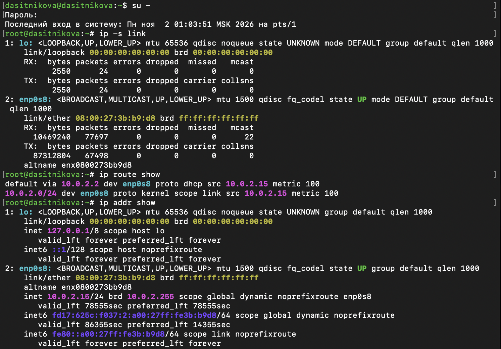{#fig-001 width=85%}

В системе два интерфейса. Пояснение информации об интерфейсе `enp0s8`:

- `2: enp0s8:` --- номер и имя интерфейса: Ethernet-адаптер на шине PCI 0 в слоте 8;
- `<BROADCAST,MULTICAST,UP,LOWER_UP>` --- флаги: поддерживаются широковещательная и групповая рассылка, интерфейс включён (`UP`), физическое соединение установлено (`LOWER_UP`);
- `mtu 1500` --- максимальный размер пакета в байтах, стандартный для Ethernet;
- `qdisc fq_codel` --- дисциплина очереди исходящих пакетов, которая распределяет полосу между потоками и не даёт очереди разрастаться;
- `state UP` --- интерфейс работает;
- `link/ether 08:00:27:3b:b9:d8` --- MAC-адрес; префикс `08:00:27` принадлежит VirtualBox; `brd ff:ff:ff:ff:ff:ff` --- широковещательный MAC-адрес;
- `RX` --- принято 10 469 240 байт в 77 697 пакетах, из них 22 групповых; `TX` --- отправлено 87 312 804 байт в 67 498 пакетах; ошибок, отброшенных и пропущенных пакетов, коллизий нет;
- `altname enx0800273bb9d8` --- альтернативное имя интерфейса, построенное по MAC-адресу.

Интерфейс `lo` --- петлевой: `mtu 65536`, нулевой MAC-адрес, и все 24 пакета, отправленные через него, им же и приняты.

Таблица маршрутизации содержит два маршрута:

- `default via 10.0.2.2 dev enp0s8 proto dhcp src 10.0.2.15 metric 100` --- маршрут по умолчанию: пакеты на все адреса, для которых нет более точного маршрута, отправляются через шлюз `10.0.2.2` (маршрутизатор NAT VirtualBox) с интерфейса `enp0s8`; маршрут получен по DHCP, исходящим адресом подставляется `10.0.2.15`, метрика 100;
- `10.0.2.0/24 dev enp0s8 proto kernel scope link src 10.0.2.15 metric 100` --- маршрут в собственную подсеть: её узлы доступны напрямую, без шлюза.

Для интерфейса `enp0s8` назначены адреса:

- `inet 10.0.2.15/24 brd 10.0.2.255 scope global dynamic noprefixroute` --- IPv4-адрес устройства `10.0.2.15` с префиксом 24 (маска `255.255.255.0`) и широковещательным адресом `10.0.2.255`; `dynamic` --- адрес получен по DHCP, `valid_lft 78555sec` --- до окончания аренды почти 22 часа; `noprefixroute` --- маршрут в подсеть создаёт не ядро, а NetworkManager;
- `inet6 fd17:625c:f037:2:a00:27ff:fe3b:b9d8/64 scope global dynamic` --- уникальный локальный IPv6-адрес, полученный автоматически от NAT VirtualBox; его идентификатор интерфейса `a00:27ff:fe3b:b9d8` построен из MAC-адреса по схеме EUI-64;
- `inet6 fe80::a00:27ff:fe3b:b9d8/64 scope link` --- локальный адрес канала.

Таким образом, IPv4-адрес устройства --- `10.0.2.15`, обозначение сетевого адаптера --- `enp0s8`. У петлевого интерфейса адреса `127.0.0.1/8` и `::1/128` с областью действия `host`.

С помощью команды `ping` проверено подключение к интернету. Затем к интерфейсу добавлен дополнительный адрес, проверено, что адрес добавился, и вывод утилиты `ip` сравнён с выводом команды `ifconfig` ([рис. @fig-002]).

~~~bash
ping -c 4 8.8.8.8
ip addr add 10.0.0.10/24 dev enp0s8
ip addr show enp0s8
ifconfig
~~~

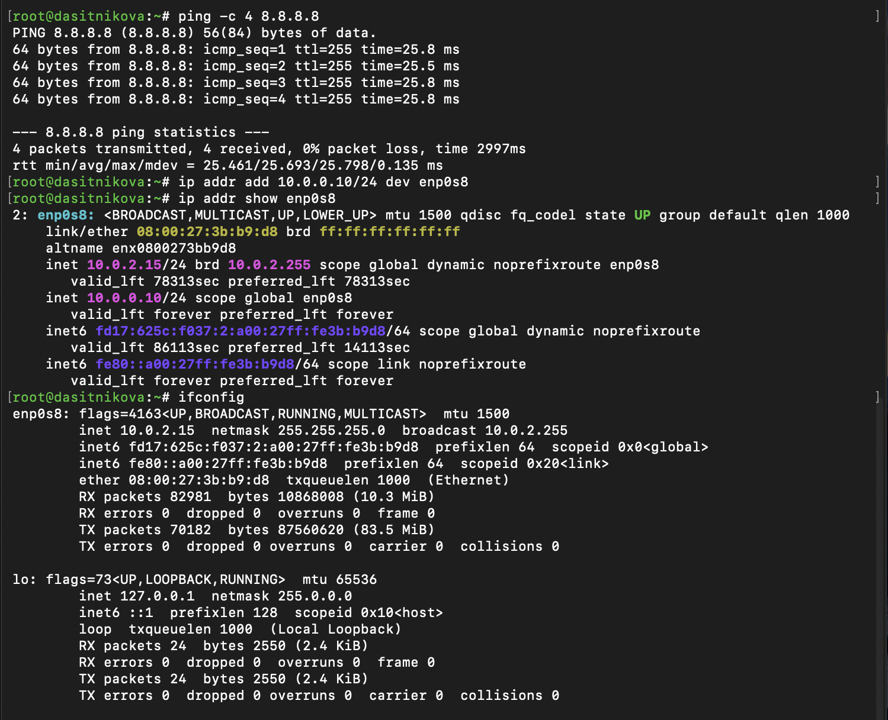{#fig-002 width=85%}

На четыре эхо-запроса к DNS-серверу Google `8.8.8.8` получены четыре ответа: потерь нет, среднее время отклика --- 25,7 мс. Подключение к интернету работает.

После `ip addr add` у интерфейса `enp0s8` два адреса IPv4: полученный по DHCP `10.0.2.15/24` и добавленный вручную `10.0.0.10/24`. У добавленного адреса нет пометки `dynamic` и срок действия `forever`: он не арендован, а назначен статически и действует до перезагрузки или перенастройки интерфейса.

Команда `ifconfig` выводит те же интерфейсы в другом формате: флаги и MTU в первой строке, адрес IPv4 с маской и широковещательным адресом, адреса IPv6 с длиной префикса и областью, MAC-адрес, длина очереди передачи и статистика приёма и передачи в пакетах и байтах. Отличия от `ip`: размеры дополнительно приведены в удобных единицах (10,3 и 83,5 МиБ), но добавленный адрес `10.0.0.10` в выводе отсутствует --- `ifconfig` показывает только один адрес IPv4 на интерфейсе. Кроме того, `ifconfig` не выводит состояние физического соединения, дисциплину очереди и альтернативные имена.

Выведен список всех прослушиваемых системой портов UDP и TCP ([рис. @fig-003]).

~~~bash
ss -tul
~~~

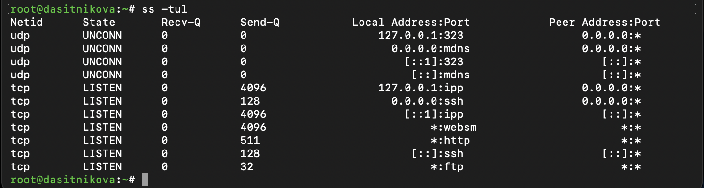{#fig-003 width=85%}

Ключи `-t` и `-u` выбирают TCP- и UDP-сокеты, `-l` --- только ожидающие подключений. Порты:

- UDP `323` на `127.0.0.1` и `[::1]` --- служба времени chronyd, принимает команды управления только с самого узла;
- UDP `mdns` (5353) на всех адресах --- служба Avahi, обнаружение узлов и служб в локальной сети;
- TCP `ipp` (631) на `127.0.0.1` и `[::1]` --- служба печати CUPS, доступна только локально;
- TCP `ssh` (22) на `0.0.0.0` и `[::]` --- сервер SSH принимает подключения на всех адресах IPv4 и IPv6;
- TCP `websm` (9090), `http` (80) и `ftp` (21) на `*` --- веб-консоль Cockpit, веб-сервер Apache и FTP-сервер vsftpd, установленные в предыдущих работах.

Адрес `127.0.0.1` или `[::1]` в столбце `Local Address` означает, что служба недоступна из сети, адрес `0.0.0.0`, `[::]` или `*` --- что она доступна на всех интерфейсах.

## Управление сетевыми подключениями с помощью nmcli

Получены полномочия администратора и выведена информация о текущих соединениях. К интерфейсу `enp0s8` добавлены Ethernet-соединение `dhcp` и Ethernet-соединение `static` со статическим IPv4-адресом адаптера и статическим адресом шлюза, после чего информация о соединениях выведена повторно. Затем выполнено переключение на статическое соединение и проверена его успешность ([рис. @fig-004]).

~~~bash
su -
nmcli connection show
nmcli connection add con-name "dhcp" type ethernet ifname enp0s8
nmcli connection add con-name "static" ifname enp0s8 autoconnect no type ethernet ip4 10.0.0.10/24 gw4 10.0.0.1
nmcli connection show
nmcli connection up "static"
nmcli connection show
ip addr show enp0s8
~~~

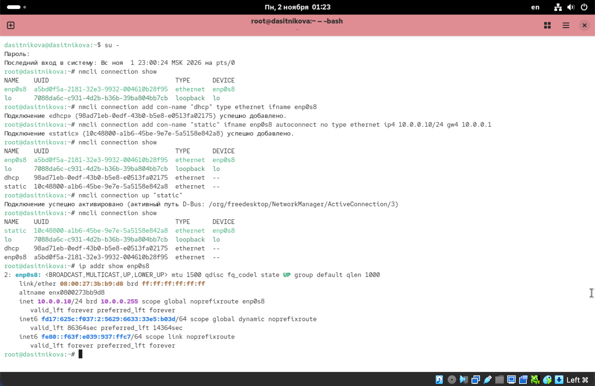{#fig-004 width=85%}

Сначала в системе два соединения: `enp0s8`, созданное при установке системы и активное на устройстве `enp0s8`, и `lo` для петлевого интерфейса. Оба новых соединения успешно добавлены и получили собственные идентификаторы UUID. В столбце `DEVICE` у них прочерк: устройство уже занято активным соединением `enp0s8`, а новые соединения лишь сохранены.

После активации соединения `static` оно стало активным на устройстве `enp0s8`, а соединение `enp0s8` --- неактивным. Интерфейс получил адрес `10.0.0.10/24` без пометки `dynamic`; адрес `10.0.2.15` удалён. Глобальный IPv6-адрес изменился на `fd17:625c:f037:2:5629:6633:33e5:b03d`: для нового соединения NetworkManager построил идентификатор интерфейса по схеме stable-privacy, а не из MAC-адреса. Сеть VirtualBox имеет адрес `10.0.2.0/24`, а шлюза `10.0.0.1` в ней нет, поэтому в этом состоянии виртуальная машина не связана с внешними сетями, и подключение по SSH недоступно.

Выполнен возврат к соединению `dhcp` и проверена успешность переключения ([рис. @fig-005]).

~~~bash
nmcli connection up "dhcp"
nmcli connection show
ip addr show enp0s8
~~~

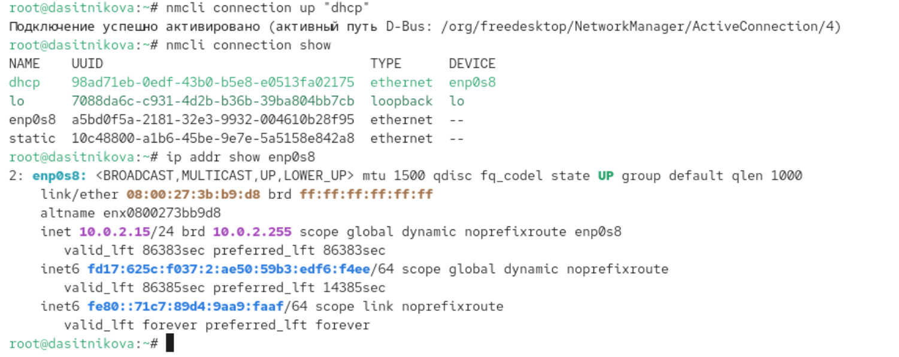{#fig-005 width=85%}

Активно соединение `dhcp`. DHCP-сервер VirtualBox снова выдал адрес `10.0.2.15/24`, срок аренды обновился почти до полных суток (`valid_lft 86383sec`). IPv6-адрес соединения `dhcp` вновь отличается от адресов других соединений: идентификатор stable-privacy зависит от профиля соединения.

## Изменение параметров соединения с помощью nmcli

Для статического соединения отключено автоподключение, добавлены два DNS-сервера, изменён IP-адрес и добавлен ещё один IP-адрес. После изменения свойств соединение активировано и проверена успешность переключения ([рис. @fig-006]).

~~~bash
nmcli connection modify "static" connection.autoconnect no
nmcli connection modify "static" ipv4.dns 10.0.0.10
nmcli connection modify "static" +ipv4.dns 8.8.8.8
nmcli connection modify "static" ipv4.addresses 10.0.0.20/24
nmcli connection modify "static" +ipv4.addresses 10.20.30.40/16
nmcli connection up "static"
nmcli connection show
ip addr show enp0s8
~~~

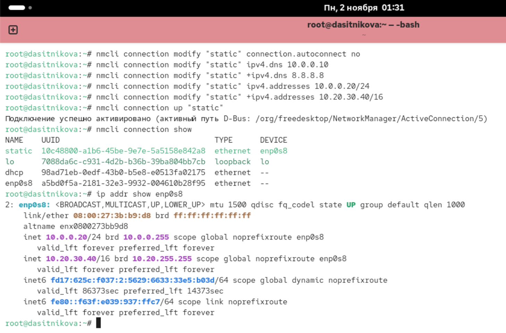{#fig-006 width=85%}

Команды `nmcli connection modify` выполнены без сообщений. Изменения записываются в профиль, но на устройство не переносятся, пока соединение не будет активировано заново. После активации соединения `static` у интерфейса два адреса: `10.0.0.20/24` с широковещательным адресом `10.0.0.255` и `10.20.30.40/16` с широковещательным адресом `10.20.255.255`. Адрес `10.0.0.10`, заданный при создании соединения, заменён: параметр `ipv4.addresses` без знака `+` перезаписывает список, а со знаком `+` --- дополняет его. Так же второй DNS-сервер `8.8.8.8` добавлен к первому, а не заменил его.

С помощью `nmtui` просмотрены настройки сети на устройстве: список соединений ([рис. @fig-007]) и параметры соединения `static` ([рис. @fig-008]).

~~~bash
nmtui
~~~

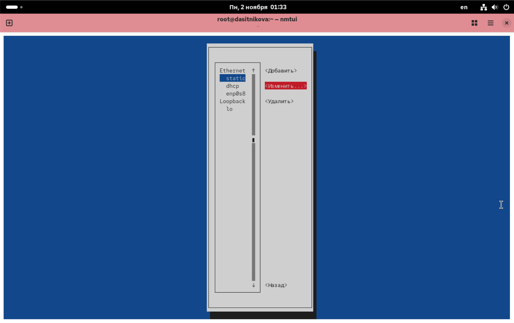{#fig-007 width=85%}

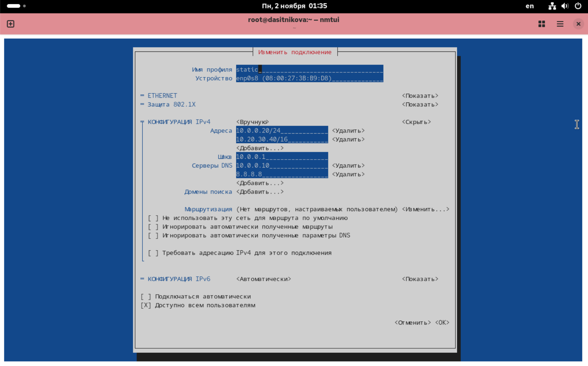{#fig-008 width=85%}

Главное меню `nmtui` предлагает изменить подключение, активировать подключение, настроить имя узла и включить или выключить радиомодули. В разделе редактирования соединения сгруппированы по типу: соединения Ethernet `static`, `dhcp` и `enp0s8` и петлевое соединение `lo`.

Карточка соединения `static` содержит все его настройки:

- имя профиля `static` и устройство `enp0s8` с MAC-адресом `08:00:27:3B:B9:D8`;
- конфигурация IPv4 «Вручную»: адреса `10.0.0.20/24` и `10.20.30.40/16`, шлюз `10.0.0.1`, DNS-серверы `10.0.0.10` и `8.8.8.8`, домены поиска не заданы, пользовательских маршрутов нет;
- конфигурация IPv6 «Автоматически»;
- флажок «Подключаться автоматически» снят --- автоподключение отключено;
- флажок «Доступно всем пользователям» установлен --- соединение системное, им может пользоваться любой пользователь.

Настройки сетевых соединений просмотрены в графическом интерфейсе операционной системы: в разделе «Сеть» приложения «Настройки» ([рис. @fig-009]) и в окне параметров соединения `static` ([рис. @fig-010]).

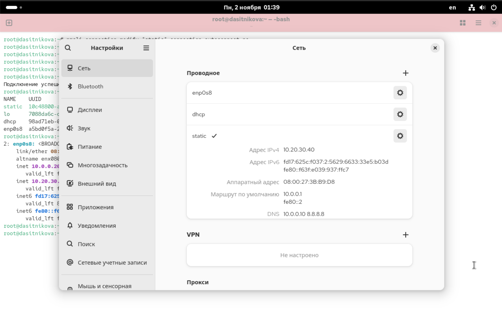{#fig-009 width=85%}

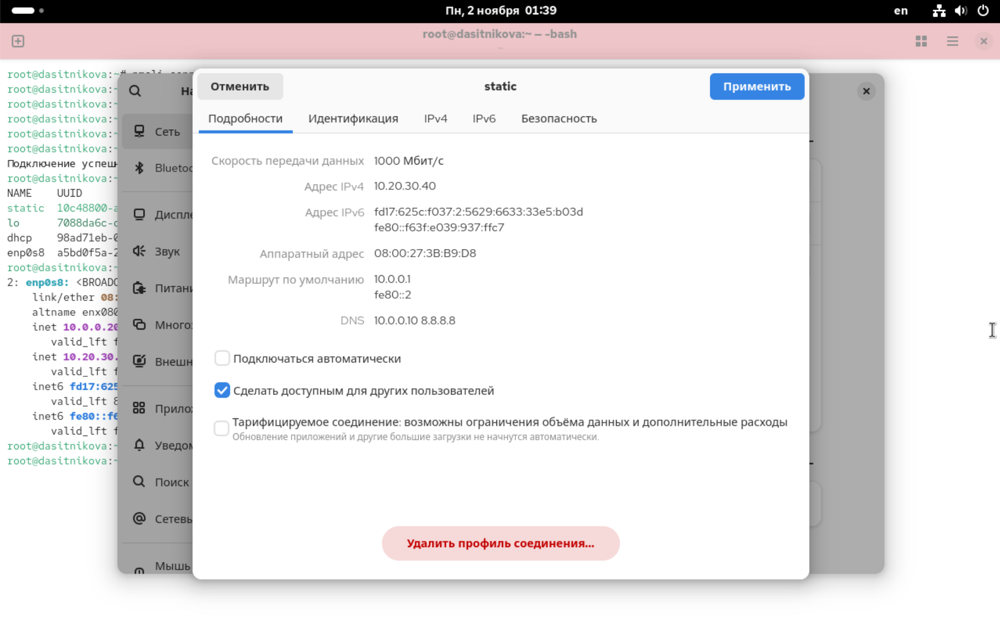{#fig-010 width=85%}

В разделе «Проводное» перечислены те же три соединения, активное `static` отмечено галочкой. Для него указаны адрес IPv4, адреса IPv6, аппаратный (MAC) адрес, маршруты по умолчанию --- шлюз IPv4 `10.0.0.1` и шлюз IPv6 `fe80::2`, полученный от VirtualBox, --- и DNS-серверы `10.0.0.10 8.8.8.8`. Окно параметров дополнительно показывает скорость соединения 1000 Мбит/с и флажки автоподключения, доступности для всех пользователей и тарифицируемого соединения; на вкладках «Идентификация», «IPv4», «IPv6» и «Безопасность» эти параметры можно изменить. Графический интерфейс, `nmtui` и `nmcli` показывают и изменяют один и тот же профиль NetworkManager.

Выполнено переключение на первоначальное сетевое соединение ([рис. @fig-011]).

~~~bash
nmcli connection up "enp0s8"
nmcli connection show
ip addr show enp0s8
~~~

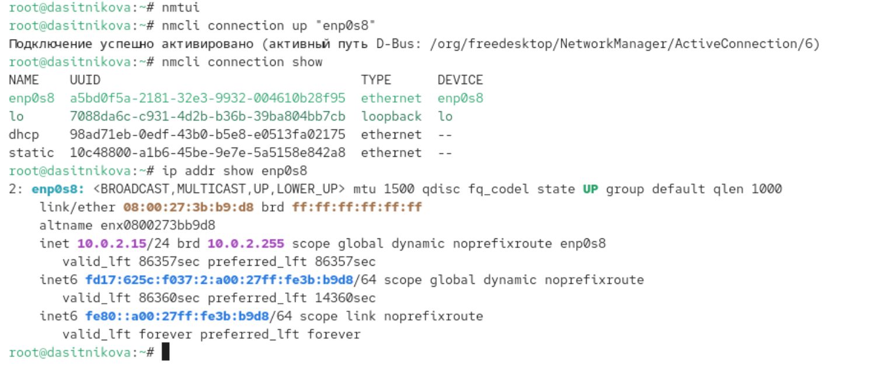{#fig-011 width=85%}

Активно исходное соединение `enp0s8`, интерфейс снова имеет адрес `10.0.2.15/24`, полученный по DHCP, и прежний IPv6-адрес с идентификатором `a00:27ff:fe3b:b9d8`, построенным из MAC-адреса: соединение, созданное при установке системы, использует схему EUI-64. Связь с хостом и подключение по SSH восстановлены. Соединения `dhcp` и `static` сохранены и могут быть активированы в любой момент.

# Выводы

В ходе лабораторной работы получены навыки настройки сетевых параметров Rocky Linux 10.2. С помощью утилиты `ip` просмотрены состояние и статистика интерфейсов, таблица маршрутизации и адреса, интерфейсу временно назначен дополнительный адрес, а вывод `ip` сравнён с выводом устаревшей команды `ifconfig`, которая не показывает дополнительные адреса. С помощью `ss` определены службы, ожидающие сетевых подключений.

С помощью `nmcli` созданы соединения с динамической и статической настройкой адреса, выполнено переключение между ними, изменены адреса и DNS-серверы статического соединения. Показано, что одно устройство может иметь несколько соединений, из которых активно только одно, и что `nmcli`, `nmtui` и графический интерфейс работают с одними и теми же профилями NetworkManager.

# Контрольные вопросы

1. **Какая команда отображает только статус соединения, но не IP-адрес?**

   `ip link show` --- состояние интерфейсов (`UP`/`DOWN`) и MAC-адреса без IP. Аналогично `nmcli device status` --- устройства, их состояние и активное соединение ([рис. @fig-012]).

   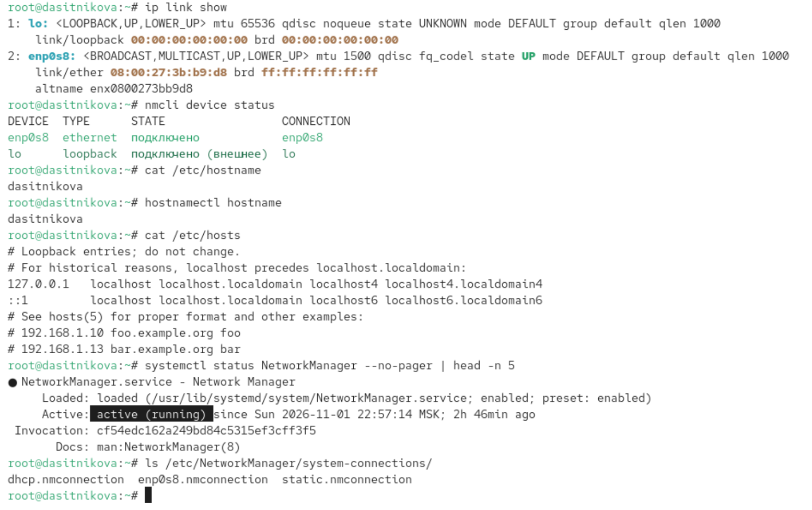{#fig-012 width=85%}

2. **Какая служба управляет сетью в ОС типа RHEL?**

   NetworkManager ([рис. @fig-012]).

3. **Какой файл содержит имя узла (устройства) в ОС типа RHEL?**

   `/etc/hostname` ([рис. @fig-012]).

4. **Какая команда позволяет вам задать имя узла (устройства)?**

   `hostnamectl set-hostname имя` (можно и `nmcli general hostname имя`). Команда записывает имя в `/etc/hostname` и сразу его применяет.

5. **Какой конфигурационный файл можно изменить для включения разрешения имён для конкретного IP-адреса?**

   `/etc/hosts` --- строка вида `10.0.0.20 myserver` ([рис. @fig-012]). Он проверяется раньше DNS. DNS-серверы указываются в `/etc/resolv.conf`, но при работающем NetworkManager его не правят вручную: NetworkManager генерирует его сам из настроек соединения.

6. **Какая команда показывает текущую конфигурацию маршрутизации?**

   `ip route show` (коротко `ip r`) ([рис. @fig-001]). Старые аналоги --- `route -n` и `netstat -rn`.

7. **Как проверить текущий статус службы NetworkManager?**

   `systemctl status NetworkManager` ([рис. @fig-012]). Кратко ещё `nmcli general status`.

8. **Какая команда позволяет вам изменить текущий IP-адрес и шлюз по умолчанию для вашего сетевого соединения?**

   `nmcli connection modify` с последующей активацией ([рис. @fig-006]). То же можно сделать в `nmtui`. `ip addr add` и `ip route add` меняют адрес и маршрут только до перезагрузки.

   ~~~bash
   nmcli connection modify "static" ipv4.addresses 10.0.0.20/24 ipv4.gateway 10.0.0.1
   nmcli connection up "static"
   ~~~

# Список литературы{.unnumbered}

::: {#refs}
:::
